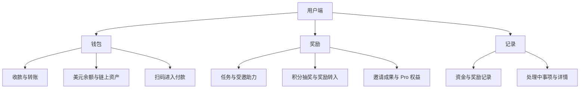

# DexWallet 界面与交互重构方案

更新日期：2026 年 10 月 25 日。

建议将 DexWallet 设计成以钱包支付为核心、以任务奖励带动使用的产品。用户端采用「钱包／奖励／记录」三个主要入口，邀请融入奖励体系，付款围绕「付给谁、从哪里付、到账多少」组织。

本方案重新推导用户端、商户端和平台端的界面结构，用于下一轮原型设计。导航调整、页面合并和文案调整属于设计建议，需通过原型验证；保存本方案不代表原有页面稿已同步或新的导航已成为业务决议。

业务规则依据为 [产品约定](../product/产品约定.md)、[功能问答](待确认功能清单.md) 和 2026 年 10 月 24 日更新的 [钱包支付全场景与前后端工作流](钱包支付全场景与前后端工作流.md)。最新工作流补齐的给他人充值、企业创建商户、平台代收及人工结算纳入本方案；其中建议性审核流程和未验证通道继续保留原有状态，不作为已上线能力。

## 产品背景与设计目标

### 三条业务主线

| 业务 | 用户真正想完成的事情 | 设计必须解决的问题 |
| --- | --- | --- |
| 钱包与支付 | 收钱、付钱、转钱，查看资产 | 钱从哪里出、到哪里去、什么时候完成 |
| 任务与奖励 | 完成任务或邀请好友，获得可使用的奖励 | 本次能得什么、奖励在哪里、还差哪些条件 |
| 商户收款与平台运营 | 收订单款、退款、结算、处理异常 | 哪笔钱已收、哪笔待处理、下一步由谁操作 |

主要用户至少包括通过邀请进入的新用户、为付款而来的用户，以及已有链上钱包的用户。不同入口应直接恢复对应任务：

- 邀请链接进入受邀任务。
- 商户支付链接进入订单收银台。
- 普通打开应用进入钱包。
- 只有需要使用链上钱包时，才要求创建、导入或连接钱包。

Telegram Mini App 继续采用静默鉴权；需要登录的客户端在登录后恢复原任务或订单。外部钱包连接不代替产品登录，也不代表已授权扣款。首版 Mini App 的资产范围保持 TON 网络的 TON、USDT，独立 App 按已确定范围扩展，界面只展示当前客户端实际可用的通道。

### 主要理解成本

用户同时面对四类资产和一种进度：美元余额、链上资产、任务积分、待提现奖励、Pro 进度。界面必须帮助用户区分用途和去向，避免把奖励、积分与可付款余额理解成同一种钱。

核心设计目标是让用户在每一步知道当前发生了什么，以及下一步能做什么。衡量体验不能只看点击次数，还应看资金去向是否明确、操作中断后能否恢复、失败原因是否可理解。

## 交互设计依据

以下原则提供设计依据，具体导航与页面拆分仍需通过项目原型验证。

| 原则 | 对 DexWallet 的具体影响 | 参考 |
| --- | --- | --- |
| 心智模型 | 用户先确定给谁转钱，系统再提供可用付款来源，减少对内部账户分类的依赖 | [NN/G Mental Models](https://www.nngroup.com/articles/mental-models/) |
| 渐进披露 | 主界面突出金额、对象和下一步；钱包选择、费用明细按需展开，费用总额、实际到账及奖励条件在确认前可见 | [NN/G Progressive Disclosure](https://www.nngroup.com/articles/progressive-disclosure/) |
| 识别优于记忆 | 优先使用收款链接、二维码、昵称与账户标识、最近使用的钱包，减少手工输入地址 | [NN/G Recognition and Recall](https://www.nngroup.com/articles/recognition-and-recall/) |
| 状态可见 | 明确等待授权、确认中、成功和异常，退出后能找到原交易 | [NN/G Usability Heuristics](https://www.nngroup.com/articles/ten-usability-heuristics/) |
| 错误预防与恢复 | 扣款前确认对象与金额，结果未知时查询原记录，失败时提供具体原因及可执行操作 | [NN/G Usability Heuristics](https://www.nngroup.com/articles/ten-usability-heuristics/) |

这些原则不直接证明某种导航一定更好。将记录提升为主要入口、将邀请放入奖励，是结合本项目资金异步处理和邀请依附任务的特点提出的设计选择。

## 用户端信息架构

### 三个主要入口

建议底部固定「钱包／奖励／记录」，账户、安全、钱包管理和帮助从头像进入。

- 钱包承担核心使用价值，普通打开应用默认进入这里。
- 奖励统一承接任务、积分、首奖、Pro 和邀请，减少功能之间来回跳转。
- 记录提供资金追踪和异常恢复入口，支持用户从外部钱包返回或重新打开应用后继续查询。

邀请必须依附具体任务，当前不提供通用邀请链接，因此放在奖励内部更符合实际流程。如果后续发现用户频繁查看邀请成果，再根据使用情况调整入口权重。

### 页面与弹层的划分

需要中途离开、返回继续或长期查询的内容采用可恢复页面，例如任务、充值、转账、收银台和交易详情。钱包选择、币种选择、筛选与费用解释使用底部抽屉。Pro 权益初期可以采用可展开的说明面板，内容增长后再独立成页。

资金状态和长期处理进展不能只存在于一次性弹窗中。返回操作应恢复之前的任务上下文；改变钱包或资产后重新计算付款信息，但不改变收款对象。

## 钱包首页与资产表达

### 首页布局

建议从上到下排列：

1. 顶部展示头像、账户名称和扫码入口。
2. 有进行中业务时，展示「1 笔付款确认中」等可点击提示。
3. 美元余额卡展示可用金额、处理中金额，以及充值、转出入口。
4. 高频操作区展示收款、转账。
5. 链上钱包区展示当前钱包、网络、资产及参考估值。
6. 最近两三笔交易，可进入全部记录。

美元余额与链上钱包使用明确的区域边界。钱包切换按钮放在链上钱包区域，避免用户误认为切换链上钱包也会改变产品账户的美元余额。

没有链上钱包时提供创建、导入和连接入口，不阻塞美元账户和任务功能。余额加载失败显示失败与重试，不能显示成零余额。

### 数值与用词

| 对象 | 建议表达 | 主要位置 |
| --- | --- | --- |
| 美元余额 | 可用于付款、账户转账和链上转出 | 钱包 |
| 链上资产 | 钱包名称、网络、币种数量，附参考估值 | 钱包 |
| 任务积分 | 用于积分抽奖 | 奖励 |
| 待提现奖励 | 达到条件后可转入美元余额 | 奖励 |
| Pro 进度 | 累计进度，不是可消费积分 | 奖励 |

不将四类数值合成一个醒目的总资产，也不把任务积分展示成确定可兑换的美元。积分的美元计价基准用于奖励计算，用户通过随机奖励获得现金，并非固定兑换。

## 用户端页面清单

以下按页面组组织。一个页面组可以包含多个步骤，弹层不单独计作完整页面。

| 页面组 | 界面职责与关键交互 |
| --- | --- |
| 钱包首页 | 查看可用资金、进入收付款、恢复未完成交易 |
| 美元余额详情 | 查看可用与处理中金额，充值、转出及相关流水 |
| 链上资产详情 | 查看指定钱包、网络与资产，进入收款或转账 |
| 收款页 | 明确选择收到美元余额或收到链上钱包，展示对应二维码和分享链接 |
| 收款对象选择页 | 支持扫码、相册识码、粘贴链接、账户标识或地址输入，确认实际收款对象；手动订单查询按访问权限提供兜底 |
| 转账流程 | 对象 → 金额与来源 → 确认 → 结果，根据对象调整字段 |
| 充值流程 | 展示受益账户、付款资产、费用与净到账，支持本人充值和给他人充值 |
| 美元余额转出流程 | 展示目标链上钱包、网络、币种、扣款与实际到账，覆盖本人及他人地址 |
| 商户收银台 | 展示商户、订单、应付金额、付款来源及组合付款明细 |
| 交易进度与详情 | 持续展示状态、资金变化、退款、异常及可执行操作 |
| 奖励首页 | 展示下一步任务、积分、待提现奖励、Pro 进度及邀请入口 |
| 任务详情与受邀任务 | 复用任务步骤，明确当前参与身份、双方收益与资格消耗 |
| 积分抽奖页 | 展示投入、奖励规则、结果和记录，水果机是该页的表现形式 |
| 奖励转入美元余额 | 展示金额、到账账户、当前条件与申请状态 |
| 邀请成果页 | 分开呈现好友关系、有效助力、助力积分和长期分成 |
| 记录页 | 汇总资金与奖励，按类型、账户和状态筛选 |
| 钱包与账户管理 | 创建、导入、连接、备份恢复、安全与帮助，长流程使用独立步骤 |

## 收付款流程

### 围绕收款对象组织

| 收款对象 | 使用美元余额 | 使用链上钱包 |
| --- | --- | --- |
| 他人的美元账户 | 账户转账 | 给他人充值 |
| 本人的美元账户 | 无需操作 | 本人充值 |
| 链上地址 | 美元余额转出到链上 | 普通链上转账 |
| 商户订单 | 余额支付 | 链上支付，或与美元余额组合 |

扫码或打开链接后，系统识别目标，再提供该目标支持的方式。用户无需先选择内部业务术语。链上转出与充值仍使用各自的费用规则，不因复用流程而混为同一种业务。

扫描小王的账户收款码后，确认界面示例：

> 转给小王
>
> 到账位置：小王的美元余额
>
> 对方收到：$10.00
>
> 付款来源：我的美元余额，可更换

更换为链上钱包后，受益账户保持不变，页面更新付款币量、费用和净到账，不自动改成向小王的链上地址转账。收款请求如果指定了固定到账金额，应按该目标重新报价；不能静默因扣费减少对方到账。

扫码识别不等于自动付款，用户仍须确认对象与金额。地址无法唯一确定网络时明确选择网络，不凭地址外观猜测。未知或不支持的二维码说明原因，保留重新识别或手动输入入口。

### 商户收银台

优先给出一个可执行的付款方案，允许用户修改。金额示例：

> 订单金额：$10.00
>
> 美元余额：使用 $3.00
>
> TON 网络 USDT：支付剩余 $7.00 对应币量
>
> 网络费用：单独列示
>
> 主按钮：确认付款

实际币量来自报价，不假设稳定币与美元恒定等值。确认前展示扣款、费用、到账或订单覆盖金额及报价有效期。报价失效时更新并重新确认；已有效提交的交易继续按其业务规则核验。

组合付款限定本人美元余额加一个链上钱包、一个网络、一种链上资产。资金构成必须可见，不能静默消耗两种资产，也不把商户订单的组合付款能力扩展到个人账户转账。

### 支付进度与异常恢复

| 状态 | 应告诉用户什么 | 下一步 |
| --- | --- | --- |
| 等待钱包授权 | 尚需在钱包中确认 | 返回钱包继续 |
| 正在核验付款 | 已提交，系统正在确认到账 | 查看进度，可以离开 |
| 已支付 | 商户订单已确认收款 | 返回商户或查看详情 |
| 结果暂未确定 | 正在查询原交易 | 继续查询，避免重复付款 |
| 已确认未完成 | 原付款没有完成及具体原因 | 条件允许时重新付款 |
| 需要处理 | 哪部分资金已收到、哪部分待处理 | 查看处理进展或提交所需信息 |

组合支付分别展示美元部分和链上部分的状态，整单核验完成后才显示成功。关闭页面或客户端倒计时结束不能把已提交交易判为失败，也不能自动释放结果未知的占用资金。

从钱包返回时自动查询原交易；关闭应用后通过钱包提示和记录页继续查看。商户通知失败不改变已收款事实。退款详情应展示原资金来源、退回金额和各部分状态，不把退款申请受理显示成已到账。

## 奖励与任务流程

### 奖励首页

首页回答三个问题：现在有什么、接下来可以做什么、怎样把奖励转入美元余额。

上方展示待提现奖励和可消费积分，Pro 进度单独展示。其后展示当前最相关的下一步，再往下是任务列表和邀请入口。

| 用户状态 | 主要引导 |
| --- | --- |
| 尚未完成首个任务 | 完成首个任务，获得 $1 待提现奖励 |
| 有任务可领取 | 检查完成情况并领奖 |
| 积分达到单次抽奖要求 | 使用 100 积分抽奖 |
| 满足奖励转入条件 | 转入美元余额 |
| 条件尚未满足 | 查看具体条件及可完成的操作 |

内容优先级可随状态变化，但导航和关键操作的位置保持稳定。多个条件同时成立时，不隐藏任务列表、抽奖和奖励转入等原有入口。

首次领奖结果示例：

> 获得 $1.00，已进入待提现奖励。
>
> Pro 进度增加 1000，当前 1000 / 2000。

不能让用户误以为同时获得 1000 可消费积分。Pro 解锁与待提现奖励达到 $2 是两个独立条件；获得 Pro 不保证金额已达门槛，抽奖不保证固定次数后一定达到。

### 积分抽奖与奖励转入

水果机页主按钮显示「100 积分转一次」，规则入口展示实际启用的奖项和概率。结果显示本次奖励进入待提现奖励，不采用固定兑换措辞。扣分、结果和入账一起完成，动画仅表现已确定结果；关闭页面不影响结算，超时查询原转动记录。

建议将「奖励提现」按钮改为「转入美元余额」，并说明奖励提现到账至本人美元余额。转到链上时使用「转出到链上钱包」，明确区分两个动作。

奖励转入页展示固定到账账户、申请金额、手续费 0，以及 Pro、最低 $2 和当前其他有效条件。条件未满足时说明具体缺项与可执行路径，不能只给不可点击按钮。申请可能自动处理或进入审核；拒绝退回待提现奖励，状态未知时查询原申请。

Pro 达到 2000 累计进度后自动永久生效。消耗积分不减少进度，20% 邀请分成不计进度，触发解锁的当笔不翻倍；页面不能增加购买或手动领取 Pro 的操作。

### 任务与受邀助力

任务卡片突出「去完成」等主操作，将「邀请好友完成」作为次操作，完成首个任务后开放邀请。

任务详情路径为：查看步骤 → 去外部完成 → 返回原任务 → 检查并领奖 → 查看结果。返回时保留任务与邀请上下文；验证失败说明未满足的条件，结果未知时查询原领奖记录，不能重复发奖。

| 参与身份 | 开始任务前必须表达的内容 |
| --- | --- |
| 受邀新用户 | 本人首次完成获得 $1 待提现奖励，完成后建立邀请关系；邀请者获得适用任务积分 |
| 受邀老用户 | 本次助力本人无奖励，消耗该任务参与资格；邀请者获得适用任务积分 |

老用户无本人奖励且占用资格的说明在开始前醒目展示，并在确认助力时再次说明，不仅放入规则弹窗。本人打开自己的链接返回任务页，不产生助力。已绑定用户助力他人不改变已有邀请关系。

### 邀请成果

分别呈现已绑定好友、有效助力次数、助力所得积分及好友后续任务的 20% 分成。助力次数不等于绑定好友数，助力收益与长期分成分开展示。

分享时先选择具体任务，再生成任务邀请链接，不增加通用邀请链接。好友详情可查看助力与分成贡献并进入相关记录；关系不提供用户侧修改入口。

## 商户端界面

| 界面 | 核心内容 |
| --- | --- |
| 企业与商户开通 | 主体资料、创建商户、启用状态；审核方式按最终业务规则确定 |
| 工作台 | 今日收款、待处理退款、可结算金额及异常提醒 |
| 订单列表与详情 | 支付状态、付款构成、退款、通知结果及关联记录 |
| 创建收款单 | 金额、说明、有效期，生成二维码与链接；作为显著操作按钮 |
| 资金与结算 | 待结算、申请中、已结算、费用与净到账 |
| 接入与设置 | 接口凭据、通知地址、接入测试、结算资料 |

商户界面区分用户已付款与企业已收到结算款。平台应付商户的金额不能展示成企业链上已到账。订单详情区分收款状态、商户通知状态和退款状态，便于核对与重试通知。

## 平台端界面

平台端以待办事项为入口，采用列表与集中处理详情：

| 界面 | 核心内容 |
| --- | --- |
| 待办工作台 | 审核、异常付款、退款、结算及对账差异 |
| 处理详情 | 对象、资金状态、证据、关联记录、处理历史与可执行动作 |
| 用户与企业商户管理 | 账户与主体信息、启用状态、关联业务 |
| 任务与奖励配置 | 任务规则、奖励参数和生效范围 |
| 平台资金与对账 | 通道状态、收付款核对、资金钱包及差异处理 |
| 参数配置与操作记录 | 配置变更、执行记录及查询 |

处理异常付款时，在同一详情中展示订单、链上到账、用户记录与处理历史，减少跨页面核对。人工结算区分审核通过、待执行、已提交链上和确认完成。

可执行动作由业务状态决定。不能把结果未知的付款直接手动改为成功；涉及资金的操作应能核对依据并记录原因。

## 原型顺序与验证

### 优先贯通的六条路径

1. 新用户通过邀请完成首个任务，理解 $1 奖励与 Pro 进度。
2. 老用户助力，理解自己无奖励且会消耗资格。
3. 用户扫码给他人的美元账户转钱，并更换付款来源。
4. 用户组合支付，跳到外部钱包后返回，恢复交易状态。
5. 用户将奖励转入美元余额，再转到链上钱包。
6. 商户申请结算，平台处理，双方查看同一笔资金的进度。

每条路径同时设计正常、处理中和异常状态，并补充无数据、无可用钱包或通道、报价失效等适用状态。

### 观察项

| 验证问题 | 观察方式 |
| --- | --- |
| 能否找到入口 | 让用户完成指定任务，记录首次选择、误入页面与求助情况 |
| 能否理解资金去向 | 确认前请用户说明从哪里扣款、对方收到什么、手续费如何计算 |
| 能否区分处理中与失败 | 模拟钱包返回和网络超时，观察是否尝试重复付款 |
| 能否理解奖励条件 | 请用户说明 $1 首奖、1000 Pro 进度、积分和 $2 门槛的关系 |
| 能否从中断中恢复 | 关闭页面后重新进入，观察能否自行找到原交易或任务 |
| 后台能否完成核对 | 让商户和平台角色追踪一笔结算或异常付款，核对双方状态是否一致 |

根据观察调整导航、文案和页面拆分，再进入视觉稿。原型验证结果不等于真实资金通道验证，正式开放仍需满足工作流中约定的通道条件。

## 与已有页面稿的衔接

| 原有组织 | 本方案建议 |
| --- | --- |
| 钱包、任务、邀请作为底部导航 | 钱包、奖励、记录作为底部导航，邀请进入奖励体系 |
| 任务、Pro、水果机和提现分散呈现 | 以奖励首页串联任务、积分抽奖、条件与奖励转入 |
| 从链上转账或账户转账开始选择 | 优先识别收款对象，再选择该目标支持的付款来源 |
| 账单主要作为钱包的二级入口 | 记录作为稳定的资金追踪与异常恢复入口 |
| 固定本人充值及较早的商户流程 | 按最新工作流覆盖给他人充值、企业商户及人工结算 |

现有 [产品页面目录](../product/README.md) 与 Word 页面稿保留，作为功能和历史设计参考。本方案不批量改写旧稿；后续制作新原型时，以验证后的结构逐页同步，并保持业务规则与界面建议的边界清楚。
