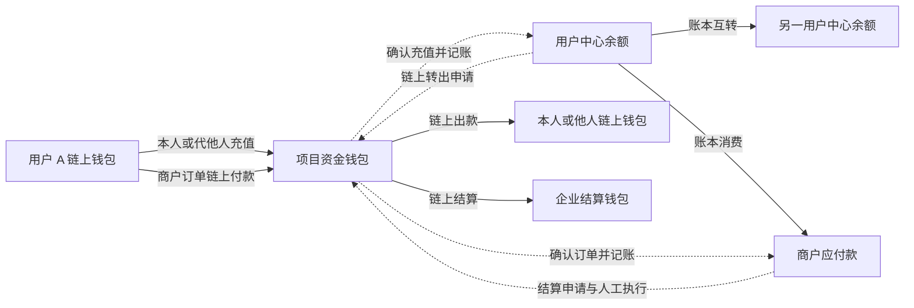
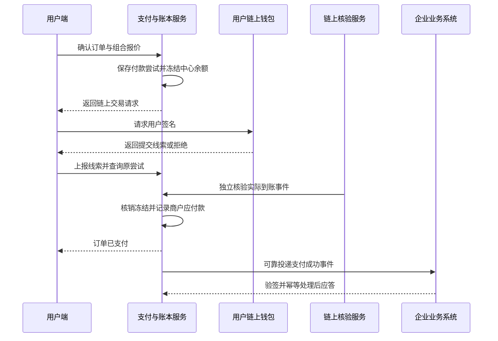

# 钱包支付全场景与前后端工作流

更新日期：2026 年 10 月 24 日。

本文面向产品、前端、后端和运营，覆盖用户收付款、链上充值与转出、企业商户收款、组合支付、退款、人工结算，以及异常恢复和对账。每个场景说明用户操作、前后端协作、资金变化和成功条件，可用于拆分页面、接口和验收用例。

产品采用中心化美元账本承接账户支付，以链上通道收付真实资产。用户主要通过扫码、分享链接和 App 内选择完成操作；系统负责识别收款对象、生成交易、核验到账和记账。

## 1 范围与规则依据

### 1.1 已确认要求

- 用户中心钱包之间可以互转；中心钱包可以转到去中心化钱包。
- 去中心化钱包可以充值到本人或他人的中心钱包。
- 企业可以创建商户，商户可以创建付费单；用户可以使用中心余额、链上资产及两者组合支付。
- 充值和商户链上付款由项目资金钱包收取；商户收入先记为平台应付商户的款项，由人工结算给企业。
- 优先使用二维码、分享链接和 App 交互，尽量减少账户、地址、网络和金额的手工输入。
- 沿用已确认客户端与资产范围：Mini App 支持 TON 网络的 TON、USDT；App 支持 TON、Base、Solana、TRON 上已确定的资产，详见[网络币种范围](网络币种与外部钱包建议.md)。通道逐项验证、启用，不因本文调整范围。
- 用户内置钱包密钥由用户保管，后端不保存；外部钱包按网络和签名能力接入，首版仅同设备连接，详见[外部钱包接入方案](外部钱包接入方案.md)。

### 1.2 本文采用的设计建议

以下用于完整描述工作流，不等于已经上线或用户已经逐项确认。既有参数和默认规则参考[产品约定](../product/产品约定.md)。

| 事项 | 工作流采用的建议 |
| --- | --- |
| 企业与商户 | 企业为归属主体，商户为收款经营主体；企业创建商户后由平台审核启用，首版界面可只开放一个商户 |
| 账户收款 | 收款人必须已有产品账户；个人账户码同时支持余额转账和链上代充值；首版不提供未注册用户待领取转账 |
| 链上转出目标 | 支持本人和他人的有效链上地址；是否需要先保存地址、地址变更后的限制，由出金策略决定，不要求对方拥有产品账户 |
| 组合付款 | 本人中心余额，加一个链上钱包、一个网络、一种资产；不跨链、不跨钱包凑款 |
| 计价与费用 | 商户订单按美元计价，项目报价换算链上数量；费用独立列示，不把稳定币价格固定假设为 1 美元 |
| 充值代付 | 沿用平台代付、从充值金额扣费的要求；仅在能力验证通过的通道开放，其他通道不可冒充已支持 |
| 普通链上转账 | 默认由付款钱包承担网络费，与充值代付规则分开 |
| 退款 | 正常订单先支持整单退款，异常款允许差额退款；原则上退回原出资来源，费用与汇差政策需单独确定 |
| 结算 | 商户申请、人工审核和执行，首版按链上结算设计；法币银行结算不在本次工作流内 |
| 非连接钱包充值 | 作为补充通道设计；只有到账归属、报价和费用规则均落实后才能启用 |

首版不包含跨链桥、任意代币兑换、商户直接扣用户钱包、周期自动扣费、用户付款码被商户反扫扣款、多商户拆单分账和完整电商库存物流系统。商品交付由企业业务系统承担。

### 1.3 与现有页面的衔接

| 现有描述 | 本次需要补齐的行为 |
| --- | --- |
| [收款](../product/用户端/钱包/06收款.md)的账户码只接受中心余额 | 账户码支持中心余额转账、链上资产给该账户充值 |
| [充值](../product/用户端/钱包/08充值美元余额.md)固定本人 | 保留本人快捷入口，增加明确受益人的代充值入口 |
| [美元余额提现](../product/用户端/钱包/09美元余额提现.md)主要描述本人钱包 | 共用出金能力覆盖本人和他人链上地址，并清楚展示实际目标 |
| 产品约定默认由平台开通商户 | 改为企业创建商户、平台审核启用的建议流程 |
| [资金与结算](../product/商户端/05资金与结算.md)仍把平台代收写为默认方案 | 平台代收、人工结算给企业已成为明确要求 |

本次新增完整工作流说明；上述页面及其 Word 稿后续应按同一规则同步，避免把旧稿限制误当成本次范围。

## 2 角色与资金模型

### 2.1 必须分开的对象

| 对象 | 含义与职责 |
| --- | --- |
| 产品用户 | 平台登录身份，拥有中心余额；与连接的钱包地址分开 |
| 用户中心钱包 | 平台美元账本中的可用和冻结余额，是平台对用户的负债 |
| 用户链上钱包 | 用户控制的内置或外部钱包；可能有多个网络、地址 |
| 受益账户 | 充值实际记入的产品账户，可能与付款人不同 |
| 企业与商户 | 企业拥有商户；订单、凭据、应付款按商户隔离 |
| 商户应付款 | 已收订单对应的待结算资金，不是用户中心余额，也不是商户已收到的链上资产 |
| 项目资金钱包 | 平台控制的链上收款、归集、出款地址；可按网络和用途分组 |
| 平台操作员 | 审核出金、退款、商户结算，处理异常并留痕 |
| 链上通道与签名服务 | 构造、广播、监听、核验交易；平台签名能力与普通业务服务隔离 |

实线中的账本互转不产生链上交易。用户直接链上钱包互转也不经过项目钱包。中心余额支付时，备付资产已在项目资金池，只需把对应负债从用户转为商户应付款。

### 2.2 收款对象和付款来源

| 收款对象 | 中心余额付款 | 链上钱包付款 |
| --- | --- | --- |
| 本人中心账户 | 不需要自己给自己转中心余额 | 本人充值 |
| 他人中心账户 | 账户互转 | 给他人充值 |
| 本人或他人链上地址 | 平台链上转出 | 普通链上转账 |
| 商户订单 | 纯余额支付 | 纯链上支付，也可与中心余额组合 |

付款来源变化不能悄悄改变收款目标。例如扫码进入“给小王美元余额转账”后，改用链上钱包付款，受益账户仍然是小王。

## 3 共用前后端协作规则

### 3.1 收款请求与二维码

| 类型 | 二维码或链接内容 | 后端解析结果 |
| --- | --- | --- |
| 账户收款码 | 项目可信域名下的不可猜测收款标识；可附带固定金额请求 | 收款类型、受益账户 idx、安全展示名称、可用付款来源、金额规则 |
| 链上收款码 | 明确网络的地址或对应交易请求；可选资产和金额 | 已支持的网络、完整资产标识、目标地址、可选数量；信息不足时要求补选 |
| 商户订单码 | 项目订单支付链接与受保护的访问标识 | 商户、订单 idx、商品说明、应付金额、有效期、可用通道、最新状态 |

二维码不包含登录令牌、密钥或可直接扣款的授权。账户静态码可以重复收款；订单码对应一次订单支付。二维码中的可变金额、地址和状态不能覆盖服务端订单记录。知道订单号不等于拥有订单详情的访问权限，手动查询只返回授权范围内的信息。

同设备优先点击链接；面对面用扫码；截图用相册识别。App 链接和 Mini App 启动参数都恢复同一个业务上下文。外部钱包配对码与业务码分开，不把扫描业务码视为连接或扣款授权。

### 3.2 每次资金操作的通用步骤

1. 前端解析入口，向后端获取可信收款对象和业务状态。
2. 后端返回当前客户端、资产、账户及商户均允许的通道，前端只展示可用选项。
3. 用户选金额和付款来源，后端生成报价，包含扣款、到账、费用、资产精度、有效期及规则版本。
4. 前端完整展示给谁、到哪里、扣多少和费用；用户确认后提交幂等请求。
5. 后端持久化业务记录和必要的冻结，再进行异步签名、广播或链上核验。前端收到受理结果不表示资金成功。
6. 前端订阅状态或轮询；切到钱包、关闭页面、换设备后，都通过业务 idx 恢复原操作。
7. 后端达到成功条件后，在同一数据库事务内更新账本和业务状态，写出待通知事件；异步通知失败可重试。

前端不能通过取消请求、退出页面或本地倒计时让已提交资金操作失效。中心余额扣款使用服务端认可的账户安全校验；仅有可伪造的“本机验证成功”标记不足以授权。

### 3.3 金额与报价

| 业务 | 确认页必须展示 | 计算约束 |
| --- | --- | --- |
| 中心余额互转 | 扣款美元、对方到账美元、费用 | 默认免手续费；资金在同一账本事务内转移 |
| 充值 | 支付币量、汇率、代付费用、受益账户、净入账美元 | 净入账等于实际可计价到账资产价值扣除已约定费用；不可重复扣取同一费用 |
| 中心余额链上转出 | 扣款美元、费用、预计或承诺到账币量 | 报价明确是预计还是锁定；超过用户确认范围要重新确认 |
| 商户支付 | 商品金额、中心余额部分、链上部分、网络费与平台费 | 两部分商品价款合计等于订单应收；不能把手续费算成商品已付金额 |
| 商户结算 | 结算占用美元、费用、企业净收币量 | 同时明确报价有效期和人工处理超时后的重报价规则 |

后端金额使用精确十进制或最小单位整数，禁止浮点金额运算；API 金额使用明确单位的十进制字符串，前端避免转为浮点后做最终结算。美元账本内部精度、展示小数位和舍入方向分别定义，舍入差额进入专门科目。对外业务 ID 沿用 idx。

报价到期与链上确认超时是不同概念。已被服务端受理并满足有效提交条件的付款保留原报价；只有报价、没有有效付款尝试的晚到交易按异常流程处理。各链如何证明提交时点、多久等待、何时可重试，需要在通道实现中明确，不能用客户端时间作为唯一凭据。

## 4 场景目录

以下覆盖本次钱包支付业务边界。每个场景的异常分支同时适用第 10 节，不必在各页面重复定义。

| 编号 | 场景 | 主参与方 |
| --- | --- | --- |
| S01 | 打开链接并登录恢复业务 | 用户、用户端、身份服务 |
| S02 | 创建导入或连接付款钱包 | 用户、用户端、外部钱包 |
| S03 | 扫码相册识码与手动查找 | 用户、用户端、请求解析服务 |
| S04 | 展示个人中心账户收款码 | 收款用户、用户端 |
| S05 | 展示个人链上收款码并收款 | 收款用户、用户端、链上通道 |
| S06 | 中心余额转给他人中心余额 | 付款人、收款人、账本服务 |
| S07 | 中心余额转到本人链上钱包 | 用户、出金服务 |
| S08 | 中心余额转到他人链上钱包 | 用户、出金服务、外部收款人 |
| S09 | 链上钱包充值本人中心余额 | 用户、链上通道、账本服务 |
| S10 | 链上钱包充值他人中心余额 | 付款人、受益人、链上通道 |
| S11 | 交易所或未连接钱包发起充值 | 付款人、充值通道、平台操作员 |
| S12 | 用户链上钱包直接转账 | 用户、用户端、链上网络 |
| S13 | 任务奖励转入本人中心余额 | 用户、奖励服务、账本服务 |
| S14 | 企业创建商户并启用 | 企业、商户端、平台端 |
| S15 | 商户配置接入和结算资料 | 企业、商户端、平台端 |
| S16 | 商户后台创建付费单 | 商户、商户端、订单服务 |
| S17 | 企业系统通过接口创建付费单 | 企业系统、订单服务 |
| S18 | 用户打开统一收银台 | 用户、用户端、支付服务 |
| S19 | 全额使用中心余额支付 | 用户、账本服务、商户 |
| S20 | 全额使用链上资产支付 | 用户、链上通道、商户 |
| S21 | 中心余额和链上资产组合支付 | 用户、账本服务、链上通道、商户 |
| S22 | 订单取消过期及再次付款 | 用户、商户、订单服务 |
| S23 | 支付结果通知与商品交付 | 用户、支付服务、企业系统 |
| S24 | 纯中心余额订单退款 | 用户、商户、平台、账本服务 |
| S25 | 纯链上订单退款 | 用户、商户、平台、出金服务 |
| S26 | 组合支付订单退款 | 用户、商户、平台、退款服务 |
| S27 | 异常到账认领补记与退回 | 付款人、受益人、平台操作员 |
| S28 | 商户查看资金并申请结算 | 商户、商户端、账本服务 |
| S29 | 平台人工结算给企业 | 企业、平台操作员、出金服务 |
| S30 | 结算拒绝重报价与失败恢复 | 企业、平台操作员、结算服务 |
| S31 | 账单查询通知和跨端恢复 | 用户、商户、查询服务 |
| S32 | 平台异常处理和资金对账 | 平台操作员、对账服务 |
| S33 | 项目钱包归集和备付调拨 | 平台操作员、资金服务 |

## 5 用户账户与钱包场景

### S01 打开链接并登录恢复业务

**场景说明：** 用户点击他人收款链接、商户支付链接，或从二维码进入产品；登录完成后应回到原业务。

| 步骤 | 前端工作流 | 后端工作流 |
| --- | --- | --- |
| 1 | 保存入口类型与不含密钥的请求标识；已登录则直接继续 | 解析请求是否存在、可访问、仍有效，返回可公开的必要信息 |
| 2 | Mini App 使用平台鉴权流程；App 使用现有登录入口 | 验证真实鉴权材料，解析或创建产品身份，签发产品会话；不信任客户端自报用户 ID |
| 3 | 恢复收款或订单页，重新拉取状态 | 用当前身份检查访问权限，返回付款选项；登录不触发付款 |

**结果与边界：** 登录后仍须确认扣款。收款账户和商户订单不可因登录用户变化而被覆盖；链接已失效时展示明确原因。本期纯链上商户支付也按产品登录用户发起设计，匿名付款需要单独开放规则。

### S02 创建导入或连接付款钱包

**场景说明：** 用户需要链上付款时，选择内置或外部钱包；仅使用中心余额时不强制准备链上钱包。

| 步骤 | 前端工作流 | 后端工作流 |
| --- | --- | --- |
| 1 | 按当前业务展示兼容钱包和资产；可创建、导入内置钱包或连接外部钱包 | 返回网络、资产、通道能力和维护状态，不接收助记词或私钥 |
| 2 | 内置钱包在本地生成或恢复密钥并引导备份；外部钱包同设备唤起授权 | 如需记录地址关联，仅保存必要公开信息；敏感地址绑定另行验证控制权 |
| 3 | 恢复原页面，展示钱包地址、余额、费用条件 | 查询链上资产与费用能力；地址或网络变化后使旧付款参数失效并重算 |

**结果与边界：** 连接只建立会话，不表示授权扣款；断开不删除历史记录。外部钱包不支持所需签名方法时返回选择页。前端存储内置密钥的保护方案需按客户端落实，后端业务日志不得接收密钥。

### S03 扫码相册识码与手动查找

**场景说明：** 用户用统一入口识别账户码、链上码和商户订单码，也可填写账户 idx 或订单号作为兜底。

| 步骤 | 前端工作流 | 后端工作流 |
| --- | --- | --- |
| 1 | 扫码、相册识别、粘贴或输入标识；只解析内容，不直接执行交易 | 项目业务链接解析成明确类型；外部地址按支持网络校验 |
| 2 | 账户码进入转给某人，链上码进入地址转账，订单码进入收银台 | 返回可信目标摘要、金额规则和可用操作；查找按完整标识并限制枚举 |
| 3 | 缺少金额时输入金额；缺少网络时选择网络，再展示确认页 | 核验业务范围、目标状态与报价；拒绝任意未知合约调用内容 |

**结果与边界：** 只有裸地址时不能可靠猜测网络，必须补选。未知链接不自动访问后端任意 URL，不把钱包配对码当收款码。不支持的码显示原因并保留手动输入入口。

### S04 展示个人中心账户收款码

**场景说明：** 收款人展示或分享账户码，对方可使用中心余额或链上资产把钱记入该账户。

| 步骤 | 前端工作流 | 后端工作流 |
| --- | --- | --- |
| 1 | 收款页选择“美元余额收款”，展示昵称、账户标识、到账位置 | 获取或生成绑定当前账户的稳定收款标识，不直接暴露完整账户资料 |
| 2 | 可保持不定金额，或创建指定美元金额的收款请求；保存或分享卡片 | 固定金额请求独立保存金额、用途、有效期；不能靠修改 URL 改价 |
| 3 | 收款人查看到账提示和账单 | 付款方走 S06 或 S10；确认入账后向收款人投递通知 |

**结果与边界：** 展示二维码不会生成余额。静态码每次扫码产生独立资金操作；一次性指定金额请求需定义重复支付防护。分享不提供代扣权限。

### S05 展示个人链上收款码并收款

**场景说明：** 用户希望资产直接进入自己的链上钱包，不增加平台美元余额。

| 步骤 | 前端工作流 | 后端工作流 |
| --- | --- | --- |
| 1 | 选择钱包、网络和资产，展示完整地址与收款码，可选数量 | 校验资产配置；提供地址格式和网络说明，记录需要观察的公开地址 |
| 2 | 分享收款信息，对方使用任意兼容工具转账 | 索引或查询已观察地址的到账记录，按网络确认规则刷新状态 |
| 3 | 展示链上待确认或已到账及交易凭据 | 记录钱包资产变化，不记入中心账本、不记入商户应付款 |

**结果与边界：** 成功以链上实际转入为准。后端余额查询延迟不改变资产实际归属；其他链资产不合并为当前资产余额。

### S06 中心余额转给他人中心余额

**场景说明：** A 扫 B 的账户码，或选择常用收款人，使用中心余额向 B 转账。

| 步骤 | 前端工作流 | 后端工作流 |
| --- | --- | --- |
| 1 | 展示 B 的昵称、账户 idx 和“到账美元余额”；输入金额 | 检查 A、B 状态、目标存在、限额和费用；禁止同一中心账户自转 |
| 2 | 展示扣款与到账金额，完成安全校验并提交幂等请求 | 在单一事务内锁定相关余额、复查余额和限额，记 A 扣款、B 入账、业务完成及通知事件 |
| 3 | 展示成功并更新余额；B 收到到账通知 | 返回唯一转账 idx；双方账单引用同一业务，重试返回原结果 |

**资金与成功条件：** A 的用户负债减少，B 的增加，项目链上资产不动。账本事务提交即成功，通知失败不撤销转账。已成功互转不提供无条件撤回，需对方重新转回或另走有依据的争议处理。

### S07 中心余额转到本人链上钱包

**场景说明：** 用户把平台美元余额提到自己选择的链上钱包。

| 步骤 | 前端工作流 | 后端工作流 |
| --- | --- | --- |
| 1 | 从本人钱包列表选地址、网络和资产，填写扣款美元金额 | 获取余额、最低金额、费用和报价，核验通道、地址与平台备付情况 |
| 2 | 展示扣款、到账币量和审核提示，确认申请 | 幂等创建出金单并冻结用户余额；执行系统及用户维度风控，进入自动执行或待人工审核 |
| 3 | 展示审核中、待重报价或出款中 | 审核通过且报价有效后生成唯一执行任务，由隔离签名服务签名并广播；持久化链上标识 |
| 4 | 持续查询，成功后展示到账及账单 | 后端核验实际目标、资产、金额和确认状态，核销冻结、登记资产支出与费用，完成出金 |

**资金与成功条件：** 申请使可用余额减少、冻结增加；确认链上出款后完成扣款。确定未执行或审核拒绝可释放冻结；广播结果未知不可释放后再重发。审核超时导致报价失效时，由用户确认新报价。

### S08 中心余额转到他人链上钱包

**场景说明：** 用户扫他人的链上收款码，用中心余额支付给该地址；对方无需产品账户。

| 步骤 | 前端工作流 | 后端工作流 |
| --- | --- | --- |
| 1 | 解析目标链上地址和网络，付款来源选美元余额 | 按 S07 出金通道校验；收款地址不必属于当前用户，不自动绑定为本人钱包 |
| 2 | 展示“到账链上地址”、网络、资产、金额与费用，确认 | 保存不可变目标快照、报价和请求；风险策略可将新地址或异常行为转人工审核 |
| 3 | 按 S07 展示审核、广播、确认和结果 | 复用冻结、签名、广播、核验和结账流程，按原请求执行 |

**资金与成功条件：** 项目钱包直接向目标地址出款，不给对方增加中心余额。地址簿昵称只作展示，不能代替完整地址确认；提交后改地址必须终止尚未执行的原单，再建立新请求。

### S09 链上钱包充值本人中心余额

**场景说明：** 用户点击充值，选择内置或连接的外部钱包，把链上资产转换为自己的平台美元余额。

| 步骤 | 前端工作流 | 后端工作流 |
| --- | --- | --- |
| 1 | 默认受益人为本人，选择钱包、资产和数量 | 生成充值报价，明确代付费用和净入账美元；检查代付通道能力 |
| 2 | 确认受益账户和净入账，提交充值请求 | 创建充值单，固定受益账户、报价、收款地址及到账关联方式，返回可签名交易请求 |
| 3 | 内置钱包本地签名或唤起外部钱包；返回后显示处理中 | 根据协议广播或等待钱包广播；接收交易线索，同时独立监听项目收款通道 |
| 4 | 等待确认，成功后更新中心余额和充值账单 | 核验网络、真实资产、收款人、数量、业务关联和确认程度；去重后入账本人余额，登记资产及费用 |

**资金与成功条件：** 实际资产进入项目钱包，确认后增加本人美元余额。客户端提交交易哈希只是线索；钱包返回和用户点“已完成”均不触发入账。没有可靠归属或代付能力的通道不得开放此流程。

### S10 链上钱包充值他人中心余额

**场景说明：** A 扫 B 的账户码，选择链上钱包出资；B 收到中心余额。

| 步骤 | 前端工作流 | 后端工作流 |
| --- | --- | --- |
| 1 | 展示“转给 B，到账 B 的美元余额”，选择链上付款 | 固定受益账户为 B，付款登录身份为 A；记录付款地址但不把它作为受益人判定依据 |
| 2 | 输入 B 应收美元或支付币量，展示对应扣款、费用和净到账 | 按所选金额模式生成报价；目标为固定净到账时反算所需币量和费用 |
| 3 | 确认后按 S09 签名、广播、恢复查询 | 创建独立代充值单；核验项目钱包实收，给 B 入账，记录 A 的支出业务 |
| 4 | A 看付款结果，B 看到账记录 | 双方通知分开；A 不因此获得查看 B 总余额或其他账单的权限 |

**资金与成功条件：** 付款人 A、链上付款地址、受益账户 B、项目收款地址分别保存。只有 B 增加中心余额，A 不再先入账再扣款。付款资金需要退回时，按原出资事实和账务状态处理，不能默认退给 B。

### S11 交易所或未连接钱包发起充值

**场景说明：** 用户无法连接付款工具，希望复制充值信息，从交易所提现或另一钱包转入；可给本人或他人充值。

| 步骤 | 前端工作流 | 后端工作流 |
| --- | --- | --- |
| 1 | 先选受益账户、网络、资产，再选择手动转入 | 为目标生成可可靠归属的专属地址或带关联信息的充值请求；没有能力则不提供此入口 |
| 2 | 展示地址、必要备注、预计到账与有效期，支持一键复制和分享 | 记录地址或业务标识到受益账户的映射；不能复用地址时保留历史映射，不因订单关闭抹除 |
| 3 | 用户在外部工具转出，返回后查看到账状态 | 独立扫描实际入账，不要求用户必须提交哈希；收到线索时仍做完整核验 |
| 4 | 显示已入账或需处理原因 | 有效请求按其报价规则入账；无锁价或延迟到账按预先公示的计价规则处理，否则进入待处理，不擅自选汇率 |

**资金与成功条件：** 不按发送地址猜受益人，不靠相同金额认领。交易所可能扣提现费，按实际到账判断是否足额。该通道的发送端费用通常不受平台控制，须另行确定与充值代付要求的兼容方案；未确定前保持未启用，不静默替代 S09。

### S12 用户链上钱包直接转账

**场景说明：** 用户用内置或外部链上钱包转到本人另一个钱包或他人钱包，资金不经过平台账本。

| 步骤 | 前端工作流 | 后端工作流 |
| --- | --- | --- |
| 1 | 扫链上码或选择常用地址，选择同网络资产和数量 | 提供余额、资产配置、地址校验和费用估算；不创建中心余额冻结 |
| 2 | 确认目标、数量及网络费，在本地或外部钱包签名 | 可提供交易构造、广播和状态查询；不得代替用户持有私钥签名 |
| 3 | 展示已提交、确认中、成功或确定失败 | 核验或索引链上交易，更新钱包记录；不记充值、不记商户收入 |

**资金与成功条件：** 用户链上资产直接到目标地址，付款钱包默认承担费用。跨网络转账不由此入口隐式完成；资产相同名称也不代表能跨链直转。

### S13 任务奖励转入本人中心余额

**场景说明：** 已有任务业务的待提现奖励进入中心余额，之后可用于本文件中的转账和消费。

| 步骤 | 前端工作流 | 后端工作流 |
| --- | --- | --- |
| 1 | 展示待提现奖励、条件和最低 2 美元，无链上地址选择 | 计算当前动态资格及限额，拒绝把积分或 Pro 进度当美元余额 |
| 2 | 用户提交提现申请 | 幂等创建奖励提现单，按已有规则扣减待提现奖励，转自动执行或高风险审核 |
| 3 | 展示成功、待审核或拒绝恢复 | 通过后事务内增加本人中心余额；拒绝时恢复原奖励账户，各阶段不重复执行 |

**资金与成功条件：** 无链上交易、无手续费；这里只覆盖奖励转入钱包的边界，不改变任务发奖或积分玩法。

## 6 企业商户与订单支付场景

### S14 企业创建商户并启用

**场景说明：** 企业建立经营主体和商户，审核启用后才能对外收款。

| 步骤 | 前端工作流 | 后端工作流 |
| --- | --- | --- |
| 1 | 企业在后台建立企业资料，填写商户名称、用途和联系人 | 建立企业、管理账户与商户归属关系；后端按归属控制访问，不能信任前端传入的企业 idx |
| 2 | 企业提交，展示待审核及补充资料入口 | 保存资料版本，状态进入待审核；资料重复提交保持同一申请或明确版本 |
| 3 | 平台查看资料，批准或填写退回原因 | 记录审核人、依据和时间；批准后启用商户收款能力，退回后允许修改再提交 |
| 4 | 商户进入概览，可创建付费单 | 返回当前权限及通道范围；未启用时保留状态查询，禁止新收款 |

**结果与边界：** 企业创建不自动代表收款已启用。首版不建设复杂多操作员权限界面，但数据层必须隔离企业与商户。商户停用后，历史到账、退款和已受理结算继续有明确处理路径。

### S15 商户配置接入和结算资料

**场景说明：** 企业配置支付回调、业务返回入口及企业结算地址；后台手动开单可不依赖 API 接入。

| 步骤 | 前端工作流 | 后端工作流 |
| --- | --- | --- |
| 1 | 商户查看接入说明，申请或轮换调用凭据，设置回调地址 | 凭据限定商户权限，保存安全验证材料；校验回调地址和可达性，防止向内部网络任意请求 |
| 2 | 商户设置支付返回地址和接收回调的配置 | 服务端校验配置归属和允许的返回目标；返回跳转不作为支付成功凭据 |
| 3 | 企业录入结算网络、资产、地址，完成必要确认 | 保存版本并记录操作者；地址变更按策略审核，不改写已经受理结算单的目标快照 |
| 4 | 前端展示配置状态和测试结果 | 提供不产生真实资金的回调测试；回调签名、时间戳、重放防护及轮换规则写入接入说明 |

**结果与边界：** 商户调用凭据只由企业后端使用，不嵌入用户端代码。结算地址与用户付款地址、项目收款地址是三个不同对象。

### S16 商户后台创建付费单

**场景说明：** 商户手动填写商品或服务内容，生成一张可分享的订单二维码。

| 步骤 | 前端工作流 | 后端工作流 |
| --- | --- | --- |
| 1 | 输入商品标题、美元金额、可选商户订单号、备注和有效期 | 校验商户启用状态、金额、权限和至少一种可用付款方式；纯余额可用时不依赖链上通道在线 |
| 2 | 商户确认并创建 | 幂等生成订单 idx，保存商品与金额快照、商户归属、有效期和可接受通道 |
| 3 | 展示支付链接、订单码、金额及最新状态，支持分享 | 返回受保护的支付入口；同商户同订单号请求参数相同返回原单，参数不同返回冲突 |
| 4 | 商户查看订单列表或详情 | 查询该商户订单、付款尝试及通知状态 |

**结果与边界：** 创建订单不产生商户收入。已向用户展示的金额不能悄悄修改；需要改价时关闭允许关闭的原单并创建新单，已开始的付款按 S22 处理。

### S17 企业系统通过接口创建付费单

**场景说明：** 用户在企业网站或 App 购买商品，企业后端创建付款订单并打开 DexWallet 收银台。

| 步骤 | 前端及企业系统工作流 | 平台后端工作流 |
| --- | --- | --- |
| 1 | 企业前端提交购买请求，企业后端根据商品计算价格 | 接收企业后端的已认证开单请求，核验凭据、商户、权限和重放条件 |
| 2 | 企业后端传商户订单号、美元金额、商品摘要及已允许的返回配置 | 共用 S16 订单创建服务；以商户和商户订单号约束唯一性，金额以认证开单参数为准 |
| 3 | 企业前端打开支付链接；电脑页面可以展示订单码供手机扫描 | 返回平台订单 idx、支付链接、有效期，绝不要求用户手工填写链上地址 |
| 4 | 企业后端保存平台订单关联 | 支持主动查单和 S23 回调；接口超时后可用原商户订单号找回原单 |

**结果与边界：** 用户浏览器不能持商户密钥直接创建任意价格订单。库存预留、商品税费和发货属于企业系统；平台只确认支付和对应资金。

### S18 用户打开统一收银台

**场景说明：** 用户扫码、点链接或查单，看到同一支付确认页。

| 步骤 | 前端工作流 | 后端工作流 |
| --- | --- | --- |
| 1 | 按 S01、S03 获取订单，展示商户、商品、订单号和应付美元 | 读取当前订单状态，检查商户状态、访问范围和是否已有有效付款尝试 |
| 2 | 默认优先可用中心余额；用户可关闭或修改余额部分，并选一种链上资产 | 返回余额及实际可用通道，校验客户端范围和钱包能力；不能使用任务待提现余额或积分 |
| 3 | 展示付款组成、实际扣款、费用与报价倒计时 | 根据完整组成生成报价；商户应收、用户费用和商户服务费分别计算 |
| 4 | 用户确认支付，按付款组成进入 S19、S20 或 S21 | 获取订单级有效付款资格；原尝试结果未知时返回原尝试，不再创建第二笔并行扣款 |

**结果与边界：** 记住最近付款方式只影响默认选择，不代表自动支付。订单已付款则展示结果；金额或来源发生变化必须重算并再次确认。

### S19 全额使用中心余额支付

**场景说明：** 用户用中心余额支付完整商品金额，无需链上钱包。

| 步骤 | 前端工作流 | 后端工作流 |
| --- | --- | --- |
| 1 | 展示商户及扣款，完成账户安全校验 | 校验报价、订单未支付、可用余额和当前风险策略 |
| 2 | 提交订单 idx、报价标识和幂等键 | 在单一事务内锁定订单与余额，扣用户余额、增加商户应付款及费用科目，写支付成功与通知事件 |
| 3 | 展示支付成功、账单和返回商户入口 | 返回成功结果，异步通知企业系统；重试不重复扣款 |

**资金与成功条件：** 用户负债转为商户负债，项目链上资产不动。商户看到已支付和待结算金额，不代表企业链上钱包已到账。风控若需异步审核，前端显示待审核，不把受理标为成功。

### S20 全额使用链上资产支付

**场景说明：** 用户用一种支持的链上资产支付订单，资金进入项目钱包。

| 步骤 | 前端工作流 | 后端工作流 |
| --- | --- | --- |
| 1 | 关闭中心余额付款，选择钱包、网络和资产，确认数量与费用 | 创建订单下的付款尝试和报价，分配可靠到账关联信息；支付用途固定为商户订单 |
| 2 | 展示并签名明确交易；外部钱包确认后返回原订单 | 持久化交易请求，广播或监听；独立校验资产、项目收款方、数量和订单关联 |
| 3 | 显示链上确认中，不提前提示商户交付 | 达到确认要求后，在账务事务内登记实际收款、商户应付款、费用和订单支付成功 |
| 4 | 展示成功并进入 S23 | 发送商户通知和用户通知，更新账单 |

**资金与成功条件：** 这笔实收直接记为商户订单资金，不先增加用户中心余额，避免充值与支付重复入账。签名或广播完成不等于订单成功。

### S21 中心余额和链上资产组合支付

**场景说明：** 10 美元订单使用 3 美元余额及等值 7 美元的一种链上资产，手续费另列。

| 步骤 | 前端工作流 | 后端工作流 |
| --- | --- | --- |
| 1 | 展示完整组合与费用，用户确认 | 锁定订单有效付款尝试；事务内预留 3 美元、保存 7 美元对应报价及链上收款请求 |
| 2 | 收到准备成功才唤起钱包；显示余额已预留和链上待支付 | 返回与该尝试绑定的交易请求；其他设备重复确认返回同一尝试 |
| 3 | 用户签名或拒绝；页面切回后继续查询 | 跟踪原交易；拒绝且确定没有可执行链上交易时释放预留；提交未知时继续保持处理中 |
| 4 | 展示两部分独立进度，整单只显示一次最终结果 | 核验链上价款足额后，事务内核销 3 美元预留、记链上资产、增加商户应付款并确认整单支付 |
| 5 | 成功后查看账单及商户交付状态 | 异步通知；异常差额或重复实收进入独立异常记录 |

**资金与成功条件：** 中心部分有效扣款且链上部分确认到账，才能整单成功。链上已到账、账本事务暂时失败时，保留收款证据并重试结账，不能要求用户重付。预留已释放后晚到的链上款，不得无授权重新扣中心余额；转异常补偿，默认进入退回已收链上款的审核流程，重新补付需用户明确确认。

### S22 订单取消过期及再次付款

**场景说明：** 用户不继续付款、商户关闭订单、订单到期，或需要更换付款方式。

| 步骤 | 前端工作流 | 后端工作流 |
| --- | --- | --- |
| 1 | 未提交时返回或更换来源，页面不声称已取消链上交易 | 尚未创建付款尝试时无资金操作；关闭未付款订单可直接终止新付款入口 |
| 2 | 已有尝试时先查询状态，展示能否取消或换方式 | 区分只有预留、待签名、已签名可能广播、已广播和已到账；按通道证据判断能否安全终止 |
| 3 | 到期或商户关闭时显示“停止新付款，原付款核验中”等准确状态 | 关闭新尝试入口，保留已有交易核验和资金记录；不按页面倒计时直接释放一切冻结 |
| 4 | 明确原尝试不再产生扣款后，用户才可建立新尝试 | 原尝试安全终止后释放占用，再决定订单是否仍可付；晚到资金转异常，不能遗失 |

**结果与边界：** 客户端拒绝消息、查不到交易、RPC 超时不能单独证明资金永远不会执行。长时间未知由通道恢复策略及人工处理接管；需要释放预留时必须定义晚到资金补偿，不能无限挂起且无人负责。

### S23 支付结果通知与商品交付

**场景说明：** 已确认付款后，用户拿到支付结果，企业系统据此交付商品或服务。

| 步骤 | 前端及企业系统工作流 | 平台后端工作流 |
| --- | --- | --- |
| 1 | 用户端从平台查询支付成功，展示金额、商户和账单 | 账本与支付状态提交成功后，读取同事务保存的待通知事件 |
| 2 | 企业后端接收回调，验证签名、订单、金额、状态和事件标识 | 投递含商户订单号、平台订单 idx、实付摘要、状态与事件版本的通知；失败按退避策略重试 |
| 3 | 企业后端幂等标记已支付并执行交付；异常时可主动查单 | 查询接口返回权威支付状态；重复或乱序回调不能让已退款状态倒退为普通已付 |
| 4 | 用户返回商户，看到交付结果；商户后台展示通知和交付线索 | 回跳只导航，不触发二次扣款；回调失败记录异常但不撤销支付 |

**结果与边界：** 手工开单且未配置业务系统时，由商户后台看到已支付后人工交付。已付款但发货失败属于履约问题，可发起退款，不把支付记录改为失败。

## 7 退款与异常到账场景

### S24 纯中心余额订单退款

**场景说明：** 商户为已支付订单申请整单退款，平台审核后把款退回原付款中心账户。

| 步骤 | 前端工作流 | 后端工作流 |
| --- | --- | --- |
| 1 | 商户选择订单、填写原因；用户可查看申请进度 | 检查订单归属、实际可退金额和重复申请；创建退款单并占用可用商户应付款 |
| 2 | 平台查看退款影响和资金是否充足，批准或拒绝 | 通过后在同一事务内扣商户退款占用、增加原付款用户余额、记录退款完成和通知事件 |
| 3 | 双方看到退款成功，原订单保留支付及退款历史 | 退款累计不得超过可退商品价款；拒绝时释放退款占用 |

**资金与成功条件：** 全部账本处理，无链上交易。商户已结算导致余额不足时进入待补资金，不能把无来源的数字直接退给用户；若平台承担垫付，必须有明确授权和独立应收账务。

### S25 纯链上订单退款

**场景说明：** 商户订单使用链上资产付款，需要把可退金额退回可验证的原出资来源。

| 步骤 | 前端工作流 | 后端工作流 |
| --- | --- | --- |
| 1 | 商户申请；用户看到拟退网络、资产、币量、费用和目标 | 建立退款单，锁定商户退款资金；依据原付款资产与已展示政策计算可退币量 |
| 2 | 普通钱包原路退回；来源不可直接接收时展示目标确认流程 | 不盲目退到代币合约、中转合约或交易所热钱包；核验实际付款来源和可收款目标，必要时人工审核 |
| 3 | 平台批准后展示出款中和链上确认中 | 生成唯一退款执行任务，项目钱包签名并出款；核验目标、资产、金额和确认状态 |
| 4 | 展示已退款并提供凭据 | 核销商户占用、登记资产支出，更新退款单并通知双方 |

**资金与成功条件：** 仅链上退款最终确认后标记该部分已退款。建议普通订单按原商品价款对应币量原币退回，原网络费、退款费和汇差承担另定并在付款前展示；不能临时用当前汇率静默减少承诺退款。

### S26 组合支付订单退款

**场景说明：** 一张组合支付订单整单退款，中心余额部分与链上部分分别回到其原资金来源。

| 步骤 | 前端工作流 | 后端工作流 |
| --- | --- | --- |
| 1 | 商户申请整单退款，用户看到两部分明细 | 创建退款主单和两个退款分项，按原出资构成锁定商户资金，校验累计可退上限 |
| 2 | 平台批准，分别展示中心退款和链上退款进度 | 中心分项按 S24 事务处理，链上分项按 S25 异步执行；两个分项分别幂等 |
| 3 | 一部分完成时展示“部分已退，其余处理中” | 已退中心余额不因链上退款失败而自动再扣；只重试或处理未完成分项 |
| 4 | 两部分都完成后展示整单退款完成 | 汇总分项结果，写退款完成和商户通知事件 |

**资金与成功条件：** 不把两部分合并退给同一个任意账户。退款主单不能先标完成再等链上出款；链上未知状态继续保留资金占用和证据。

### S27 异常到账认领补记与退回

**场景说明：** 项目实际收到钱，但出现缺失关联、少付、多付、重复、过期到账、错误受益人争议等情况。

| 步骤 | 前端工作流 | 后端工作流 |
| --- | --- | --- |
| 1 | 用户查看异常原因，可提交交易线索和说明；不要求反复付款 | 扫链产生独立实收记录，先记待归属或待处理资金；避免只留日志不入账 |
| 2 | 平台看到资产、数量、目标、确认状态、已有归属及候选业务 | 独立核验链上证据、请求映射和是否已被使用；仅知道交易哈希不足以证明认领权 |
| 3 | 平台选择有证据的关联入账、补确认、差额退回或暂挂 | 在受约束事务内分配到账并记账；分配总额不能超过实收；错误关联修正使用有记录的冲正与重记 |
| 4 | 用户看到处理结果，平台保留后续责任人和原因 | 退款按实际出资来源处理；已入他人中心余额的代充值不得因付款人投诉就自动再次从资金池退款 |

**资金与成功条件：** 异常关闭必须对应明确的账务结果，未归属资金不能直接算平台收入。少付首版建议走人工退款或明确补付请求，不开放不受约束的多币种拼单；多付只把订单应收计入商户，超额单独处理。

## 8 商户人工结算场景

### S28 商户查看资金并申请结算

**场景说明：** 企业查看商户应付款，申请把可结算部分转到企业链上钱包。

| 步骤 | 前端工作流 | 后端工作流 |
| --- | --- | --- |
| 1 | 展示待结算、可结算、退款占用、结算处理中及历史流水 | 按商户汇总账本；已支付订单按生效结算规则进入可结算，不把全部历史收入当可用金额 |
| 2 | 选择已登记的企业结算地址、网络和资产，输入美元金额 | 校验商户、地址版本、金额、最低限额及费用，返回结算报价或明确的估算值 |
| 3 | 确认占用金额和净到账量，提交申请 | 幂等创建结算单，事务内把可结算金额转为结算冻结，保存目标及报价快照 |
| 4 | 商户查看审核中和处理时间线 | 生成平台待处理任务，不自动表示已支付企业 |

**资金与成功条件：** 此时只是商户应付款内部冻结，项目资产不动。退款占用、其他结算占用不能被重复使用；是否设结算等待期由规则配置，前端必须展示具体原因。

### S29 平台人工结算给企业

**场景说明：** 平台人员审核结算单并发起实际链上出款，人工控制时点，系统负责金额约束、去重和确认。

| 步骤 | 平台及商户前端工作流 | 后端工作流 |
| --- | --- | --- |
| 1 | 平台打开结算详情，核对企业、商户、金额、地址、报价及订单资金 | 检查结算冻结有效、无冲突退款、目标版本正确、通道和备付资产充足 |
| 2 | 平台审核通过，确认最终交易内容并选择执行 | 原子创建唯一出款任务并锁定执行权；保存操作者、金额、目标、资产和授权记录 |
| 3 | 推荐通过受控签名服务人工触发；使用外部多签时在指定工具确认 | 通过受控签名或导出的固定交易提案出款；外部执行也绑定同一任务，不允许后台并行再次发送 |
| 4 | 平台录入或系统回传交易凭据，双方看到确认中 | 独立核验项目实际支出、企业目标、金额、资产和链上结果，凭据不能只作文本备注 |
| 5 | 商户看到已结算和到账币量 | 确认后核销商户结算冻结、减少项目资产、登记费用与结算完成，发送通知 |

**资金与成功条件：** 人工点“完成”或上传截图不等于结算成功。原则上一张结算单对应一个出款任务；确需拆分时先建立分项与金额上限，全部达到要求后才完成主单。结算单导出签名后即按可能执行管理，不能随意解锁重发。

### S30 结算拒绝重报价与失败恢复

**场景说明：** 审核未通过、报价过期、项目备付不足、签名未完成或出款结果异常。

| 分支 | 前端工作流 | 后端工作流与资金处理 |
| --- | --- | --- |
| 审核拒绝 | 商户看到原因及已恢复金额 | 确认没有可执行出款后释放结算冻结，记录拒绝，不删除申请 |
| 报价过期 | 商户看到新旧净到账量并主动确认 | 保留申请及金额占用，生成新报价；确认前不执行改变到账量的出款 |
| 备付不足 | 展示待平台补充资金，平台列出缺少的网络资产 | 保留冻结并生成调拨任务；不自动挪用其他已锁定出款、不标记已发出 |
| 确定未出款失败 | 展示可重试或已终止 | 核实没有仍可执行的签名交易后，可在同一结算单创建替代执行，或终止并释放冻结 |
| 广播或链上结果未知 | 展示处理中及最近查询时间 | 检查原交易和可能的替代交易，保留冻结；不能同时退款又继续原出款 |
| 已出款但更新失败 | 展示核验中，完成后自动更新 | 依据独立链上证据幂等结账，不再发起一笔相同转账 |

**结果与边界：** 重报价等待达到处理时限后，应通知责任人并提供安全终止路径。商户在申请后更改结算地址，不影响已有单据；如需改目标，只有原执行确定不可再执行后才能重建申请。

## 9 查询与平台资金管理场景

### S31 账单查询通知和跨端恢复

**场景说明：** 用户、商户在关闭页面、钱包返回失败或更换设备后，仍能找回交易状态。

| 步骤 | 前端工作流 | 后端工作流 |
| --- | --- | --- |
| 1 | 账单按收支、类型、时间和状态查询；商户按订单和结算查询 | 按当前主体授权范围查询，聚合业务主单与资金分项；链上数量和美元折算分开 |
| 2 | 打开详情，展示目标、出资来源、金额、费用、状态时间线和链上凭据 | 返回权威状态、最近核验时间、可执行下一步和关联退款；不把前端缓存当最终状态 |
| 3 | 收到通知或恢复 App 时刷新原业务 | 通知至少一次投递、客户端按事件去重；丢通知可通过查单恢复 |
| 4 | 处理中页面只提供查状态、明确可用的取消或处理入口 | 原请求重复提交返回原业务；新的金额或目标必须创建新的操作意图 |

**结果与边界：** 用户看到一个清晰的业务账单，详情可展开冻结、扣款、退回和链上分项；不把每个内部记账步骤误显示成用户再次消费。付款人无权查看代充值受益人的其他资产。

### S32 平台异常处理和资金对账

**场景说明：** 平台核对真实链上资产、用户负债、商户应付款和在途资金，处理长期未知或不一致记录。

| 步骤 | 平台前端工作流 | 后端工作流 |
| --- | --- | --- |
| 1 | 工作台显示未归属实收、未知出款、账本不平、回调失败和超时待办 | 定时扫描与增量监听并行，持久化扫描游标、确认范围、最近成功时间和缺口 |
| 2 | 选择网络、资产、时间及业务类型执行对账 | 对比链上收支与内部资金事件，再核对资金事件、账本分录与业务状态；记录本次对账快照 |
| 3 | 查看差异证据，选择重新核验、补记、重试通知或有依据的退款 | 只能执行类型明确的处理命令，检查原状态和版本；没有真实到账证据不得补确认支付成功 |
| 4 | 填写原因并查看处理预览；完成后回查 | 事务化处理、保留前后状态和操作者，写审计和通知；不能直接编辑历史分录覆盖差异 |

**资金与成功条件：** 对账分别比较原币数量和美元账面价值，汇率重估不算链上缺款。发现链上回滚、错误确认等情况时记录差异并限制相关风险敞口，按证据冲正或追补，不盲目把已花出的余额改成普通成功值。

### S33 项目钱包归集和备付调拨

**场景说明：** 平台将专属充值地址中的资产归集，或为出金钱包补充同网络备付资产和手续费币。

| 步骤 | 平台前端工作流 | 后端工作流 |
| --- | --- | --- |
| 1 | 查看各网络、资产、地址用途、待归集和已承诺出款 | 统计可用资产、在途调拨和出款占用，避免把同一笔资产安排给多个任务 |
| 2 | 按规则人工确认或启动已授权归集任务 | 创建独立资金调拨单，绑定项目自有来源和目标；签名服务按权限执行 |
| 3 | 显示链上确认与归集费用 | 跟踪交易，成功后更新地址资产分布和费用，失败或未知按出款恢复规则处理 |
| 4 | 调拨完成后恢复具备执行条件的出款单 | 重新核验备付和报价，不因为余额刚到就跳过用户或商户的重报价确认 |

**资金与成功条件：** 项目自有地址之间调拨不新增用户充值、不新增商户收入；监听器必须识别内部调拨，防止重复记账。归集费用与已向用户报价的充值费用分开核算，不能归集时再未经授权扣用户余额。

## 10 共用异常场景及恢复工作流

正常页面至少覆盖准备、待确认、处理中、成功、确定失败和需处理状态。以下异常由服务端给出明确原因及允许操作，前端不根据错误文本自行猜测是否要重新付款。

| 编号与场景 | 前端工作流 | 后端工作流及资金结果 |
| --- | --- | --- |
| E01 链接失效或二维码被修改 | 停在解析页，展示无法使用原因，允许重新扫描 | 校验标识、有效期、版本和实际业务对象；不创建资金操作、不信任被改金额 |
| E02 扫到裸地址或不支持的链资产 | 补选网络或说明不支持，不自动猜测 | 校验网络与完整资产标识，禁止使用同名假币配置、错链通道和任意调用 |
| E03 收款账户不存在冻结或商户停用 | 展示目标当前不可收款；已提交业务仍可查看 | 新请求拒绝；已发生链上实收登记异常并确定入账冻结或退回路径，不丢弃资金 |
| E04 中心余额或链上资产不足 | 显示实际缺额，允许调整付款方式 | 提交时重新校验；中心扣款并发锁定，禁止超支；准备失败不留无主冻结 |
| E05 手续费币不足或代付能力不可用 | 在确认前提示缺少条件或通道不可用 | 不生成无法执行的正常付款承诺；没有已确认替代费用规则时不能静默改由用户承担 |
| E06 报价过期或行情不可用 | 展示新旧报价并重新确认；不可用时暂停新换算操作 | 未受理操作重新报价；已有效受理交易按其锁价规则核验，保留历史报价，不改历史成交 |
| E07 钱包未安装拒绝或会话过期 | 安装入口、换钱包、重新连接或返回；保存原业务 | 连接失败不扣款；付款拒绝结合广播状态处理，不能只凭拒绝消息释放未知出款资金 |
| E08 付款中钱包账户或网络变化 | 清除旧确认，重新展示付款账户与费用 | 使未提交参数失效；已提交按原地址及交易继续核验，不用新账户覆盖原尝试 |
| E09 重复点击网络重试或跨设备并发 | 展示同一操作结果，避免开多个等待页 | 幂等键绑定主体、业务和参数摘要；同键异参报冲突，订单级限制并行有效付款尝试 |
| E10 提交响应丢失或 App 被回收 | 用原幂等键或业务 idx 找回状态，提供查询入口 | 先查已受理记录，再判断是否允许重试；后端异步任务不依赖页面存活 |
| E11 签名成功但广播失败或返回未知 | 显示提交待核验，不提示立即再付 | 持久化签名或交易标识，核查网络与钱包是否已广播；重播同一有效交易或受控替代，不独立再发一笔 |
| E12 链上已提交但确认缓慢或 RPC 中断 | 显示确认中及最近查询时间 | 多来源查询、恢复扫描缺口；保留原交易及冻结，超时进入责任明确的异常队列 |
| E13 链上执行失败退款弹回或交易失效 | 展示真实结果与已产生费用 | 验证最终实际资产变动，不把失败交易里的无效事件当到账；确认不会再执行才释放对应资金 |
| E14 少付或只有组合的一部分到账 | 展示已收、差额和待处理，不显示整单成功 | 已收资金进入异常归属，冻结按补偿策略管理；补付须独立受控请求，未补足不能通知商户成功 |
| E15 多付 | 展示订单已付金额和超额处理进度 | 只将应收部分计入商户，超额记独立待退资金；分配与退款总量不超过实际实收 |
| E16 同一订单再次收到链上付款 | 展示原单已支付及重复款处理记录 | 第二笔真实收款单独入账待处理，不第二次增加商户应付款或第二次发货 |
| E17 订单关闭过期后到账 | 显示付款核验或晚到账待处理 | 有效在途尝试按原规则完成；已安全终止后晚到款按 S27 处理，冻结已释放时不偷偷再次扣余额 |
| E18 缺失备注或无法关联到账 | 提供交易线索和申诉入口，展示待归属 | 独立保存实收、阻止重复认领；验证请求与资金归属后补记，不能凭截图和金额认领 |
| E19 链上到账而账本更新失败 | 显示到账处理中，不引导再次支付 | 持久化到账证据，幂等重试账本事务；只要未记账就继续恢复，不重复创建实收 |
| E20 回调失败重复或乱序 | 用户付款结果保持成功；商户端展示通知异常 | 根据事件版本重试通知，企业端验签并幂等处理；不重扣、不因通知失败重置支付状态 |
| E21 退款与结算并发 | 显示实际可用资金及占用原因 | 锁定商户可用金额及相关订单退款额度；同一资金只能被一个冻结占用，冲突方明确失败或等待 |
| E22 退款或结算已经出款但状态未落库 | 显示核验中，禁止再次执行按钮 | 用原执行任务及链上证据补结账；原出款不能因数据库重试而变成第二笔出款 |
| E23 链上回滚或确认后发现不一致 | 展示相关记录核查中，平台查看受影响业务 | 记录原证据和新证据，按资产与负债实际影响受控冲正；涉及已消费资金时转专门追补处理，不抹除历史 |
| E24 平台备付不足或通道维护 | 新请求明确不可用，已受理请求显示等待原因 | 暂停不可执行的新出金，保留原冻结；归集或调拨后重新校验价格和授权再执行 |
| E25 实际网络费与估算不同 | 显示最终费用和明确退回记录 | 事前定义费率或上限；超出已授权范围先重新确认或平台承担，不静默追加扣款；预留结余按规则释放 |
| E26 收错网络资产或意外小额到账 | 显示支持范围与待处理线索，不承诺必然找回 | 能识别的项目实收记录待处理；是否可恢复取决于实际控制与通道能力，不按同名币自动兑美元 |
| E27 用户要求撤回已成功转账或代充值 | 展示已到账事实，允许提交争议说明 | 不把投诉当撤销授权；已入受益人账户的资金须核实可用余额、权属和处理依据，防止付款人获退而受益人仍保留原款 |
| E28 人工外部签名后长时间未广播 | 平台显示已有待执行提案，商户看到处理中 | 将已签名可执行提案纳入在途管理；只有证实失效或不可再执行后，才允许替代或释放冻结 |

## 11 前后端模块与接口边界

### 11.1 前端页面和公共组件

| 模块 | 需要承担的工作 |
| --- | --- |
| 钱包首页 | 展示中心余额与链上资产，提供扫一扫、收款、转账、充值、账单入口 |
| 请求解析与路由 | 统一扫码、相册、分享链接、Mini App 启动及手动查找；恢复原业务 |
| 收款目标组件 | 展示中心账户或链上地址，始终明确到账位置，支持常用对象和本人钱包选择 |
| 钱包与资产选择器 | 内置和外部钱包并列，按业务、客户端、网络和能力筛选；支持同设备返回 |
| 金额与报价组件 | 区分订单金额、扣款金额、净到账、费用、汇率和到期时间；金额由后端最终确认 |
| 支付确认页 | 三种支付方式共用组成展示、确认和防重复提交能力 |
| 处理结果与账单页 | 展示主单与分项状态，恢复查询，提供明确可用的下一步 |
| 企业商户后台 | 企业与商户申请、配置、开单、订单、退款、资金和结算 |
| 平台后台 | 审核、出款执行、异常证据、对账、资金调拨和操作记录 |

界面文案通过国际化资源管理。用户页面隐藏不必要的协议与内部状态名，但平台诊断保留业务 idx、网络、资产、交易凭据、错误码、原始通道错误和重试时间，按权限展示必要上下文。

### 11.2 后端职责

| 模块 | 核心职责 | 不能替代的职责 |
| --- | --- | --- |
| 身份与主体 | 登录、账户、企业与商户归属、权限 | 钱包连接不替代产品身份验证 |
| 收付款请求 | 收款码、目标解析、金额约束和链接访问 | 解析二维码不等于授权扣款 |
| 报价与通道配置 | 汇率、精度、费用、限额、可用资产及规则版本 | 不能只依靠前端隐藏通道 |
| 账本 | 复式分录、可用与冻结、幂等余额变更、余额查询 | 业务服务不得绕过账本直接改余额字段 |
| 订单与支付 | 订单生命周期、付款尝试、组合付款和收款分配 | 交易提交不等于支付完成 |
| 链上核验 | 持久化监听、确认、交易解析、去重和链上回滚检测 | 不能信任客户端宣称的金额或状态 |
| 出金与签名 | 冻结、审核衔接、执行任务、签名广播和恢复 | 人工操作不能绕过唯一执行任务 |
| 退款与结算 | 退款额度、资金占用、分项退款、商户应付款核销 | 不能把退款或结算受理当作真实出款 |
| 风控与审核 | 系统及用户统计判断、审核队列和解释 | 风控拒绝不能丢弃已到账资金 |
| 通知与对账 | 可靠事件、商户回调、用户通知、对账差异与审计 | 通知失败不能反向改支付结果 |

这些是业务边界，不要求首版拆成多个独立部署的微服务；可以先在同一后端按模块组织，保留事务和手写扩展边界。

### 11.3 概念接口清单

下表描述需要的契约能力，不固定路由或框架。进入实现时，先修改项目选定的 API 源定义，再生成前后端类型与客户端，不手写两套不一致的契约。

| 能力 | 主要请求信息 | 必须返回或保证的信息 |
| --- | --- | --- |
| 解析收付款入口 | 扫码内容或业务标识、当前身份 | 类型、可信目标摘要、金额约束、允许操作；不返回越权详情 |
| 创建个人收款请求 | 目标账户、可选金额和用途 | 收款请求 idx、链接、到期与复用规则 |
| 获取可用付款方式 | 业务对象、客户端、当前钱包能力 | 中心余额、可用链资产、费用要求、不可用原因 |
| 获取报价 | 来源、目标、金额模式、资产、支付组成 | 报价 idx、各金额及单位、费用明细、到期、规则版本 |
| 发起账户互转 | 目标、金额、报价、幂等键、安全验证 | 转账 idx、权威状态、双方资金摘要 |
| 创建充值请求 | 受益账户、付款来源、报价、幂等键 | 充值 idx、交易请求、到账归属方式；服务端固定受益人 |
| 创建链上转出 | 目标网络资产地址、报价、幂等键、安全验证 | 出金 idx、冻结金额、审核和执行状态 |
| 上报链上提交线索 | 业务 idx、交易哈希或协议提交线索 | 接收结果和当前状态；不得接受客户端直接提交成功状态 |
| 创建企业与商户申请 | 主体资料、业务资料、幂等键 | 申请和商户 idx、审核状态 |
| 创建商户订单 | 商户订单号、金额、商品摘要、有效期 | 平台订单 idx、支付链接、最新状态；同号异参冲突 |
| 准备或确认支付 | 订单、付款组成、报价、幂等键、安全验证 | 付款尝试 idx、冻结情况、可签名交易或已完成结果 |
| 查询与安全取消 | 业务 idx、预期版本、取消原因 | 权威状态、是否真正终止、资金占用及可执行动作 |
| 发起和审核退款 | 原订单、原因、退款范围、幂等键 | 退款主单及分项、目标、资金占用、需补充的来源证明 |
| 申请与执行结算 | 金额、企业目标版本、报价、幂等键 | 结算 idx、冻结、审批、唯一出款任务及确认状态 |
| 查询账单与资金 | 主体范围、过滤项、分页信息 | 主单与分项、原币及美元金额、费用和时间线 |
| 异常处理命令 | 异常 idx、操作类型、证据、原因、预期版本 | 执行预览及结果、账务变化、审计标识 |
| 商户查询与回调 | 商户认证、订单号；事件签名信息 | 权威状态、事件标识、事件版本及金额摘要 |

所有写操作按主体和动作划分幂等范围；幂等记录保留时间覆盖实际重试和资金处理窗口。错误返回具名代码、是否可重试、当前业务 idx 和允许动作；不得把内部失败伪装成空列表或普通成功。

## 12 状态与账务一致性

### 12.1 关键数据对象

| 对象 | 最小业务信息 |
| --- | --- |
| 收款请求 | idx、目标类型、目标快照、金额规则、有效期、访问和复用规则 |
| 报价 | idx、金额单位、网络资产、汇率、费用、有效期、锁价条件、规则版本 |
| 付款尝试 | idx、订单或充值用途、付款身份、受益人、来源组成、报价、状态与版本 |
| 中心余额冻结 | idx、账户、金额、所属业务、冻结与释放或核销原因，防止被多个业务消费 |
| 链上实收 | 网络、交易标识、具体转账事件位置、真实资产、收款方、数量、确认状态 |
| 实收分配 | 实收标识、关联业务、分配数量及用途；累计分配不超过该笔实收 |
| 出款任务 | idx、用途、原单、来源、目标、金额、授权记录、签名及广播标识、替代交易关系 |
| 账本凭证 | idx、业务幂等键、币种及单位、借贷分录、原始凭证及冲正关联 |
| 退款与结算 | 主单、分项、可退或可结算上限、冻结、目标快照、执行任务及状态 |
| 通知事件 | 事件 idx、聚合对象、版本、内容快照、目标、投递尝试和应答 |
| 审计与异常 | 操作者、对象、前后状态、原因、证据、责任人、下一次处理时间 |

链上去重粒度必须到具体资产转移事件，不能只用交易哈希：同一交易可能包含多笔转账。具体事件位置按链定义，例如日志、指令或消息位置。内部归集、客户充值、商户支付通过用途和已分配事件区分，不能让同一实收同时计入两类业务。

### 12.2 状态应分别建模

| 对象 | 主流程 | 关键分支 |
| --- | --- | --- |
| 商户订单 | 待支付 → 付款处理中 → 已支付 | 未开始付款可取消或过期；退款状态独立保留，不覆盖原支付事实 |
| 付款尝试 | 已准备 → 待授权 → 提交待核验 → 链上确认中 → 已完成 | 安全取消、确定失败、待异常处理；纯余额可在事务中直接完成 |
| 充值 | 待转入 → 已发现到账 → 确认中 → 已入账 | 少付、无归属、过期到账等进入待处理；关闭入口不终止监听 |
| 中心余额冻结 | 已冻结 → 已核销 | 或已释放；核销和释放互斥，重复执行无额外影响 |
| 出款任务 | 待执行 → 已生成签名请求 → 可能执行或已广播 → 确认中 → 已完成 | 确定未执行失败、结果未知、替代交易核验中 |
| 退款 | 已申请 → 待审核 → 退款中 → 已退款 | 被拒绝、资金不足、部分已退款、待异常处理 |
| 结算 | 已申请并冻结 → 待审核 → 待执行 → 确认中 → 已结算 | 被拒绝、待重报价、待备付、待异常处理 |
| 通知 | 待发送 → 已应答 | 失败待重试、超过自动重试待人工；不改变支付状态 |

实现时业务类型、状态、错误、事件和 Redis key 使用具名定义。交易替换、重播和失效证明由各链适配器实现，不把某一条链的 nonce 或确认方式硬套到所有链。

### 12.3 资金变化与记账示例

以下示例仅说明业务账务，忽略费用、汇差和舍入；实际凭证需增加对应科目并保持每种记账单位平衡。美元账与原币数量账分别核对。

| 业务 | 账本变化 | 链上变化 |
| --- | --- | --- |
| A 给 B 转 10 美元 | 借 A 用户负债 10，贷 B 用户负债 10 | 无 |
| 链上充值净计 10 美元给 B | 借项目资产对应账面值 10，贷 B 用户负债 10 | 项目收到对应资产 |
| 用户余额支付 10 美元 | 借用户负债 10，贷商户应付款 10 | 无 |
| 链上支付 10 美元订单 | 借项目资产对应账面值 10，贷商户应付款 10 | 项目收到对应资产；用户中心余额不变 |
| 3 美元余额加 7 美元链上支付 | 借用户负债 3、项目资产对应账面值 7，贷商户应付款 10 | 项目收到 7 美元对应资产 |
| 中心余额转出 10 美元 | 申请先冻结；完成时借用户负债 10，贷项目资产对应账面值 10 | 项目支出对应资产 |
| 余额订单退 10 美元 | 借商户应付款 10，贷原付款用户负债 10 | 无 |
| 企业结算 10 美元 | 申请先冻结；完成时借商户应付款 10，贷项目资产对应账面值 10 | 项目向企业支出对应资产 |

冻结只调整可用与占用，不重复增加或减少总负债。待归属实收先记项目资产及待处理负债；查明归属后转入用户负债、商户应付款或退款占用，不能不记账也不能认作无来源收入。账本有专门费用、汇差和舍入科目，不能靠修改用户余额使报表看起来平衡。

### 12.4 必须保持的不变量

1. 同一有效资金请求最多产生一次应有扣款或入账；重试只恢复原结果。
2. 账户互转的扣款和入账在同一事务提交，不允许只扣一边。
3. 同一冻结只能被核销或释放一次，不能同时发生。
4. 一笔实收可以按应收与超额分配，但分配总额不得超过实收，不能完整重复用于多个订单。
5. 同一商户订单只产生一次商品价款入账；重复实收进入独立异常资金。
6. 用户可用余额和商户可用应付款不能被并发扣成负数；退款、结算与出金占用必须互斥计量。
7. 链上资金事实与数据库业务状态通过持久化任务衔接；交易完成而事务失败必须可恢复。
8. 只有满足对应链的实际成功与确认规则，才允许把链上资金分项标为完成。
9. 通知、回跳、截图、用户上报哈希或操作员点击都不能单独替代资金事实。
10. 不通过直接编辑历史分录修正差异；所有补记、冲正和退款都关联原业务并可审计。

## 13 前后端联调验收

实现时用以下可观察结果验收；数据库事务和状态机使用确定性单元测试，链上 RPC、钱包协议、签名与通知在边界使用 fake 或 mock。真实钱包、测试网络和服务商接入放在独立集成测试，不让不稳定外部环境决定普通单元测试结果。

| 验收组 | 必须验证的结果 |
| --- | --- |
| 入口与恢复 S01 至 S05 | 扫码、相册和同设备链接打开同一目标；登录和钱包返回后目标与金额不丢；账户码与链上码显示不同到账位置 |
| 余额互转 S06 | 成功后双方金额对应；余额不足不产生单边流水；并发和超时重试只转一次 |
| 链上转出 S07 至 S08 | 本人和他人地址均按授权目标出款；审核拒绝恢复；未知交易不释放后再发；已到账数据库失败可恢复 |
| 本人与代充值 S09 至 S11 | A 出资、B 入账，A 不额外入账；重扫同一链上事件不重复记账；无关联、少付和晚到有明确记录 |
| 链上直转 S12 | 资产到目标钱包，中心余额和商户应付款不变化；失败及网络费显示符合实际 |
| 奖励转入 S13 | 仅本人中心余额增加；拒绝恢复奖励；不发链上交易、不把积分当钱 |
| 企业与开单 S14 至 S17 | 跨企业访问被拒绝；未启用不能收款；同订单号重试不重复建单，异参有冲突；商户凭据不下发用户端 |
| 三种支付 S18 至 S21 | 应收、余额部分、链上价款和费用可核对；商户只入账一次；纯链上付款不另记用户充值 |
| 组合支付恢复 S21 至 S22 | 签名拒绝、部分实收、账本失败、预留释放后晚到、另一设备重复付款均有确定资金归属 |
| 通知与履约 S23 | 重复、乱序、丢失回调可恢复；回跳伪造不能触发发货；支付成功与履约失败分开 |
| 退款 S24 至 S27 | 退款来源和上限正确；部分已退不重复退；交易所或合约来源不盲退；已结算资金不足不虚构可退款余额 |
| 人工结算 S28 至 S30 | 冻结与报价一致；只有实际出款核验完成才结算；外部签名未广播仍避免重复执行；拒绝和失败可安全恢复 |
| 查询对账 S31 至 S33 | 换设备找到原业务；每笔异常有责任和资金去向；内部归集不新增用户充值；原币与美元差异可解释 |
| 共用异常 E01 至 E28 | 每种异常有对应界面、后端状态、资金动作和恢复入口，日志能够关联完整业务链路 |

重点端到端示例：A 用链上钱包给 B 充值 20 美元净余额；B 给 C 转 5 美元，再用 3 美元余额与等值 7 美元链上资产购买 10 美元商品；商户申请退款或人工结算。分别核对 A 的出资、B 与 C 的中心余额、项目实际原币资产、商户应付款及各项费用。退款与结算用不同订单或互斥分支验证，不能让同一资金同时完成两次支出。

## 14 开发落地顺序与需定稿项

### 14.1 建议实施顺序

1. 建立身份、账户账本、报价、收付款请求、状态查询和幂等基础；贯通中心余额互转及账单。
2. 在 Mini App 已确认的 TON 资产范围内逐通道验证签名、费用代付、到账归属和链上转出，贯通本人充值、代充值与出金。
3. 建立企业商户、付费单、纯余额及纯链上收银台、可靠回调和人工结算，形成完整商品收款闭环。
4. 完成组合支付、退款、异常补偿及全量对账联调；这些对象从模型阶段预留，不以省略补偿作为上线方式。
5. 复用同一业务契约扩展独立 App 已确认的网络与资产，并逐链验证全部异常恢复能力。

以上是开发顺序，不缩减已经确认的客户端、资产或组合支付范围。

### 14.2 开发前必须落到具体配置或通道方案的事项

| 事项 | 本文当前处理 | 定稿所需结果 |
| --- | --- | --- |
| 各链到账关联 | 使用可独立核验的业务关联、专属地址或受控合约，不能靠金额猜测 | 每条通道选择实际方案，给出事件唯一键、归属验证、地址归集及异常例子 |
| 充值代付 | 保留已确认要求，能力未验证不开放 | 每种网络资产及钱包签名路径验证代付、费用扣取和失败成本，不笼统承诺所有钱包可无手续费币转账 |
| 手动外部转入 | 设计补充通道，未落实不启用 | 确定交易所费用、净到账、无锁价或晚到账的报价政策及受益人映射 |
| 退款资产和费用 | 按原资金来源，正常整单及异常差额分开 | 明确原币数量、网络费、退款费、汇差及交易所来源的安全收款验证 |
| 提交有效性与冻结时限 | 结果未知保持可追踪，不以界面超时判断失败 | 每链定义有效提交证据、签名失效、替代交易和晚到账补偿；定义自动与人工处理时限 |
| 企业和商户启用 | 企业创建、平台审核的建议流程 | 确认资料字段、首版商户数量、审核条件和结算地址变更流程 |
| 商户结算规则 | 申请、人工审核执行、链上核验完成 | 定稿服务费、最低金额、是否等待期、费用和超时责任；明确签名工具及执行权限 |
| 用户费用与限额 | 沿用现有原型默认值，展示来源和版本 | 按实际通道成本配置；原型数值不能直接作为已验证生产参数 |
| 项目资金钱包 | 按网络与用途分组，业务服务与签名隔离 | 定稿收款、归集、出款地址职责，签名与备份恢复方式，备付和费用资产调拨规则 |
| 页面同步 | 本文说明最新完整流程 | 同步用户收款充值提现、企业商户入口、结算页面和对应 Word 稿，前后端使用同一词汇与状态 |

这些事项不影响按本文继续细化页面与接口；涉及资金执行的通道必须完成相应验证和政策定稿后开放。
