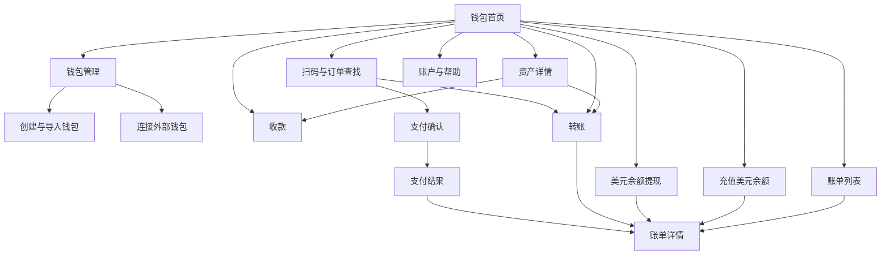
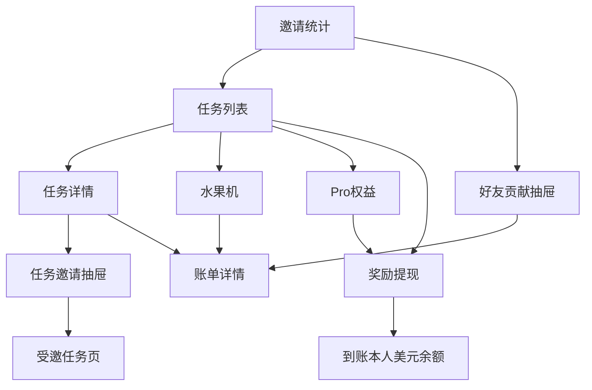

# 导航与流程

本页只说明页面关系，具体展示、按钮和弹窗见 [产品目录](README.md) 中的各页面。

## 用户端导航

底部固定“钱包／任务／邀请”，钱包为默认首页。二级页面使用返回按钮，不保留底部导航。账户与帮助从头像进入，登录与钱包准备按需出现，不阻塞任务浏览和可用的非钱包功能。

上图邀请抽屉仅对已完成首个任务的用户开放；受邀任务页来自分享链接，可直接进入。本人打开自己的链接回任务页。

## 五条主要体验路径

| 路径 | 页面顺序 | 用户应能看懂的结果 |
| --- | --- | --- |
| 首次做任务 | 登录或静默进入 → 任务列表 → 任务详情 → 完成领奖 → 结果反馈 | 得到 1 美元待提现奖励，Pro 增加 1000 进度；没有多出 1000 可消费积分 |
| 积分换奖励 | 任务获积分 → 水果机 → 结果 → 奖励提现 → 美元余额 | 每次消耗 100 积分，奖励提现需满足条件，与链上出金分开 |
| 链上充值 | 钱包首页 → 充值美元余额 → 选钱包资产 → 报价确认 → 钱包授权 → 账单 | 原币支出、代付费用和净入账美元可核对 |
| 用户互转 | 钱包首页 → 转账 → 链上或美元账户 → 收款人确认 → 授权 → 账单 | 清楚知道转到了链上地址还是产品美元账户 |
| 商户付款 | 扫码或输入订单号 → 支付确认 → 选择美元与一种链上资产 → 授权 → 支付结果 | 两部分完成才显示整单成功，处理中和异常有持续入口 |

链上收款路径为“钱包首页或资产详情 → 收款 → 地址／收款码”，与充值美元余额入口分开。美元余额链上提现走独立出金页面及账单；奖励提现固定转入本人美元余额。

## 商户与平台导航

| 角色 | 一级导航 | 详情形式 |
| --- | --- | --- |
| 商户 | 概览、订单、创建收款单、资金与结算、接入设置 | 订单独立详情页；退款、结算、回调使用弹窗或抽屉 |
| 平台 | 工作台、用户、商户、任务、审核、异常订单、资金与结算、参数配置、操作记录 | 列表加详情抽屉，相关资金业务之间可跳转 |

两类后台共用 [登录布局](公共/后台登录.md)，账户与权限分开。商户只能操作自己的订单与资金；平台可以处理申请、异常和配置，但不能在列表里直接手动把未知付款改成成功。

## 页面与弹窗的划分

独立页面用于需要直接打开、恢复查询或较长填写流程的任务，如充值、转账、提现、订单详情。钱包选择、筛选、费用说明、确认及短结果反馈采用弹窗或抽屉。提交后的长期状态放在账单、支付结果或后台记录中，不只留在一次性弹窗。

## 原型制作顺序

1. 钱包首页、任务列表、邀请统计，以及共用钱包选择和金额展示。
2. 收款、两类转账、充值、两种提现，连通账单。
3. 任务详情、受邀任务、水果机、Pro，覆盖新老用户差异。
4. 扫码、支付确认与结果，覆盖纯余额、纯链上和组合付款。
5. 商户订单与结算、平台审核与异常处理，完成双端资金状态对应。

各阶段都先画有数据、无数据、处理中、失败四类基本状态；不按所有弹窗另计一整页。
