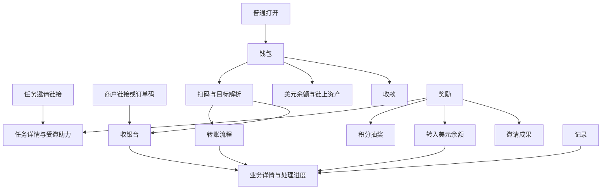

# 信息架构与交互原则

本版按用户目标组织页面，以「钱包／奖励／记录」为用户端主要导航；后台围绕订单经营与待办处理分别组织。功能范围见 [项目总览](../product/01项目总览.md)。

## 设计依据

| 原则 | 本项目采用方式 | 来源 |
| --- | --- | --- |
| 心智模型 | 先确认给谁与到账位置，再选择资金来源，降低对内部账户分类的依赖 | [NN/G Mental Models](https://www.nngroup.com/articles/mental-models/) |
| 渐进披露 | 主流程突出目标、金额和下一步，钱包选择、费用构成与规则按需展开；确认前费用总额与重要条件可见 | [NN/G Progressive Disclosure](https://www.nngroup.com/articles/progressive-disclosure/) |
| 识别优于记忆 | 使用业务码、链接、头像昵称加 idx、明确钱包与网络，减少地址手输 | [NN/G Recognition and Recall](https://www.nngroup.com/articles/recognition-and-recall/) |
| 状态可见与错误恢复 | 等待授权、确认、审核和异常分别呈现，可退出后继续查询 | [NN/G Usability Heuristics](https://www.nngroup.com/articles/ten-usability-heuristics/) |

这些原则支持设计推导，不证明某个导航一定提高转化。把邀请放入奖励是因为邀请必须依附任务，把记录提升为主要入口是为了异步交易恢复；通过原型观察再调整权重。

## 导航与入口

底部导航只在三个主要页面固定显示。二级流程提供返回；外部直达时提供回钱包或奖励的明确入口。返回恢复来源列表筛选、任务上下文和未提交表单。登录、连接钱包和外部签名不把用户送回无关首页。

账户与帮助从头像进入，钱包管理也可从钱包选择抽屉进入。未准备链上钱包不阻止任务与美元账户功能。

## 信息层级

钱包首页依次展示账户与扫码、进行中事项、美元余额、高频收转操作、链上资产、最近记录。钱包切换放在链上区域，切换不改变产品用户。

奖励首页展示待提现奖励、任务积分和独立 Pro 进度，再给当前最相关下一步、任务列表及邀请入口。主要提示随资格变化，按钮位置和导航保持稳定，不能隐藏其他已可用操作。

记录页以业务事件呈现，展开资金分项。冻结、扣款和退回属于同一操作的阶段，不能误显示成多次消费。金额按单位显示，不跨美元、币量和积分直接汇总。

后台列表处理检索和筛选；订单、结算执行和复杂异常详情可直接打开并恢复。短配置与筛选用抽屉，危险资金动作确认展示对象、金额、目标及影响。关闭抽屉保留原列表条件。

## 页面与组件选择

| 内容 | 形式 | 原因 |
| --- | --- | --- |
| 转账、充值、出金、任务、收银台 | 可恢复页面或有明确步骤的流程 | 会离开应用、授权或长时间等待 |
| 交易、退款、结算和异常详情 | 持久详情页 | 需要反复查状态和分享授权范围内的入口 |
| 钱包、资产、筛选、费用解释 | 底部抽屉，后台侧栏 | 短选择，关闭后回原上下文 |
| Pro 权益 | 规则面板与进度明细，可按内容增长独立 | 解释权益，不额外增加领取步骤 |
| 完成反馈 | 页面内状态或短反馈，提供记录入口 | 成功不能只存在于消失的弹窗 |

## 通用交互规则

- 加载显示占位，失败显示原因和重试，未知金额不能写成 0；空列表与筛选无结果使用不同提示。
- 金额显示单位、实际扣款和实际到账；网络费不同资产时分开列，不把估值当数量。
- 禁用按钮给出原因与可执行下一步；异步状态显示最近查询时间和当前责任，不伪造固定进度百分比。
- 表单提交使用原操作标识防重；响应丢失先查原单。重复点击禁止与服务端幂等同时存在。
- 账户、网络或报价变化清除未提交确认；已提交原单保持目标快照，不随当前选择改变。
- 只在明确可安全终止时显示取消；离开页面与取消业务不是同一个动作。
- 扫码权限失败保留相册、粘贴或手动查找；未知码不自动打开任意链接；多个有效码先展示类型与摘要供选择。
- 按钮使用「转给」「充值到账」「转入美元余额」「转出到链上钱包」等明确结果的文案。
- 可复制编号与完整地址，缩略显示不能阻止用户查看完整确认信息；颜色不作为状态唯一提示。
- 文案与可访问性标签进入国际化资源；时间按用户时区呈现，后台查询说明统计时区。

## 六条原型主路径

先验证首奖、新老用户助力、给他人充值并切换付款来源、组合付款跳出返回、奖励转入后链上转出、商户人工结算。每条含正常、处理中和失败恢复。

让测试者解释资金来源、去向与奖励条件，观察是否误以为已到账、重复付款或需要重新做任务。记录首次入口、完成情况、求助与中断恢复行为，再调整页面划分；不在业务原型尚不清楚时先用视觉装饰补救。
