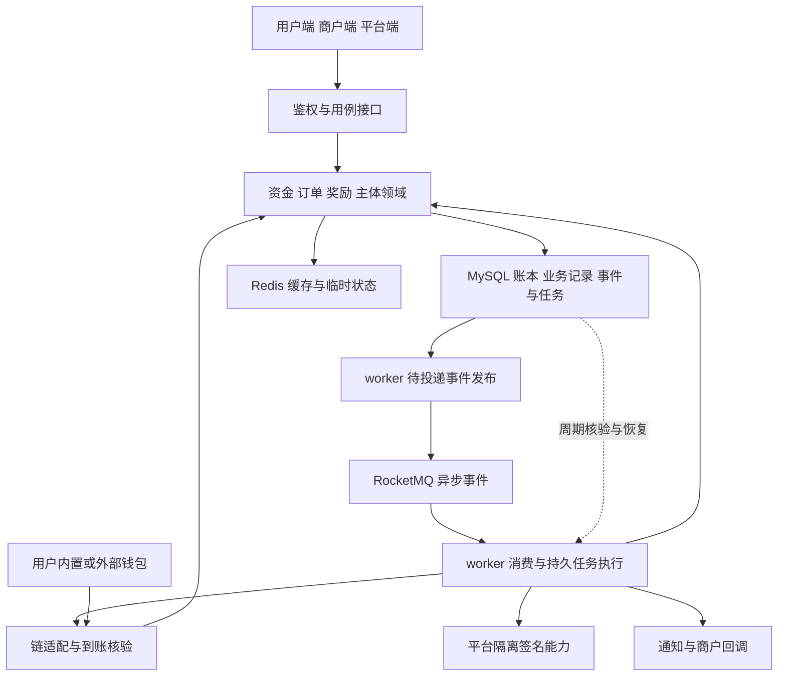

# 系统架构与契约

本页为实现边界设计，不是已部署架构或可调用接口。已确认 Go/go-zero/goctl + MySQL/InnoDB，重视以仓库 SQL DDL 为源的模型生成；前端采用 React + TypeScript + Vite、pnpm workspace、Less 与 i18next。工程采用单仓库、一个后端 Go module，用户、商户、平台三个独立前端应用，分别构建并按独立域名方向部署。确认依据见 [1.1 讨论记录](工程工作记录/01-工程基础/1.1-工程结构与模块划分/01讨论记录.md)。

Q04、Q05 已确认：领域模块在一个后端工程中协作，关键资金写入统一入口，跨模块原子动作共享事务；按 2026-10-28 部署讨论修订为一个后端程序/进程同时承载 HTTP API 与后台任务，三个静态站点和业务数据库保持原边界，平台签名单独隔离。后台任务仍是独立职责，不再要求独立 worker 部署；需要资源隔离时再拆进程。目录随业务增长，允许授权的只读聚合 SQL。Q06 按用户要求将 Redis 与消息中间件纳入架构，本地复用现有 Redis 和 RocketMQ。Q07 已确认 `.api` 为 HTTP 唯一权威源，前端类型从同一源派生；SQL DDL 与增量迁移管理数据库定义，1.2 已通过隔离示例验证生成与迁移，实际入口与限制见 [契约生成与迁移](../engineering/契约生成与迁移.md)。Q08 已确认 1.1 只初始化最小工程清单与结构约定，独立 App 框架、组件版本与具体接入机制由所属工作项落实。

## 系统边界

用户密钥留在本地或外部钱包；平台签名只处理平台资金钱包，不能获得用户密钥。连接协议处理账户与签名会话，资产查询、到账核验、资金归属和商户订单仍由业务服务负责。

图中的事件发布与消费是后台任务模块中的不同角色，首版与 HTTP API 在同一后端进程运行，箭头不表示进程间 RPC。多副本需通过共享持久状态、原子任务领取和幂等协作；进程内 goroutine 或 mutex 不能提供跨节点的唯一执行。MySQL 保存权威业务与资金状态，Redis 承接缓存及后续明确的临时状态，RocketMQ 承接异步分发；引入 MQ 不改变领奖、余额支付等共同事务边界。1.3 已验证基础客户端连通性；MQ 消息收发交 1.5，可靠投递仍交 3.5，不把连接诊断算作可靠投递通过。原选型依据见 [1.1 中间件方案](工程工作记录/01-工程基础/1.1-工程结构与模块划分/02实施方案.md#q06redisrocketmq-与持久任务的关系)。

## 领域职责

| 领域 | 职责 | 关键边界 |
| --- | --- | --- |
| 身份与主体 | 产品用户、外部身份、企业商户、后台账户权限 | 钱包连接不等于登录；商户隔离由服务端执行 |
| 请求解析与报价 | 收款对象、金额模式、通道、费率、汇率、限额及版本 | 不信任二维码可变金额或客户端成功状态 |
| 账本 | 分录、可用与冻结、资金占用、余额查询与冲正 | 业务不能直接改余额字段绕过凭证 |
| 支付与充值 | 订单、付款尝试、组合、实收分配和成功判断 | 充值与商户支付不能重复使用同一实收 |
| 出金、退款与结算 | 额度、审核、目标快照、执行任务及恢复 | 结果未知不能释放后再出一笔 |
| 链上通道 | 交易构造、提交线索、监听、最终确认、回滚检测 | 各链的失效或替代语义分别实现 |
| 任务与奖励 | 类型资格验证、首奖、邀请、积分、Pro、抽奖、奖励申请 | 任务验证可扩展，公共结算只能发生一次 |
| 风险与运营 | 统计判断、人工审核、配置、异常责任 | 风控拒绝不使已到款消失 |
| 通知、对账与审计 | 可靠事件、差异核对、补记依据与操作记录 | 通知失败不能改支付事实 |

接口层负责解析、鉴权与响应，用例编排事务与外部依赖，领域模块表达规则。数据库访问、链 RPC、签名、时钟、随机源与通知形成可替换边界，便于确定性验证。

## 数据对象

以下是概念模型，进入实现时再确定完整字段、索引、保留周期和生成链。

| 对象 | 必要信息与约束 |
| --- | --- |
| 用户与外部身份 | 产品 idx、状态；邮箱用户可无 TG，产品、外部身份及绑定关系职责分离；身份的稳定平台标识不随绑定记录重建而变化 |
| 登录身份与凭证 | 邮箱验证码、Telegram 授权关联产品用户；邮箱验证成功后创建或登录对应用户，不引入邮箱密码；认证与会话分别承担职责 |
| 企业与商户 | 归属、资料版本、状态、主账户、费率与通道版本 |
| 钱包会话与地址 | 用户、类型、网络、公开地址、能力、会话状态；无用户密钥 |
| 收款请求 | idx、目标类型与快照、金额规则、访问标识、有效期、复用规则 |
| 报价 | idx、金额单位、币量、汇率、费用、精度、期限、锁价及规则版本 |
| 业务主单与付款尝试 | 用途、对象、付款身份、受益人、来源组成、报价、状态版本；订单最多一个有效尝试 |
| 冻结与占用 | 账户、金额、归属业务、核销或释放原因；两种终态互斥 |
| 链上实收与分配 | 网络、交易、事件位置、真实资产、地址、数量、确认；分配总量受实收上限约束 |
| 账本凭证与分录 | 业务幂等、单位、借贷、原凭证与冲正关系；按单位平衡 |
| 出款任务 | 用途、主单分项、来源目标、金额、授权、提案、广播、替代关系、执行锁 |
| 退款与结算 | 来源构成、额度、占用、目标与报价快照、执行分项、状态 |
| 任务与参与 | 类型、所需身份、次数周期、外部身份资格消耗、受益产品用户、邀请上下文、验证结果与完成记录；换绑不重置消耗 |
| 邀请与奖励流水 | 产品用户的直接关系、首奖唯一性、实际任务积分、分成来源、Pro 进度变化；奖励归属不随外部身份换绑迁移 |
| 抽奖记录与奖励申请 | 投入、版本、结果、现金；提现申请状态与退回或转入关联 |
| 事件与投递记录 | 事件 idx、业务版本、快照、目标、重试与应答 |
| 异常与审计 | 证据、主体、前后状态、原因、责任人、下次处理时间 |

对外业务标识沿用 idx。金额用精确表示，临时有限增长时序标识可用 number，不能把该精度取舍扩展到结算金额。

## 状态与前端呈现

| 对象 | 主流程 | 重要分支 |
| --- | --- | --- |
| 商户订单 | 待支付 → 付款处理中 → 已支付 | 关闭新付款、过期；退款另有状态，保留支付事实 |
| 付款尝试 | 已准备 → 待授权 → 提交待核验 → 确认中 → 完成 | 安全取消、确定失败、异常 |
| 充值 | 待转入 → 发现到账 → 确认中 → 已入账 | 少付、晚到、无归属；关闭入口不停止监听 |
| 冻结 | 已冻结 → 已核销 | 或已释放，终态互斥 |
| 出款 | 待执行 → 签名请求 → 可能执行或已广播 → 确认中 → 完成 | 未知、确定未执行、替代交易核验 |
| 退款 | 申请 → 审核 → 执行 → 已退款 | 拒绝、资金不足、部分已退、异常 |
| 结算 | 申请并冻结 → 审核 → 待执行 → 确认 → 已结算 | 重报价、待备付、拒绝、异常 |
| 奖励申请 | 扣奖励并申请 → 审核或自动处理 → 已转入 | 拒绝并退回；终态不能重复执行 |
| 通知 | 待发 → 已应答 | 重试或人工待办，不影响支付终态 |

实现时状态、错误码、事件 topic、Redis key 使用具名定义。前端接收状态和允许动作，不通过错误文本猜是否可重试。未知与确定失败分开，禁止将超时统一映射为失败。

1.3 Q01 已确认普通 JSON 响应结构及字符串错误码，完整定义与 HTTP 映射见 [1.3 实施方案](工程工作记录/01-工程基础/1.3-后端公共基础/02实施方案.md)。请求受理或查询成功与业务对象完成分开，前端按错误码国际化并通过 traceId 关联诊断；当前规则已在 1.3 健康接口和公共错误出口落实；业务接口仍未实现。

## 概念接口清单

| 能力 | 输入重点 | 返回或一致性要求 |
| --- | --- | --- |
| 邮箱验证码请求 | 邮箱、验证用途及请求上下文，具体源定义待实施 | 发送结果不代表登录成功；有效期、频控、尝试及重发规则待细化 |
| 登录与恢复上下文 | 邮箱及验证码或 Telegram 授权材料、原业务标识 | 验证成功后创建或登录产品用户，签发会话并恢复授权目标；邮箱登录无需 TG，不回退为设备登录 |
| 解析入口与创建收款请求 | 码或链接、目标、可选金额 | 可信对象、类型、金额约束、复用与访问规则 |
| 查询可用方式与报价 | 客户端、业务、来源目标、金额模式 | 可用资产及原因，币量费用期限、报价 idx |
| 余额互转 | 目标、报价、幂等键、安全校验 | 唯一业务、双方摘要，原子扣增 |
| 充值与代充值 | 受益人、来源、报价、幂等键 | 受益人固定、可签名请求和归属方式 |
| 用户链上转出 | 目标快照、报价、安全验证 | 占用、审核与执行状态 |
| 钱包交易线索上报 | 业务 idx、哈希或协议线索 | 当前状态，不接受客户端宣称完成 |
| 商户申请与订单创建 | 归属、资料、商户订单号、金额 | 状态、订单 idx、支付链接，同号异参冲突 |
| 支付准备与确认 | 订单、组成、报价、幂等、安全校验 | 唯一有效付款尝试、预留或即时结果 |
| 安全取消与状态查询 | 业务 idx、预期版本、原因 | 是否实际终止、资金占用、允许动作 |
| 退款、结算申请与执行 | 原业务、额度、目标版本、报价、原因 | 主单分项、占用、审核、唯一出款任务 |
| 任务列表与验证 | 产品用户、所需外部身份、任务、邀请上下文、请求标识 | 缺失身份及绑定引导、对应身份的当前资格、按产品用户计算的收益、原结算结果 |
| 抽奖与奖励转入 | 操作标识、金额或固定投入、规则版本 | 确定结果或申请状态，重试不重复结算 |
| 记录与邀请统计 | 主体、筛选、分页 | 分单位业务记录、关联分项、可见贡献 |
| 异常处理与对账 | 证据、处理类型、预期版本、原因 | 预览与执行结果、凭证和审计 |
| 配置与通知 | 配置版本、事件标识和应答 | 新版本生效范围、可靠投递诊断 |

所有写操作按主体与动作划分幂等范围，保存参数摘要，同键异参报冲突；保留窗口覆盖实际重试与资金处理期。错误结果包含具名代码、业务 idx、可重试语义和允许动作。失败不伪装成空数据或成功。

## 原子性与异步恢复

余额互转、纯余额支付、任务奖励、抽奖及奖励转入的最终账务，在各自数据库事务内完成。会产生通知的业务同时写持久事件，再异步发送；不能先通知支付成功再提交账务。

Q06 具体建议采用事务内待投递事件（outbox），提交后由 worker 发布到 RocketMQ，再由消费者调用业务用例；重复投递按事件和消费者范围持久去重，处理结果提交后确认消费。消息投递重试与资金执行状态分别管理，MQ 故障保留待投递依据，重试耗尽保留死信与异常处理入口。具体机制在 3.5 验证，不把消息已发或消费确认当作链上到账证据。

Redis key、RocketMQ topic 与消费组按项目/环境命名。可重建缓存支持受控回查，账务写入核对 MySQL；未来会话、限流若使用 Redis，故障策略由相应能力单独落实。缓存失效与 MQ 重试都不能代替业务约束、账本幂等和唯一出款任务。

数据库与链上不能构成单个普通事务。先保存请求与必要占用，后执行链上动作，通过监听及独立查询恢复结账。实收事件去重、业务幂等和唯一执行任务分别约束重复记账与重复出款，不能只依赖按钮禁用或短期缓存锁。

监听保存游标、缺口、确认依据与回滚证据。原交易可能仍有效时，仅按通道规则重播同一交易或执行受控替代；不能另发无关联交易。外部签名提案一旦可执行即进入在途管理。

## 通道落实

TON 使用 TON Connect 为已确定 Mini App 接入方向；其他链沿用历史 SDK 候选，实际 SDK、版本、费用及兼容性在选型时查官方资料并验证，不把旧文档中的能力描述当成当前承诺。

每条通道配置网络、资产完整标识、精度、地址规则、到账关联、事件去重、确认要求、签名与广播、失效证明、代付与费用、替代执行、限额和维护状态。钱包品牌只用于兼容测试，不作为白名单。

内置钱包还需客户端密钥保护、备份与恢复验证；平台签名服务单独落实权限、备份、恢复及出款约束。详见 [待落实事项](../decisions/决议与待落实事项.md)。
