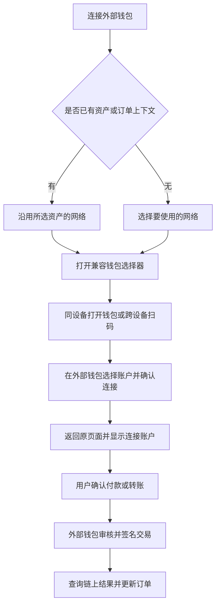

# DexWallet 外部钱包接入方案

日期：2026 年 10 月 18 日。产品原则已确认：App 和 Telegram Mini App 均不按品牌限制外部钱包。以下协议选型与交互为建议方案，尚未实施。

建议采用统一的“连接外部钱包”入口，复用成熟 SDK 的钱包选择、会话和签名能力。TON 使用 TON Connect；Base、Solana 优先使用 Reown AppKit 与 WalletConnect；TRON 通过专用适配器接入 WalletConnect，并按需要补充官方钱包连接方式。网络、币种继续遵循 [首版资产范围](网络币种与外部钱包建议.md)。

## 01 接入原则

- 不维护固定品牌白名单。此前提及的 Tonkeeper、Telegram 内置钱包、MetaMask、OKX、Trust Wallet、Binance Wallet 用于推荐展示与重点兼容测试。
- 钱包可用范围取“当前客户端开放网络、钱包支持的网络与签名方法、当前设备支持的连接方式”的交集。接入协议不等于所有钱包都兼容所有网络。
- 按当前业务请求权限。支付 Base USDC 时只要求 Base 所需能力，不强制钱包同时支持 TON、Solana、TRON。
- 钱包连接、交易授权、链上到账分别处理。连接成功不代表允许自动扣款，返回 App 不代表交易成功。
- 连接外部钱包无需导入助记词或私钥。用户在外部钱包中确认交易；DexWallet 内置钱包的创建、导入是另一条入口。

## 02 协议与组件建议

| 客户端及网络 | 推荐方案 | 适用方式 |
| --- | --- | --- |
| App 的 TON | TON Connect 官方 SDK 与选择器 | 通过官方钱包注册表发现钱包，使用钱包支持的手机链接或二维码连接 |
| App 的 Base | Reown AppKit 的 EVM 适配器，使用 WalletConnect | 复用钱包目录、选择器、会话与授权流程，只配置已开放的 Base 网络 |
| App 的 Solana | Reown AppKit 的 Solana 适配器，配合必要的现成连接器 | 通过 WalletConnect 或对应钱包的移动端连接器签名；按能力决定具体通道 |
| App 的 TRON | WalletConnect v2 的 TRON 适配器 | 复用协议与会话能力，按客户端技术栈接入；有实际兼容缺口时补充 TronWallet Adapter 或官方连接方式 |
| Telegram Mini App | TON Connect 官方 SDK 与选择器 | 仅开放 TON 网络的 TON、USDT；不加载其他链的连接入口 |

Reown AppKit 是面向应用的连接组件，WalletConnect 是应用与钱包之间的连接协议。我们接入的是应用侧组件，无需为外部钱包实现钱包侧 SDK。[Reown AppKit 概览](https://docs.reown.com/appkit/overview)

React Native 版 AppKit 已有 EVM、Solana 适配器和统一连接组件；其 Solana 文档也说明部分钱包虽有 Solana 资产管理能力，却没有对应的 WalletConnect 连接能力。因此需要按接口验证，而非按钱包宣传的链列表推断。[React Native 接入说明](https://docs.reown.com/appkit/react-native/core/installation)

TRON 官方提供 `@tronweb3/walletconnect-tron`，支持 WalletConnect v2 的二维码和深度链接连接。它不是给 EVM 适配器填一个 TRON 网络参数就能替代的能力。[TRON WalletConnect 文档](https://developers.tron.network/docs/walletconnect-tron)

TON 官方建议一般场景优先使用原生 TON Connect；其 SDK 的 WalletConnect 扩展主要用于特定集成需求，且在 Telegram Mini App 中不可用。本项目首版 TON 直接使用 TON Connect。[TON 官方说明](https://docs.ton.org/applications/ton-connect/how-to/walletconnect-support)

App 技术栈尚未确定，不能假设所有客户端 SDK 的能力一致。若使用 React Native，可优先验证上述现成 EVM、Solana 适配器；若使用 Swift、Kotlin 或 Flutter，需要按对应 SDK 能力落实相同产品流程。首版先复用各协议的官方选择器，不为了统一视觉重新开发整套钱包目录和连接协议。

## 03 用户操作流程

钱包页保留“创建或导入内置钱包”和“连接外部钱包”两个并列入口。用户不需要理解 TON Connect、WalletConnect 等协议名称，协议名称只在所复用组件需要展示时出现。

### 钱包选择器

优先展示最近使用及 SDK 能够检测到的可用钱包，提供搜索或“全部钱包”入口。不以是否安装成功检测作为可用性的唯一依据；手机系统可能限制检测，用户仍应能从完整兼容目录选择钱包。

同一部手机优先点击唤起钱包，二维码用于另一设备扫码，不要求用户在本机扫描自己的屏幕。提供复制连接链接等 SDK 支持的备用方式。没有安装钱包时，通过明确操作进入官方安装入口，不自动跳转陌生下载站。

Reown 提供推荐钱包排序、额外连接器和官方目录能力。使用推荐排序时保留全部兼容钱包入口，不设置品牌白名单；例如需要 Phantom 专用连接方式时，可评估它提供的现成连接器。[AppKit 配置说明](https://docs.reown.com/appkit/react-native/core/options)

### 返回原页面

连接或签名开始前保存当前订单、所选资产、金额及来源页面。手机返回后恢复这些信息；如果自动返回失败，用户手动切回 DexWallet 也能继续。

连接时显示“等待钱包确认”，用户拒绝后回到选择器。授权超时可以重试；交易提交后暂时无结果时先查询链上状态，不因切回 App 或超时而重复发送。

## 04 钱包管理与资金状态

| 对象 | 建议展示与行为 |
| --- | --- |
| 已连接钱包 | 钱包名称、网络、缩略地址、连接状态；支持切换、复制地址和断开连接 |
| 多网络账户 | 分别记录账户所属网络和已批准能力；不能因为同一钱包品牌而把不同地址合并 |
| 会话恢复 | 重启后恢复仍有效的会话，过期时提示重新连接；用户主动断开后不自动重连 |
| 账户或网络变化 | 重新校验余额、费用和当前订单要求；付款确认后账户变化必须重新确认 |
| 地址记录 | 提现地址或已保存地址与可签名会话分开；断开钱包连接不删除历史交易 |
| 连接完成 | 仅表示账户及连接能力可用，不改变产品登录身份或自动绑定邀请关系 |
| 钱包签名返回 | 标记待提交或待链上确认，具体取决于协议是否同时广播；不直接标记支付成功 |
| 链上确认 | 核验网络、真实资产、金额、收款方及订单关联后更新支付状态 |

选择外部钱包时，余额和历史记录仍需要链上 RPC 或索引服务；连接 SDK 不替代资产查询、交易核验和商户订单系统。若以后将钱包用于登录或敏感账户绑定，另行验证地址控制权，不能直接信任客户端提交的地址。

## 05 开发与验收范围

先打通四条链各一条完整连接及原生币、稳定币交易路径，再扩大钱包覆盖。重点测试名单用于发现手机兼容问题，不作为产品准入规则。

| 方向 | 必须验证的用户行为 |
| --- | --- |
| 钱包发现 | 推荐列表、全部钱包入口、按当前网络筛选、未安装或无法检测安装状态 |
| 手机跳转 | iOS 与 Android 打开钱包、确认或拒绝后返回、手动切回、App 被系统回收后恢复 |
| 会话 | 多钱包连接与切换、账户变化、网络变化、断开、过期和重连 |
| 交易 | 原生币与稳定币签名、余额或手续费不足、用户拒绝、签名后广播失败 |
| 状态恢复 | 网络中断、结果延迟、重复点击、返回后继续查询原交易，避免重复付款 |
| Mini App | 在 Telegram 容器内连接、签名和返回；保持 TON 网络资产范围 |

使用 Reown 前需要配置项目标识和回跳链接；正式选型时核对当前服务额度、费用及网络可达性。资产查询和订单核验保持独立，使某个连接服务短时不可用时仍能查看已产生的交易记录。

SDK 中的社交登录、买币、兑换等附带功能只按本项目已确认范围启用。连接外部钱包本身不自动增加跨链兑换、任意代币支付或新的身份体系。
