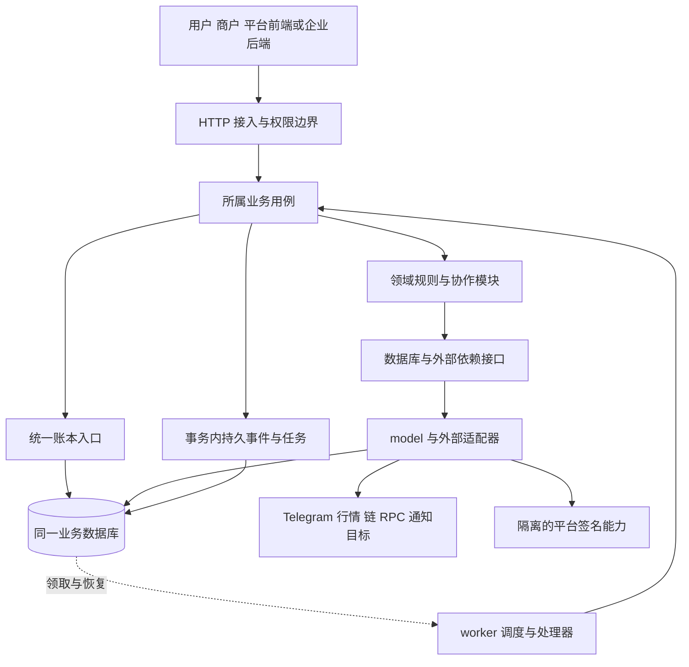

# 1.1 工程结构与模块划分 实施方案

[阶段目录](../README.md) · [全部工作记录](../../README.md) · [工作范围清单](../../../../engineering/工程阶段与工作清单.md)

方案状态：首轮讨论稿，未确认、未实施。更新日期：2026 年 10 月 26 日。待确定选项与确认依据统一记录在 [讨论记录](01讨论记录.md) 的 Q01–Q08；下文是推荐路径，目录和接口名称均非现有实现。

## 目标与工作边界

本项解决工程放在哪里、谁负责什么、如何调用与部署。依据现行 [系统架构与契约](../../../04系统架构与契约.md) 和 [工程工作清单](../../../../engineering/工程阶段与工作清单.md)，细化适合 Mini App 首发、任务奖励、美元账本与平台链上收付的模块化工程。

本轮交付为讨论与实施方案文档。确认后 1.1 的落地建议限于必要工程清单、目录入口和依赖规则；不实现鉴权、账户、账本、任务、支付、数据库业务结构、链上监听或签名。生成机制归 1.2，后端公共能力归 1.3，前端公共能力归 1.4，环境与联通归 1.5。当前无可调用 API 或应用构建结果。

## 技术栈建议与取舍

| 范围 | 推荐方案 | 项目原因与边界 |
| --- | --- | --- |
| 后端 | Go + go-zero，goctl 生成接入与模型骨架；一个 Go module | 延续候选栈与契约优先习惯；API 和 worker 共享领域代码，跨模块调用先走进程内方法，不要求 RPC 或服务注册 |
| 主存储 | MySQL/InnoDB，同一逻辑业务数据库，按领域分表 | 业务单据、资金凭证、资格与持久事件需要共同事务；不按模块拆库。InnoDB 提供事务和行锁，但一次记账仍须业务幂等、唯一约束与并发验证 |
| 数据访问 | goctl 从 SQL 生成基础 model，手写事务和业务查询扩展；资金模型默认不启用缓存生成 | 生成减少结构重复；复杂账务 SQL 与事务归所属模块。不会把自动 CRUD 当账务服务 |
| 前端 | React + TypeScript/TSX + Vite，Less、i18next | Mini App H5 与管理后台主要消费 Go API，暂不需要 SSR；SPA 的路由、查询、错误和恢复须在 1.4 明确建设。组件按业务组织，页面与样式相邻 |
| 包组织 | pnpm workspace 管理三个前端应用及实际需要的共享包；Go 独立模块 | 共享契约随同一提交演进，应用可独立构建；不引入额外 monorepo 编排框架 |
| 状态与通信 | 页面状态先用 React；建议 React Router，服务端查询按需 TanStack Query | 轮询与恢复优先满足资金状态查询；不预设全局状态库、WebSocket 或浏览器 Worker。查询重试不能触发资金写入；写操作重试须沿用原幂等标识并查询原结果 |
| 异步 | 关系库持久任务与事务事件，独立 worker 消费 | 支撑重启恢复和至少一次投递；业务实现必须容忍重复，数据库与链上仍不构成一个事务。Redis/MQ 留到有实际需要时引入 |
| 钱包 | 沿用 TON Connect 外部连接方向；内置钱包由客户端专用适配承接 | 外部连接、客户端签名、服务端链事实核验分别负责；SDK 和密钥保护在 5.1/5.3 验证，本项不选择通用助记词实现 |
| 部署 | 静态前端 + API + worker + 数据库；平台签名隔离 | 本地和测试建议容器与 Compose，生产形态在 8.2 具体化；首版无须 Kubernetes、服务网格或多个业务 RPC 服务 |

MySQL 优先主要来自现有候选栈、个人习惯和生成工具匹配，不表示 PostgreSQL 不适合账务；如果已有运维基线更适合 PostgreSQL，可在 Q01 改选，并同步重新验证生成链。React/Vite 的取舍是当前产品无需服务端渲染，不是对未来 App 框架的决定。

具体版本在对应初始化前核对并锁定：Go 写入 `go.mod`/工具链约定，前端记录 Node、pnpm 与锁文件，生成器及模板版本由 1.2 管理，容器镜像由 1.5 固定。执行脚本不得依赖浮动 `latest`。本轮没有安装依赖或验证版本组合。

## 工程目录建议

下图是分阶段目标结构，**本轮不创建这些目录**。1.1 确认后只建立实际必要的清单与入口；业务包、生成目录、worker、签名适配及部署文件随所属工作项创建，不用空文件填满规划树。

```text
DexWallet/
├── AGENTS.md                         已有，保持简短项目入口
├── docs/                             已有，设计、规范、过程与验收
├── scripts/                          已有检查；后续准备/生成/验证入口
├── backend/
│   ├── go.mod                        一个后端 module
│   ├── manifest/
│   │   ├── api/                      根 .api 引入 user/merchant/admin/open 分组
│   │   └── sql/
│   │       ├── ddl/                  完整 DDL，按领域归属
│   │       └── diff/                 已部署库的有序增量迁移
│   ├── api/
│   │   ├── main.go                   一个 HTTP 进程入口
│   │   └── internal/                 handler/types/logic/config/svc 等生成布局
│   ├── cmd/worker/main.go            后台进程入口，3.5 开始建设
│   ├── logic/<领域>/                 业务用例、规则、供外部依赖实现的接口
│   ├── model/<领域>/                 生成 model 与手写查询、事务扩展、模型枚举
│   ├── svc/                          依赖组装、事务基础、事件发布入口
│   ├── config/                       共享技术配置类型
│   ├── transport/                    响应转换与通用中间件
│   ├── error/                        具名业务错误码与语义
│   ├── daemon/                       任务领取、调度和业务处理器注册
│   ├── adapter/                      Telegram、链 RPC、平台签名客户端、通知传输
│   ├── template/                     实际需要的生成模板，1.2 验证后建立
│   └── tests/integration/            真实数据库与外部依赖测试，单测与源码相邻
├── frontend/
│   ├── package.json                  前端工作区根
│   ├── pnpm-workspace.yaml
│   ├── pnpm-lock.yaml
│   ├── apps/
│   │   ├── user/src/                 Telegram Mini App，未来 App 不放在此冒充 H5
│   │   ├── merchant/src/             企业商户工作台
│   │   └── admin/src/                平台审核、异常、配置与对账
│   └── packages/
│       └── api-contract/             按受众导出生成类型；不含会话或业务实现
└── deploy/                           后续容器构建与环境模板，不保存凭据
```

建议后端 module 名使用仓库路径 `github.com/0xabcd-k/DexWallet/backend`，在初始化时核对仓库归属并统一写入生成参数。只有一个 Go module 时不引入 `go.work`。前端 workspace 根位于 `frontend/`，不与 Go 工具管理混合。

每个前端应用在 1.4 中采用 `src/view/<业务>/index.tsx + style.less`、`src/api/request.ts`、`src/api/<业务>.ts`、`src/i18n/`、`src/app/`。接口类型共享，运行时请求客户端各应用分别组装自身会话；商户与平台不共享凭证存储。用户端的 Telegram 上下文、钱包会话与本地密钥适配归用户应用。公共 UI 或纯函数只在实际有共用需求时提取包，不先设计万能组件层。

`api/internal/logic` 仅做接口到用例的薄映射，业务规则放在 `backend/logic/<领域>`；没有业务时不创建重复转发层。`api/internal/svc` 适配共享组装，worker 只引用 `backend/svc` 及领域能力，不引用受 Go `internal` 规则限制的 `api/internal`。领域模块不反向依赖入口或完整 `ServiceContext`，所需依赖通过构造参数传入。

## 模块职责、所有权与调用

以下名称是代码组织建议；并列名称代表各自业务包，不代表独立服务。数据表最终字段由各工作项确定，表访问只能由归属模块的实现负责，不能从后台或另一个业务直接更新资金字段。

| 模块建议 | 拥有的事实与职责 | 允许协作与边界 | 落地工作项 |
| --- | --- | --- | --- |
| `identity` | 产品用户、外部身份、用户/管理会话及身份校验 | 不拥有金额或钱包密钥；企业商户归属由 merchant 提供 | 2.1–2.5 |
| `merchant` | 企业、商户、管理账户归属、启用、结算资料版本、商户 API 凭据 | 使用 identity 识别账户；不以商户资料代替资金账户，不直接执行付款 | 6.1–6.2 |
| `ledger` | 资金账户、单位、凭证分录、冻结、核销、释放与余额查询 | 为业务提供事务内记账入口；不决定订单、任务或链上交易是否成功，不反向调用这些业务 | 3.1–3.4 |
| `transfer` | 美元余额互转单据、双方业务摘要 | 同事务调用 ledger；无需链上行情、钱包连接或签名 | 3.6 |
| `task` | 任务定义、类型资格、外部验证、参与完成、任务邀请上下文和关系、助力资格；领奖事务入口 | 验证适配器只给证据；领奖用例协调 task、reward、ledger，外部验证不占用数据库长事务 | 4.1–4.2、4.4–4.5 |
| `reward` | 首奖记录、积分计算、分成计算、Pro 进度、抽奖记录、奖励转入申请 | 账户余额归 ledger；不反向调用 task，所需任务与邀请事实由领奖用例传入；抽奖、转入有自己的用例 | 4.3–4.7 |
| `request`、`quote` | 可信收款目标与请求；行情、报价及费率版本 | 资产标识与精度读取 chain 的资产定义；只返回目标/报价事实，不扣款；历史单据保存快照，内部互转不被强迫依赖外部行情 | 3.6 的账户入口、5.4–5.5、6.3–6.6 |
| `wallet` | 用户公开钱包地址、能力与会话关联；资产查询和直接交易线索 | 用户密钥由客户端控制；连接不等于登录或支付成功，普通链上转账不产生平台入账 | 5.1–5.2 |
| `chain` | 资产标识、交易构造、扫描游标、链事件、确认与回滚证据、实收和唯一分配约束 | 为 deposit/payment 提供核验与受约束实收分配；同一实收不得被两个业务各自入账；链适配器不决定业务终态 | 5.3，8.5 扩展 |
| `deposit`、`withdrawal` | 充值受益人与单据；美元链上转出申请、额度、审核、恢复 | 分别调用 quote、chain、ledger；withdrawal 使用 payout；不把未知出款视为可释放失败 | 5.5–5.6 |
| `payment` | 商户订单、付款尝试、余额与链上组成、业务成功条件 | 调用 merchant、quote、ledger、chain；先保存必要占用，核验实收后完成，不复用充值入账逻辑 | 6.3–6.6 |
| `refund`、`settlement` | 退款额度及原来源分项；商户可结算额、申请与目标快照、审核与完成 | refund 查询 payment 的可退事实；二者分别调用 ledger、payout，保留各自状态和恢复规则 | 6.8–6.9 |
| `payout`、`treasury` | 唯一出款任务、签名提案/广播/替代关系；平台备付、归集及内部调拨 | payout 通过适配器访问隔离签名能力与 chain；不自行批准退款或结算。treasury 不把内部调拨记成用户收入 | 5.3 建出款基础，6.8–6.9 复用，7.4 整合资金管理 |
| `risk`、`operations` | 统计判断与审核建议；版本配置、待办、异常责任和审计 | 审核动作调用所属业务命令，不能直接把订单改为成功或改余额；最低必要审核随业务建设 | 4.7、5.6、6.1/6.8/6.9 及阶段 7 |
| `notification`、`reconciliation`、`record` | 可靠通知投递；链上/业务/账本差异；授权记录查询与展示投影 | 只读聚合可使用专属查询适配，写操作回到归属模块；通知失败不改付款事实，对账差异不能无依据补款 | 3.6、6.7、7.4，随业务提供最低必要记录与核对 |

### 依赖方向



图表示运行调用与数据流；组装代码负责把适配器注入用例，不允许领域包导入启动入口。独立 worker 与 API 运行相同领域用例，不能另写一套余额更新逻辑。持久事件和任务通过数据库连接两个进程，不依赖进程内消息维持正确性。

关键调用约束如下：

1. **资金写入单向依赖。** payment、transfer、reward 等调用 ledger，ledger 不回调业务。各业务拥有单据，ledger 拥有资金变化。跨模块不直接调用对方 model 改表。
2. **事务由最外层业务用例协调。** 一次领奖将任务完成/资格、邀请关系、奖励/Pro、分成与账本置于同一事务；协作模块接受同一事务上下文，不各自提前提交。余额支付同理。事务基础在 1.3，具体一致性在 3.4、4.5、6.4 验证。
3. **任务与奖励避免相互调用。** task 领奖入口调用 reward 的计算与记账协作能力；reward 所需任务/关系信息以明确参数提供，不反向查询 task 服务。抽奖与奖励转入入口留在 reward，不借用任务领奖状态。
4. **链事实与业务判定分开。** worker 先让 chain 保存核验证据，再调用 deposit/payment 或出款所属业务的处理入口；相关实收分配、账本和业务终态在同一数据库事务内约束。chain 包不反向 import payment/deposit，业务路由在 worker 处理器组装。
5. **出款执行与批准分开。** withdrawal/refund/settlement 在事务中保存授权快照、占用和唯一 payout 任务；提交后 worker 调用签名/广播。payout 保存执行事实，处理器再交回所属业务结账。发生超时查询原任务，不构造第二笔无关联出款。
6. **外部调用不放入资金事务。** 任务验证、RPC、签名、回调在事务外执行；结果进入事务时重新核对资格、版本与幂等。未知保留追踪信息，不能返回普通成功值或直接释放资金。
7. **运营入口不越权写表。** 管理端只发起明确命令，所属业务检查权限、前置状态及资金约束。列表聚合不获得跨领域任意写能力。

金额精度、错误码具体集合、幂等键保留期与锁策略不在 1.1 定义；沿用精确金额带单位、API 字符串传值、对外 idx、具名枚举和错误语义。后续不得以目录已确定为由跳过这些契约讨论。

## 契约、生成与手写边界

推荐以 `backend/manifest/api/` 下的 `.api` 为 HTTP 唯一权威源，按 user、merchant、admin、open（企业服务端商户 API）组织分组，统一生成一个 API 工程。分组是消费端和权限边界，不是四个后端服务；实际 URL、认证及字段由后续各项确定。

| 内容 | 权威源与产物 | 手写边界与后续验证 |
| --- | --- | --- |
| HTTP | `.api` → Go 接入类型/路由与 TS 类型 | 1.2 验证选定 TS 插件，或经可重复生成的 OpenAPI 中间产物生成；两条方案只选一条，不手改中间定义。业务接口按所属工作项增加 |
| 数据库 | `manifest/sql/ddl` 完整结构 + `diff` 增量变更 → model | 生成与迁移执行分开；`*_model_gen.go` 不手改，自定义查询/事务在非生成文件；完整 DDL 与从旧版本迁移后的结果需一致 |
| 接入骨架 | goctl 模板与参数 → handler、types、logic、svc 等 | 1.2 实测各文件覆盖行为；首次生成 logic/svc 不等于永远禁止手写，也不假定所有文件都可安全覆盖 |
| 业务规则与客户端请求 | `logic/<领域>`、各应用 `src/api/` 手写 | 生成 DTO 不进入核心业务计算；在接入边界转换单位、状态和错误。客户端包装层复用生成类型，不复制另一套字段定义 |
| 错误、枚举、事件 | 错误码在 `error/`，模型枚举在所属手写 model，事件 topic 与发布入口在 `svc/` | 领域通过窄接口使用事件发布器；若引入 Redis，key 归统一命名空间，避免散落字面量；跨端值从选定契约派生 |

前端 `api-contract` 按消费端导出类型，避免用户应用无意引入管理端运行时能力；共享包不含登录状态、密钥、收费计算或权限判断。当前没有内部 RPC 或跨端二进制协议需求，不创建 Protobuf 工程。可重复生成、类型检查与迁移验证均是后续交付证据，本轮不宣称已运行。

## 部署单元与启用时点

| 单元 | 首版建议 | 责任及启用时点 |
| --- | --- | --- |
| `web-user` | 用户静态站点，独立域名/构建产物 | Telegram Mini App；1.4 建前端基础，1.5 测试部署，8.3 真实发布验证 |
| `web-merchant`、`web-admin` | 两个独立静态站点，可共用静态托管基础设施 | 商户与平台分别发布、分别会话；独立包本身不代替服务端鉴权 |
| `api` | 一个后端 HTTP 进程，按受众划分路由；管理入口可由反向代理限制访问 | 1.3 建基础，阶段 2 才实现登录权限；不在无权限时对外开放业务接口 |
| `worker` | 独立进程，和 API 同源同版本构建、共享领域包 | 3.5 引入持久任务；5.3 加监听和出款，6.7 加通知。任务种类独立并发配额，必要时按角色拆进程，不复制业务实现 |
| 主数据库 | API/worker 共享一套逻辑业务库 | 1.3 连接基础、1.5 隔离测试库；生产备份与恢复在 8.2 验证 |
| 平台签名能力 | 独立信任边界；服务或外部受控工具待选 | 5.3/O09 确定；API/普通 worker 不持有平台私钥。绑定唯一出款任务、目标、金额与授权；不要求现在新增签名服务代码 |
| 迁移执行 | 发布中的显式一次性任务，独立于 API/worker 启动 | 1.2 建机制，1.5 验证测试库；数据库权限与生产执行流程在部署阶段落实 |

API 与 worker 可用同一构建版本的不同启动入口；拆进程是为了请求延迟与后台恢复各自管理，不因此改为跨服务账本。worker 必须支持进程退出后恢复，通知积压不得耗尽链监听配额；具体任务领取及租约在 3.5 确定。

本地/测试 Compose 是建议，不等于生产必须单机。签名隔离需独立凭据、进程/主机及访问约束方案，不能只以同机换一个容器宣称完成。具体容量、域名、证书、日志平台、备份位置与恢复指标在 1.5/8.2 按环境讨论，本轮不创建或发布外部资源。

## 确认后的实施顺序与交接

1. 在讨论记录逐项确认 Q01–Q08，标明未采用方案与原因；必要结构选择未确定时只继续文档讨论。已有产品结论不重复确认。
2. 确认后将结构决议同步到系统架构、开发规范；按授权建立最小后端 module 与前端 workspace/应用清单，锁定本次实际使用的基础工具版本。目录只随真实文件创建，不填充空业务服务。根 `AGENTS.md` 只加已经可用的入口。
3. 核对 module/package 路径、前端共享依赖方向与 API/worker 的 Go `internal` 边界，记录 1.1 实际产生的文件和检查结果。若没有可运行应用入口，明确记录，不添加返回假成功的占位接口。
4. 交给 1.2 建立最小 API/SQL 示例、生成与迁移机制；交给 1.3 建立配置、连接、事务、错误、日志与健康检查；交给 1.4 建立路由、请求、国际化和页面壳。
5. 由 1.5 联合前项验证干净环境启动、生成、类型检查、构建、迁移与示例联通。worker 业务机制在 3.5、钱包能力在阶段 5 推进，不能因 1.1 目录已有名称就宣布相关能力完成。

本轮不新增数据模型或 API 字段，不运行数据库迁移；权限、并发、幂等和恢复在此只确定责任归属，具体场景随所属业务实现与验证。1.1 不承担资金或鉴权的功能验收。

## 验收条件

| 层次 | 可观察条件 | 验证方式与限制 |
| --- | --- | --- |
| 本轮方案文档 | 技术栈、目录、职责、调用、部署齐全；每项新增建议有 Q 编号；既有确认、推荐与待落实不混淆 | 人工交叉核对入口/台账/架构/清单；运行 `python3 scripts/check_docs.py`、`git diff --check`；仅证明文档检查 |
| 1.1 确认后落地 | 工程清单与确认目录一致；没有业务代码提前实现、重复契约源或跨端凭证共享 | 核对实际文件与依赖；锁定版本可追溯；对实际存在的代码运行相称检查，不编写占位业务测试 |
| 生成与基础交接 | 生成可复现，手写扩展不被覆盖；前端分别构建；worker 引入后与 API 使用同一领域能力 | 1.2–1.5 验证生成与前后端基础，3.5 验证 worker 接入；不作为本轮或纯目录初始化已通过的检查 |
| 后续领域验证 | 领奖与余额支付无部分提交；重复实收不重复分配；未知出款不重复执行；通知失败不改支付事实 | 3.4/3.5、4.5、5.3、6.4–6.9 编写行为测试及独立真实依赖验证，本项只检查设计能容纳这些边界 |

实施后证据写入 [验证记录](04验证记录.md)，并关联 [实施记录](03实施记录.md)。本轮文档检查通过不代表 1.1 工程落地完成或任何通道开放。

## 官方资料核对与适用范围

核对日期：2026-10-26。以下资料支持工具能力判断，具体工程取舍来自本项目需求，不是官方替本项目确认选型；未做安装、性能或真实钱包兼容测试。

- goctl 提供 API 与模型生成入口，MySQL 模型支持从 SQL 生成及选择有无缓存，适合作为候选生成链。见 [goctl CLI](https://go-zero.dev/reference/cli-guide/) 与 [goctl Model](https://go-zero.dev/reference/cli-guide/model/)。TS 链与定制目录仍须在 1.2 实测。
- InnoDB 提供事务提交/回滚与行级锁，支撑本方案的关系库基础；不会自动提供业务级幂等。见 [MySQL InnoDB](https://dev.mysql.com/doc/refman/8.4/en/innodb-introduction.html)。此处引用 8.4 手册说明能力，不代表已选定生产版本。
- React 官方列出 Vite 的 TypeScript 起步方式，也明确自行搭建 SPA 需要处理路由和数据获取等能力。本项目因 H5/后台与 Go API 的职责划分推荐该路径。见 [Build a React app from Scratch](https://react.dev/learn/build-a-react-app-from-scratch)。
- pnpm 支持 workspace 与本地包依赖，匹配多个应用共享类型的目录方案。见 [pnpm Workspace](https://pnpm.io/workspaces)。
- TON Connect 是 dApp 与钱包的连接协议，连接过程不需要 dApp 接触用户密钥；它不能替代内置密钥保护、平台账本或到账核验。见 [TON Connect overview](https://docs.ton.org/applications/ton-connect/overview)。

## 方案确认与变更

2026-10-26：形成首轮建议，所有新增选项待用户讨论确定。本轮未修改全局架构为已选技术栈，也未提升决议台账 D12 的状态。后续逐项确认时同步讨论记录、本文及受影响的全局设计；若改变事务边界、客户端能力或签名隔离，说明影响并回到对应 Q 项讨论。确定后进入 [实施记录](03实施记录.md)。
