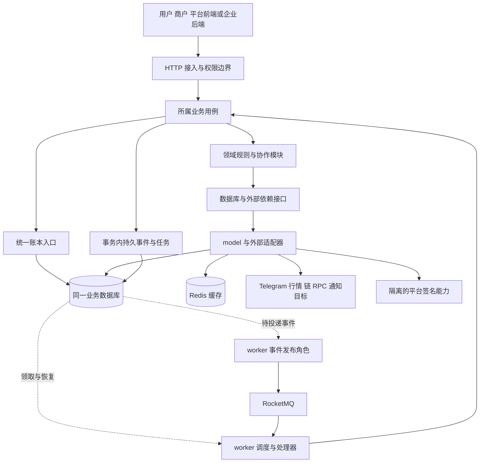

# 1.1 工程结构与模块划分 实施方案

[阶段目录](../README.md) · [全部工作记录](../../README.md) · [工作范围清单](../../../../engineering/工程阶段与工作清单.md)

方案状态：部分确认，未实施。更新日期：2026 年 10 月 26 日。Q01–Q07 的工程方向已确认，Q06 纳入 Redis 与消息中间件并复用本地 Redis/RocketMQ，Q07 确定契约权威源；具体接入与生成机制随所属工作项落实，Q08 待确定。确认依据统一记录在 [讨论记录](01讨论记录.md)。下文目录和接口名称均非现有实现。

## 目标与工作边界

本项解决工程放在哪里、谁负责什么、如何调用与部署。依据现行 [系统架构与契约](../../../04系统架构与契约.md) 和 [工程工作清单](../../../../engineering/工程阶段与工作清单.md)，细化适合 Mini App 首发、任务奖励、美元账本与平台链上收付的模块化工程。

本轮交付为讨论与实施方案文档。确认后 1.1 的落地建议限于必要工程清单、目录入口和依赖规则；不实现鉴权、账户、账本、任务、支付、数据库业务结构、链上监听或签名。生成机制归 1.2，后端公共能力归 1.3，前端公共能力归 1.4，环境与联通归 1.5。当前无可调用 API 或应用构建结果。

## 技术栈建议与取舍

已确认技术栈、单仓库与三个前端应用、Q04 模块与共同事务边界、Q05 API/worker 等运行单元；Q06 要求 Redis 与消息中间件现在进入架构，本地复用现有 Redis/RocketMQ；Q07 确定 `.api` 与 SQL 的权威源地位。缓存策略、消息投递细节、路由/查询库、版本及具体生成配置在所属工作项细化；Q08 仍待确定。

| 范围 | 推荐方案 | 项目原因与边界 |
| --- | --- | --- |
| 后端 | Go + go-zero，goctl 生成接入与模型骨架；一个 Go module | 延续候选栈与契约优先习惯；API 和 worker 共享领域代码，跨模块调用先走进程内方法，不要求 RPC 或服务注册 |
| 主存储 | MySQL/InnoDB，同一逻辑业务数据库，按领域分表 | 业务单据、资金凭证、资格与持久事件需要共同事务；不按模块拆库。InnoDB 提供事务和行锁，但一次记账仍须业务幂等、唯一约束与并发验证 |
| 数据访问 | goctl 从 SQL 生成基础 model，手写事务和业务查询扩展；资金模型默认不启用缓存生成 | 生成减少结构重复；复杂账务 SQL 与事务归所属模块。不会把自动 CRUD 当账务服务 |
| 前端 | React + TypeScript/TSX + Vite，Less、i18next | Mini App H5 与管理后台主要消费 Go API，暂不需要 SSR；SPA 的路由、查询、错误和恢复须在 1.4 明确建设。组件按业务组织，页面与样式相邻 |
| 包组织 | pnpm workspace 管理三个前端应用及实际需要的共享包；Go 独立模块 | 共享契约随同一提交演进，应用可独立构建；不引入额外 monorepo 编排框架 |
| 状态与通信 | 页面状态先用 React；建议 React Router，服务端查询按需 TanStack Query | 轮询与恢复优先满足资金状态查询；不预设全局状态库、WebSocket 或浏览器 Worker。查询重试不能触发资金写入；写操作重试须沿用原幂等标识并查询原结果 |
| 缓存 | Redis 正式纳入架构，本地复用现有服务 | 供配置、展示数据等可重建缓存及后续明确的临时状态使用；资金写入仍核对 MySQL，具体 TTL、失效与降级按业务确定 |
| 异步 | RocketMQ 承接事件分发与业务异步解耦，MySQL 保留持久任务与事件；worker 发布及消费 | 同事务写事件、提交后投递是本版建议；重复消费、消息中断恢复及重试由 3.5 落实，不能用 MQ 替代业务事实或共同事务 |
| 钱包 | 沿用 TON Connect 外部连接方向；内置钱包由客户端专用适配承接 | 外部连接、客户端签名、服务端链事实核验分别负责；SDK 和密钥保护在 5.1/5.3 验证，本项不选择通用助记词实现 |
| 部署 | 三个静态前端 + API + worker + MySQL + Redis + RocketMQ；平台签名隔离 | 本地直接复用现有中间件容器，连接参数按环境配置；测试与生产形态在 1.5/8.2 具体化，首版无须 Kubernetes、服务网格或多个业务 RPC 服务 |

用户在比较 PostgreSQL 后明确选择 MySQL，主要看重与 go-zero 配套的 SQL-first 流程：仓库 DDL 为权威源，从 SQL 生成 model，已部署库另维护增量迁移。Q01 已结束选型讨论；生成的精确金额类型、手写扩展和工具版本在 1.2 验证。React/Vite 已随 Q02 确认，独立 App 框架仍待定。

具体版本在对应初始化前核对并锁定：Go 写入 `go.mod`/工具链约定，前端记录 Node、pnpm 与锁文件，生成器及模板版本由 1.2 管理，容器镜像由 1.5 固定。执行脚本不得依赖浮动 `latest`。本轮没有安装依赖或验证版本组合。

## 工程目录建议

下图是分阶段目标结构，**本轮不创建这些目录**。单后端 module、三个前端应用、业务职责和 API/worker 运行划分已确认；实际文件、Redis/RocketMQ 接入、生成机制与签名适配随所属工作项创建，不用空文件填满规划树。

```text
DexWallet/
├── AGENTS.md                         已有，保持简短项目入口
├── docs/                             已有，设计、规范、过程与验收
├── scripts/                          已有检查；后续准备/生成/验证入口
├── backend/
│   ├── go.mod                        一个后端 module
│   ├── manifest/
│   │   ├── api/                      根 .api 引入 user/merchant/admin/open 分组
│   │   └── sql/
│   │       ├── ddl/                  完整 DDL，按领域归属
│   │       └── diff/                 已部署库的有序增量迁移
│   ├── api/
│   │   ├── main.go                   一个 HTTP 进程入口
│   │   └── internal/                 handler/types/logic/config/svc 等生成布局
│   ├── cmd/worker/main.go            后台进程入口，3.5 开始建设
│   ├── logic/<领域>/                 业务用例、规则、供外部依赖实现的接口
│   ├── model/<领域>/                 生成 model 与手写查询、事务扩展、模型枚举
│   ├── svc/                          依赖组装、事务基础、Redis 客户端与事件发布入口
│   ├── config/                       共享技术配置类型
│   ├── transport/                    响应转换与通用中间件
│   ├── error/                        具名业务错误码与语义
│   ├── daemon/                       任务调度、事件投递、RocketMQ 消费与处理器注册
│   ├── adapter/                      RocketMQ、Telegram、链 RPC、平台签名、通知传输
│   ├── template/                     实际需要的生成模板，1.2 验证后建立
│   └── tests/integration/            真实数据库与外部依赖测试，单测与源码相邻
├── frontend/
│   ├── package.json                  前端工作区根
│   ├── pnpm-workspace.yaml
│   ├── pnpm-lock.yaml
│   ├── apps/
│   │   ├── user/src/                 Telegram Mini App，未来 App 不放在此冒充 H5
│   │   ├── merchant/src/             企业商户工作台
│   │   └── admin/src/                平台审核、异常、配置与对账
│   └── packages/
│       └── api-contract/             按受众导出生成类型；不含会话或业务实现
└── deploy/                           后续容器构建与环境模板，不保存凭据
```

建议后端 module 名使用仓库路径 `github.com/0xabcd-k/DexWallet/backend`，在初始化时核对仓库归属并统一写入生成参数。只有一个 Go module 时不引入 `go.work`。前端 workspace 根位于 `frontend/`，不与 Go 工具管理混合。

每个前端应用在 1.4 中采用 `src/view/<业务>/index.tsx + style.less`、`src/api/request.ts`、`src/api/<业务>.ts`、`src/i18n/`、`src/app/`。接口类型共享，运行时请求客户端各应用分别组装自身会话；商户与平台不共享凭证存储。用户端的 Telegram 上下文、钱包会话与本地密钥适配归用户应用。公共 UI 或纯函数只在实际有共用需求时提取包，不先设计万能组件层。

`api/internal/logic` 仅做接口到用例的薄映射，业务规则放在 `backend/logic/<领域>`；没有业务时不创建重复转发层。`api/internal/svc` 适配共享组装，worker 只引用 `backend/svc` 及领域能力，不引用受 Go `internal` 规则限制的 `api/internal`。领域模块不反向依赖入口或完整 `ServiceContext`，所需依赖通过构造参数传入。

## 模块职责、所有权与调用

以下名称首先是职责与事实所有权清单，包边界按下文 Q04 细化随实际代码落定，不要求每个名称都创建顶层包或独立服务。数据表最终字段由各工作项确定，业务写入只能经归属模块的实现；授权后的只读聚合可使用专属查询，不能从后台或另一个业务直接更新资金字段。

| 模块建议 | 拥有的事实与职责 | 允许协作与边界 | 落地工作项 |
| --- | --- | --- | --- |
| `identity` | 产品用户、外部身份、用户/管理会话及身份校验 | 不拥有金额或钱包密钥；企业商户归属由 merchant 提供 | 2.1–2.5 |
| `merchant` | 企业、商户、管理账户归属、启用、结算资料版本、商户 API 凭据 | 使用 identity 识别账户；不以商户资料代替资金账户，不直接执行付款 | 6.1–6.2 |
| `ledger` | 资金账户、单位、凭证分录、冻结、核销、释放与余额查询 | 为业务提供事务内记账入口；不决定订单、任务或链上交易是否成功，不反向调用这些业务 | 3.1–3.4 |
| `transfer` | 美元余额互转单据、双方业务摘要 | 同事务调用 ledger；无需链上行情、钱包连接或签名 | 3.6 |
| `task` | 任务定义、类型资格、外部验证、参与完成、任务邀请上下文和关系、助力资格；领奖事务入口 | 验证适配器只给证据；领奖用例协调 task、reward、ledger，外部验证不占用数据库长事务 | 4.1–4.2、4.4–4.5 |
| `reward` | 首奖记录、积分计算、分成计算、Pro 进度、抽奖记录、奖励转入申请 | 账户余额归 ledger；不反向调用 task，所需任务与邀请事实由领奖用例传入；抽奖、转入有自己的用例 | 4.3–4.7 |
| `request`、`quote` | 可信收款目标与请求；行情、报价及费率版本 | 资产标识与精度读取 chain 的资产定义；只返回目标/报价事实，不扣款；历史单据保存快照，内部互转不被强迫依赖外部行情 | 3.6 的账户入口、5.4–5.5、6.3–6.6 |
| `wallet` | 用户公开钱包地址、能力与会话关联；资产查询和直接交易线索 | 用户密钥由客户端控制；连接不等于登录或支付成功，普通链上转账不产生平台入账 | 5.1–5.2 |
| `chain` | 资产标识、交易构造、扫描游标、链事件、确认与回滚证据、实收和唯一分配约束 | 为 deposit/payment 提供核验与受约束实收分配；同一实收不得被两个业务各自入账；链适配器不决定业务终态 | 5.3，8.5 扩展 |
| `deposit`、`withdrawal` | 充值受益人与单据；美元链上转出申请、额度、审核、恢复 | 分别调用 quote、chain、ledger；withdrawal 使用 payout；不把未知出款视为可释放失败 | 5.5–5.6 |
| `payment` | 商户订单、付款尝试、余额与链上组成、业务成功条件 | 调用 merchant、quote、ledger、chain；先保存必要占用，核验实收后完成，不复用充值入账逻辑 | 6.3–6.6 |
| `refund`、`settlement` | 退款额度及原来源分项；商户可结算额、申请与目标快照、审核与完成 | refund 查询 payment 的可退事实；二者分别调用 ledger、payout，保留各自状态和恢复规则 | 6.8–6.9 |
| `payout`、`treasury` | 唯一出款任务、签名提案/广播/替代关系；平台备付、归集及内部调拨 | payout 通过适配器访问隔离签名能力与 chain；不自行批准退款或结算。treasury 不把内部调拨记成用户收入 | 5.3 建出款基础，6.8–6.9 复用，7.4 整合资金管理 |
| `risk`、`operations` | 统计判断与审核建议；版本配置、待办、异常责任和审计 | 审核动作调用所属业务命令，不能直接把订单改为成功或改余额；最低必要审核随业务建设 | 4.7、5.6、6.1/6.8/6.9 及阶段 7 |
| `notification`、`reconciliation`、`record` | 可靠通知投递；链上/业务/账本差异；授权记录查询与展示投影 | 只读聚合可使用专属查询适配，写操作回到归属模块；通知失败不改付款事实，对账差异不能无依据补款 | 3.6、6.7、7.4，随业务提供最低必要记录与核对 |

### Q04 细化：拆分尺度与具体顾虑

本节 Q04 建议已获用户确认。最重要的取舍是：统一会影响资金正确性的写入入口，同时让一条业务流程能够在少量相关文件中读懂。职责表覆盖完整产品，不机械地把每个名词做成顶层包、接口和服务。

建议先按下面的协作范围理解代码，沿用职责表中的名称按需建包；这张表是阅读与组织分组，不新增一层转发目录。

| 协作范围 | 包含的职责 | 初期拆分尺度 |
| --- | --- | --- |
| 身份与经营主体 | identity、merchant | 产品身份、管理身份、企业商户分别拥有数据；权限校验在用例入口组合，不混入账本 |
| 资金账户与账本 | ledger | 单一资金写入能力；内部按账户、凭证、占用拆文件，不一张表一个业务服务 |
| 任务与奖励 | task、reward | 两个紧密协作的业务模块，领奖由 task 入口统筹；邀请/助力归 task，首奖/Pro/抽奖/奖励转入归 reward，先用文件或局部子包组织 |
| 收付款业务 | transfer、deposit、withdrawal、payment、refund、settlement；request、quote 提供目标与报价 | 业务各自拥有单据、额度和成功条件；按工作项逐个建立，不建立提前覆盖所有类型的万能订单引擎 |
| 钱包与链上执行 | wallet、chain、payout、treasury | 用户钱包、链上事实、平台出款执行区分；共享链适配和出款恢复，平台签名边界沿用现行架构 |
| 运营与查询 | risk、operations、record、reconciliation、notification | 必要能力随业务出现；待办/审计/配置可先在 operations 内按职责分文件，避免一开始就做审批或风控规则平台 |

**顾虑一：SQL-first 被误解成按表组织业务。** SQL 定义存储结构，model 封装 SQL；支付、领奖等业务仍应按动作组织。一个“余额支付”同时涉及订单、付款记录和多条账本分录，不能让前端或 handler 顺序调用几个 CRUD 代替业务事务。也不为每个 model 再套一层没有规则的 repository/service。需要隔离数据库测试边界时定义被调用方实际用到的窄接口，避免复制整套 CRUD 接口。

**顾虑二：模块拆开后，事务也被拆开。** 任务领奖由 task 用例协调同一数据库事务：重新核对资格与首奖条件，写参与和邀请关系，调用 reward 计算与更新权益，调用 ledger 记账，一起提交。协作模块接受同一个事务会话，不能 reward 已提交、task 再失败。纯余额支付同理，由 payment 用例协调用户扣款、商户应付款、支付单据与必要持久事件。外部任务验证在事务前，商户通知在事务后；具体锁顺序、重试和会话扩展随 3.4/4.5/6.4 确定。

**顾虑三：资金动作在不同业务重复实现。** ledger 负责余额约束、单位、凭证与冻结核销；reward 决定奖多少、payment 决定付给谁，不能把奖励资格和商户订单规则塞进 ledger。底层记账入口只供可信业务调用，不直接对外暴露“给任意账户加减金额”接口。提现申请、转账、退款仍保留各自授权和额度检查。

**顾虑四：看似相同的链上收付款有不同业务语义。** 充值增加指定用户美元余额，商户支付增加商户应付款；chain 统一保存实收事实和分配上限，业务在共同事务中完成分配、记账和自身终态。退款可能需要拆分原出资来源，结算依据商户申请与人工授权；二者分别维护业务状态，只共享 payout 的唯一执行任务与恢复。广播超时后应核查原任务，不能由各业务重新创建一笔打款。

**顾虑五：为模块边界制造阅读与查询成本。** task 可以单向调用 reward，reward 所需邀请和任务事实由 task 提供；ledger 不反向查询 task 或 payment。后台账单列表允许专属查询模型做授权范围内的 JOIN 和投影，不强制逐模块调用形成大量小查询。只读查询不返回可供绕过模块写入的通用 model，也不能夹带修复余额或改订单状态。

Q04 已确认三条工程规则：业务通过所属用例写入，账本/实收/出款执行有统一入口；跨模块原子动作共享一个显式事务；目录按业务增长，优先局部组织与单向调用，只读聚合按实际查询需要编写 SQL。具体包名、局部文件拆分和函数签名留到相应工作项，不作为本轮必须一次固定的接口契约。

### 依赖方向



图表示运行调用与数据流；组装代码负责把适配器注入用例，不允许领域包导入启动入口。独立 worker 与 API 运行相同领域用例，不能另写一套余额更新逻辑。事件发布与消费是同一 worker 部署单元中的不同角色，不为此新增业务微服务；具体消息与恢复链路见 Q06。

关键调用约束如下：

1. **资金写入单向依赖。** payment、transfer、reward 等调用 ledger，ledger 不回调业务。各业务拥有单据，ledger 拥有资金变化。跨模块不直接调用对方 model 改表。
2. **事务由最外层业务用例协调。** 一次领奖将任务完成/资格、邀请关系、奖励/Pro、分成与账本置于同一事务；协作模块接受同一事务上下文，不各自提前提交。余额支付同理。事务基础在 1.3，具体一致性在 3.4、4.5、6.4 验证。
3. **任务与奖励避免相互调用。** task 领奖入口调用 reward 的计算与记账协作能力；reward 所需任务/关系信息以明确参数提供，不反向查询 task 服务。抽奖与奖励转入入口留在 reward，不借用任务领奖状态。
4. **链事实与业务判定分开。** worker 先让 chain 保存核验证据，再调用 deposit/payment 或出款所属业务的处理入口；相关实收分配、账本和业务终态在同一数据库事务内约束。chain 包不反向 import payment/deposit，业务路由在 worker 处理器组装。
5. **出款执行与批准分开。** withdrawal/refund/settlement 在事务中保存授权快照、占用和唯一 payout 任务；提交后 worker 调用签名/广播。payout 保存执行事实，处理器再交回所属业务结账。发生超时查询原任务，不构造第二笔无关联出款。
6. **外部调用不放入资金事务。** 任务验证、RPC、签名、回调在事务外执行；结果进入事务时重新核对资格、版本与幂等。未知保留追踪信息，不能返回普通成功值或直接释放资金。
7. **运营入口不越权写表。** 管理端只发起明确命令，所属业务检查权限、前置状态及资金约束。列表聚合不获得跨领域任意写能力。

金额精度、错误码具体集合、幂等键保留期与锁策略不在 1.1 定义；沿用精确金额带单位、API 字符串传值、对外 idx、具名枚举和错误语义。后续不得以目录已确定为由跳过这些契约讨论。

## 契约、生成与手写边界

Q07 已确认以 `backend/manifest/api/` 下的 `.api` 为 HTTP 唯一权威源，按 user、merchant、admin、open（企业服务端商户 API）组织分组，统一生成一个 API 工程。分组是消费端和权限边界，不是四个后端服务；实际 URL、认证及字段由后续各项确定。前端类型从同一源派生；若工具链需要 OpenAPI，只生成中间产物，不维护第二套手写权威源。SQL DDL 与增量迁移管理数据库定义，生成工具及覆盖行为仍须在 1.2 验证。

| 内容 | 权威源与产物 | 手写边界与后续验证 |
| --- | --- | --- |
| HTTP | `.api` → Go 接入类型/路由与 TS 类型 | 1.2 验证选定 TS 插件，或经可重复生成的 OpenAPI 中间产物生成；两条方案只选一条，不手改中间定义。业务接口按所属工作项增加 |
| 数据库 | `manifest/sql/ddl` 完整结构 + `diff` 增量变更 → model | 生成与迁移执行分开；`*_model_gen.go` 不手改，自定义查询/事务在非生成文件；完整 DDL 与从旧版本迁移后的结果需一致 |
| 接入骨架 | goctl 模板与参数 → handler、types、logic、svc 等 | 1.2 实测各文件覆盖行为；首次生成 logic/svc 不等于永远禁止手写，也不假定所有文件都可安全覆盖 |
| 业务规则与客户端请求 | `logic/<领域>`、各应用 `src/api/` 手写 | 生成 DTO 不进入核心业务计算；在接入边界转换单位、状态和错误。客户端包装层复用生成类型，不复制另一套字段定义 |
| 错误、枚举、事件 | 错误码在 `error/`，模型枚举在所属手写 model，事件 topic 与发布入口在 `svc/`；Redis key 定义集中管理 | 领域通过窄接口使用事件发布器；Redis key、RocketMQ topic 与消费组包含项目/环境命名空间，避免散落字面量；跨端值从选定契约派生 |

前端 `api-contract` 按消费端导出类型，避免用户应用无意引入管理端运行时能力；共享包不含登录状态、密钥、收费计算或权限判断。当前没有内部 RPC 或跨端二进制协议需求，不创建 Protobuf 工程。可重复生成、类型检查与迁移验证均是后续交付证据，本轮不宣称已运行。

## 部署单元与启用时点

Q05 部署划分已确认，按 Q06 增补 Redis 与 RocketMQ。具体启用和接入仍分项验证。

| 单元 | 已确认部署方向 | 责任及启用时点 |
| --- | --- | --- |
| `web-user` | 用户静态站点，独立域名/构建产物 | Telegram Mini App；1.4 建前端基础，1.5 测试部署，8.3 真实发布验证 |
| `web-merchant`、`web-admin` | 两个独立静态站点，可共用静态托管基础设施 | 商户与平台分别发布、分别会话；独立包本身不代替服务端鉴权 |
| `api` | 一个后端 HTTP 进程，按受众划分路由；管理入口可由反向代理限制访问 | 1.3 建基础，阶段 2 才实现登录权限；不在无权限时对外开放业务接口 |
| `worker` | 独立进程，和 API 同源同版本构建、共享领域包 | 3.5 引入持久任务；5.3 加监听和出款，6.7 加通知。任务种类独立并发配额，必要时按角色拆进程，不复制业务实现 |
| 主数据库 | API/worker 共享一套逻辑业务库 | 1.3 连接基础、1.5 隔离测试库；生产备份与恢复在 8.2 验证 |
| Redis | 缓存与明确的临时状态基础设施，本地复用已有 `redis` 容器 | 1.3 配置与客户端，1.5 连通性及命名空间隔离；具体缓存策略随使用方实现 |
| RocketMQ | 事件分发基础设施，本地复用 `rmqnamesrv`、`rmqbroker` | 1.3 配置与适配边界，1.5 独立测试 topic/消费组验证，3.5 实现持久事件与消费恢复 |
| 平台签名能力 | 独立信任边界；服务或外部受控工具待选 | 5.3/O09 确定；API/普通 worker 不持有平台私钥。绑定唯一出款任务、目标、金额与授权；不要求现在新增签名服务代码 |
| 迁移执行 | 发布中的显式一次性任务，独立于 API/worker 启动 | 1.2 建机制，1.5 验证测试库；数据库权限与生产执行流程在部署阶段落实 |

API 与 worker 可用同一构建版本的不同启动入口；拆进程是为了请求延迟与后台恢复各自管理，不因此改为跨服务账本。worker 必须支持进程退出后恢复，通知积压不得耗尽链监听配额；具体任务领取及租约在 3.5 确定。

本地优先使用已有 Docker 服务，不创建会覆盖原容器或数据卷的新基础设施；应用启动配置引用已核对的环境连接参数。测试环境与生产拓扑在 1.5/8.2 具体化。签名隔离需独立凭据、进程/主机及访问约束方案，不能只以同机换一个容器宣称完成。本轮不修改运行服务或发布外部资源。

## Q06：Redis、RocketMQ 与持久任务的关系

Redis 与消息中间件纳入架构、直接复用本地已有服务是已确认要求。以下为在该方向下细化的接入与一致性方案，表结构、SDK 及行为测试在 1.3、1.5、3.5 落实，不提前实现业务。

| 组件 | 负责内容 | 与其他组件的边界 |
| --- | --- | --- |
| MySQL | 业务单据、账本、幂等凭证、持久任务、待投递事件及消费处理依据 | 是资金与业务状态的权威来源；资金检查不能依赖缓存值或消息已发送 |
| Redis | 可重建的热点查询、配置等缓存；后续有明确需求的限流或临时状态 | key 按项目、环境、用途管理；TTL 与失效随使用方确定，不能以短期缓存锁替代账务约束 |
| RocketMQ | 异步事件分发、独立订阅方解耦、消费重试 | 面向通知、统计/查询投影、缓存失效等提交后动作；不把一次领奖的资格消耗和账务拆成独立消息事务 |
| worker | 发布待投递事件、消费消息、执行持久任务和周期核验 | MQ 负责传递，任务表负责执行身份与状态；周期扫描与消息触发若指向同一任务，必须走同一幂等入口 |

推荐链路：业务事务同时写业务记录和待投递事件（outbox）→ 提交后 worker 发布到 RocketMQ → 消费者调用对应业务用例 → 本地事务提交处理结果和去重记录 → 确认消费完成。发送成功但未记投递状态、处理完成但确认丢失都可能造成重复，沿用原事件 idx 并通过消费者范围内的持久去重处理；不能仅依赖消息键或 Redis 去重。链上执行等外部副作用仍绑定唯一出款任务，不靠消费确认保证只执行一次。

待投递事件与持久任务职责不同：前者保证已提交事件可继续发送，后者保存执行状态与恢复进度。RocketMQ 负责异步订阅与分发，MySQL 扫描负责补投和业务恢复；不默认把同一动作同时做成两套独立执行队列。消费重试耗尽进入死信/异常待办，保留事件与业务关联；自动重试与人工恢复权限在 3.5 细化。

MQ 暂时不可用时，已提交业务事实不回滚，待投递事件保留并告警；异步业务只返回其真实受理/待处理状态。Redis 若只作可重建缓存，失效时可按负载保护策略回查数据库；若后续承担会话或限流，故障处理由该能力单独定义，不统一静默放行。缓存更新在数据库提交后，结合 TTL 和版本/失效事件处理，金额写入校验始终查权威状态。

### 本地服务只读核对

2026-10-26 通过 `sudo -n docker ps` 及限定字段的 `docker inspect` 核对如下；未读取环境变量或凭据，未创建 topic/消费组、发送消息或写入缓存。

| 容器 | 已观察到的状态 | 后续接入要点 |
| --- | --- | --- |
| `redis` | running；镜像标签 `redis`；host 网络，无独立端口映射 | 实际监听端口、Redis 版本和鉴权未核验；不能从无端口映射推断不可用，也不直接假定默认 6379 已验证 |
| `rmqnamesrv` | running；`apache/rocketmq:5.3.2`；`rocketmq` 网络；宿主机映射 9876 | 宿主机运行客户端时可将 `127.0.0.1:9876` 作为 NameServer 待验证入口；不当作所有 SDK 通用 endpoint |
| `rmqbroker` | running；`apache/rocketmq:5.3.2`；映射 10909、10911、10912、8080、8081 | 核验 SDK 协议、Broker 广告地址、Proxy 是否启用及实际端口；映射存在不等于端口服务与消息收发已通过 |
| `mysql` | running；镜像标签 `mysql`；host 网络 | 已确认的 MySQL 选型可在 1.5 按现有实例核对开发库；本轮未连接数据库或执行 DDL |

容器化应用不能直接将容器内 `127.0.0.1` 当作宿主机；1.5 按实际运行位置配置宿主机入口或 Docker 网络内地址，不固定容器 IP。共享本地服务按项目和环境区分 Redis key、RocketMQ topic/消费组及 MySQL 数据库；不改动其他项目数据，不执行清库或全局重置。命名格式、最小权限、连接参数与凭据来源在接入时落实，凭据不进入文档或仓库。

Go SDK 与 go-zero 的适配方式由 1.3 核对，当前不假定已安装的 Broker 自动匹配任何客户端，也不因框架内置队列示例而换成另一种中间件。1.5 用专属测试资源验证连接与最小消息收发；3.5 再验证重复投递、重启、消息积压、死信、数据库提交后断线等恢复场景。单元测试用 fake，真实 Redis/RocketMQ 测试使用独立入口。

## Q08 细化：1.1 的最小落地范围（待确认）

建议交付最小工程清单与可核对的结构约定。下面列的是 Q08 确认后的拟实施文件，不表示当前已创建，也不要求把前文目标目录全部实体化。

| 文件或约定 | 1.1 拟完成内容 | 后续交接 |
| --- | --- | --- |
| `backend/go.mod` | 初始化单一 Go module，采用前文 module 路径，核对并记录 Go 工具链版本 | 实际使用依赖时加入；生成 API 在 1.2 建立，公共启动能力在 1.3 完善；`go.sum` 随实际依赖产生 |
| `frontend/package.json`、`frontend/pnpm-workspace.yaml` | 初始化私有 workspace，明确包范围，固定 pnpm 版本并记录兼容的 Node 版本 | 只添加实际可执行的脚本，不提前写无目标的构建/测试命令 |
| `frontend/apps/{user,merchant,admin}/package.json` | 建立三个私有应用包，确定唯一包名，验证均被 workspace 识别 | 1.4 加 React/Vite 入口、TypeScript 配置、页面壳、路由与国际化，1.5 验证各自构建及启动 |
| 依赖锁文件、忽略规则与工具版本约定 | 对实际存在的依赖生成锁文件；按实际产物补齐忽略规则，避免提交依赖目录和本地凭据 | 不为填满目录手写锁文件；不提前安装尚未使用的 SDK、UI 库或状态框架 |
| 结构文档与工作记录 | 同步职责、调用关系、源/生成/手写路径；记录本项文件、检查命令及尚无可运行入口的事实 | 根 `AGENTS.md` 只收录真实可用入口；后续新增代码时维护同一约定 |

目录按真实内容创建：1.2 创建 `.api`、DDL/增量迁移示例与生成脚本，并建立前端派生契约包；1.3 建立后端配置和公共能力；1.4 建立前端公共能力；3.5 引入 worker 入口。1.1 不用 `.gitkeep` 铺满领域目录，不手写待生成的路由/类型，不创建只有转发功能的领域空包。实际生成结构若与目标路径冲突，在 1.2 验证时更新映射，不靠提前手写生成产物维持目录图。

最小验收为：Go 工具可解析 module 清单；pnpm 可识别根 workspace 与三个应用包；基础工具版本和实际依赖可追溯，存在锁文件时验证依赖解析与锁文件一致；实际依赖没有引入应用之间的反向引用；文档检查和差异检查通过。没有业务代码时不宣称通过编译或业务测试；没有应用入口时不宣称可启动。实际命令与证据在落地时填写，不预填通过结果。

选择这个边界是为了让 1.1 有真实工程产物，又让生成、后端公共基础、前端公共基础和环境各有明确验收。若把目标改成“本项结束即可启动三个页面并调用 API”，至少要同时推进 1.2–1.5，需明确调整工作项范围，不能在 1.1 初始化中顺带引入。当前推荐保持原有划分。

## 确认后的实施顺序与交接

1. 在讨论记录逐项确认 Q01–Q08，标明未采用方案与原因；必要结构选择未确定时只继续文档讨论。已有产品结论不重复确认。
2. 确认后将结构决议同步到系统架构、开发规范；按授权建立最小后端 module 与前端 workspace/应用清单，锁定本次实际使用的基础工具版本。目录只随真实文件创建，不填充空业务服务。根 `AGENTS.md` 只加已经可用的入口。
3. 核对 module/package 路径、前端共享依赖方向与 API/worker 的 Go `internal` 边界，记录 1.1 实际产生的文件和检查结果。若没有可运行应用入口，明确记录，不添加返回假成功的占位接口。
4. 交给 1.2 建立最小 API/SQL 示例、生成与迁移机制；交给 1.3 建立配置、MySQL/Redis/RocketMQ 客户端边界、事务、错误、日志与健康检查；交给 1.4 建立路由、请求、国际化和页面壳。
5. 由 1.5 验证可重复启动、生成、类型检查、构建、迁移、示例联通及已有 Redis/RocketMQ 的隔离接入。worker、事务事件投递与消费恢复在 3.5，钱包能力在阶段 5 推进，不能因 1.1 目录已有名称或容器正在运行就宣布相关能力完成。

本轮不新增数据模型或 API 字段，不运行数据库迁移；权限、并发、幂等和恢复在此只确定责任归属，具体场景随所属业务实现与验证。1.1 不承担资金或鉴权的功能验收。

## 验收条件

| 层次 | 可观察条件 | 验证方式与限制 |
| --- | --- | --- |
| 本轮方案文档 | 技术栈、目录、职责、调用、部署齐全；每项新增建议有 Q 编号；既有确认、推荐与待落实不混淆 | 人工交叉核对入口/台账/架构/清单；运行 `python3 scripts/check_docs.py`、`git diff --check`；仅证明文档检查 |
| 1.1 确认后落地 | module 可解析，workspace 识别三个应用包，工具版本及实际依赖可追溯；没有业务代码提前实现、重复契约源或跨端凭证共享 | 按 Q08 确认范围核对文件与依赖；有锁文件时验证一致性；无应用入口不声称可启动，无业务代码不以空测试代替功能验收 |
| 生成与基础交接 | 生成可复现，手写扩展不被覆盖；前端分别构建；worker 引入后与 API 使用同一领域能力 | 1.2–1.5 验证生成与前后端基础，3.5 验证 worker 接入；不作为本轮或纯目录初始化已通过的检查 |
| 中间件接入与恢复交接 | Redis 使用项目命名空间，RocketMQ 使用项目 topic/消费组；验证 SDK/网络/鉴权、消息重复和中断恢复，已有服务与其他项目数据不被覆盖 | 本轮仅核对容器元数据；1.3/1.5 验证接入，3.5 验证消息处理与持久任务，不将容器 running 当作业务验收 |
| 后续领域验证 | 领奖与余额支付无部分提交；重复实收不重复分配；未知出款不重复执行；通知失败不改支付事实 | 3.4/3.5、4.5、5.3、6.4–6.9 编写行为测试及独立真实依赖验证，本项只检查设计能容纳这些边界 |

实施后证据写入 [验证记录](04验证记录.md)，并关联 [实施记录](03实施记录.md)。本轮文档检查通过不代表 1.1 工程落地完成或任何通道开放。

## 官方资料核对与适用范围

核对日期：2026-10-26。以下资料支持工具能力判断，具体工程取舍来自本项目需求，不是官方替本项目确认选型；未做安装、性能或真实钱包兼容测试。

- goctl 提供 API 与模型生成入口，MySQL 模型支持从 SQL 生成及选择有无缓存，适合作为候选生成链。见 [goctl CLI](https://go-zero.dev/reference/cli-guide/) 与 [goctl Model](https://go-zero.dev/reference/cli-guide/model/)。TS 链与定制目录仍须在 1.2 实测。
- InnoDB 提供事务提交/回滚与行级锁，支撑本方案的关系库基础；不会自动提供业务级幂等。见 [MySQL InnoDB](https://dev.mysql.com/doc/refman/8.4/en/innodb-introduction.html)。此处引用 8.4 手册说明能力，不代表已选定生产版本。
- React 官方列出 Vite 的 TypeScript 起步方式，也明确自行搭建 SPA 需要处理路由和数据获取等能力。本项目因 H5/后台与 Go API 的职责划分推荐该路径。见 [Build a React app from Scratch](https://react.dev/learn/build-a-react-app-from-scratch)。
- pnpm 支持 workspace 与本地包依赖，匹配多个应用共享类型的目录方案。见 [pnpm Workspace](https://pnpm.io/workspaces)。
- TON Connect 是 dApp 与钱包的连接协议，连接过程不需要 dApp 接触用户密钥；它不能替代内置密钥保护、平台账本或到账核验。见 [TON Connect overview](https://docs.ton.org/applications/ton-connect/overview)。
- RocketMQ 普通消息用于异步分发，消费失败或超时有重试及死信处理；本方案仍在应用层维护持久去重和业务恢复。见 [Normal Message](https://rocketmq.apache.org/docs/featureBehavior/01normalmessage/) 与 [Consumption Retry](https://rocketmq.apache.org/docs/featureBehavior/10consumerretrypolicy/)。这些能力说明不等于本机 SDK 适配或可靠性已验证。

## 方案确认与变更

2026-10-26 首轮：形成 Q01–Q08 建议，当时均未确认。

2026-10-26 本次讨论：用户确认 Q01–Q03，明确 MySQL + go-zero 的 SQL-first 选型理由；同步系统架构、开发规范与决议台账。Q04 补充拆分尺度、共同事务、统一写入和只读聚合的取舍，仍待确认；Q05–Q08 未因本次答复自动确定。没有开始工程实现。后续若改变事务边界、客户端能力或签名隔离，说明影响并回到对应 Q 项讨论。确定后进入 [实施记录](03实施记录.md)。

2026-10-26 后续确认：用户接受 Q04、Q05，要求 Redis 与消息中间件正式进入架构并直接复用本地 Docker 服务；只读识别消息中间件为 RocketMQ。原“Redis/MQ 留到有需要时引入”建议被替代，更新目录职责、依赖图、部署单元与接入交接。Q06 的 outbox、缓存策略和 SDK 是待所属项落实的具体方案，Q07–Q08 仍待确定，本轮未运行应用或改变现有容器。

2026-10-26 契约确认与交付范围讨论：用户接受 Q07，确定 `.api`、SQL DDL/增量迁移的权威源及前端类型派生方向，同步全局架构、开发规范与决议台账；按用户要求展开 Q08，列出最小 module/workspace/应用清单、基础版本、验证条件及后续交接。Q08 尚未确认，本次只更新文档，未创建工程骨架。
