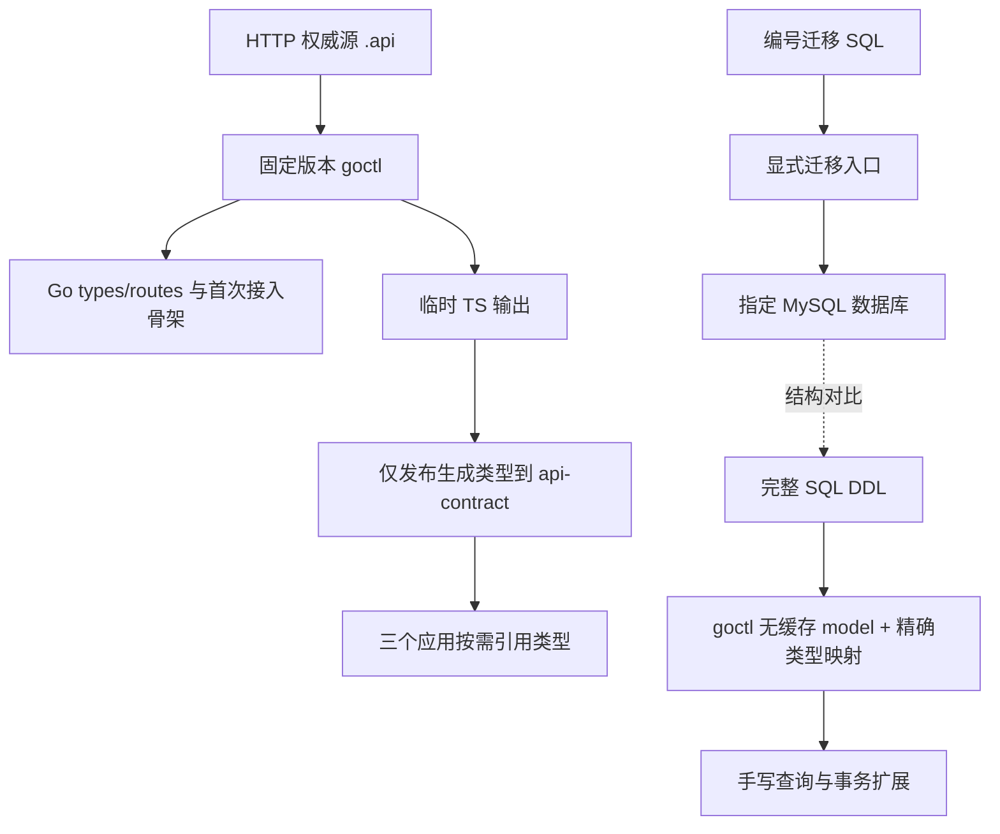

# 1.2 契约与代码生成 实施方案

[阶段目录](../README.md) · [全部工作记录](../../README.md) · [工作范围清单](../../../../engineering/工程阶段与工作清单.md)

方案状态：讨论稿，未确认、未实施。更新日期：2026 年 10 月 26 日。确认依据统一维护在 [讨论记录](01讨论记录.md)。下面的路径、命令入口与示例均为拟议交付，不是已有能力。

## 目标与工作边界

建立三条可复现流程：同一 `.api` 生成 Go 接入代码与前端 TS 类型；仓库 SQL DDL 生成基础 model；编号增量 SQL 独立执行数据库迁移。证明源定义变化能反映到产物，重新生成不覆盖手写扩展，迁移后的结构与完整 DDL 一致。

沿用 1.1 的单 Go module、三个前端应用及工具基线 Go 1.26.10、Node 24.22.1、pnpm 10.33.4。本项可增加生成所需的 go-zero、decimal、TS 编译及迁移工具依赖，不以已安装全局版本代替项目版本决议。

本项不实现鉴权、用户/余额/账本表、资金接口、状态机或签名，不建立 Redis/RocketMQ 客户端与消息机制。统一响应的业务规则、错误码、路由布局、请求运行时与国际化分别由 1.3/1.4 及业务项落实。只提供最小工程示例，不将示例字段或 URL 作为产品协议。

## 推荐生成路线（Q01、Q02）

### HTTP 与 TypeScript

继续采用 `.api` 根入口导入分组文件；业务分组沿用 user、merchant、admin、open，公共类型仅放真正共享的定义，不一次创建所有业务接口。请求、响应和业务模型分别承担传输与业务语义，不把数据库结构直接暴露为 API。

推荐首版直接使用 `goctl api ts`。生成命令实际同时产生类型、调用及请求辅助文件；包装脚本在临时目录生成，按固定清单收集类型产物到 `frontend/packages/api-contract`，不复制其请求运行时到三个应用。生成的类型内容保持原样；仅建立明确的导出入口，不用文本替换修复字段语义。包只导出类型，不导出会话、密钥、HTTP 实例或全量管理端客户端。首个示例只建立示例导出，业务分组随真实契约新增。

后端从包含各消费端的根入口生成一个 API 工程；前端若按受众生成，从相同 `.api` 文件组装受众入口，不复制字段定义。要验证跨文件 import、同名冲突、继承/嵌套结构及导出依赖，不能将一个全量类型文件手工切片后声称自动按受众隔离。类型分组不代替服务端鉴权。

`.api → OpenAPI → TS` 保留为备选，不作为第二条并行正式链。若直接生成不能保留本项目必需的类型语义，记录失败样例和替代方案影响后回到 Q01；不能绕过测试强行保留直出方案。后续商户 API 文档仍可从同一 `.api` 派生，不能手改第二套权威接口。

### SQL-first 与精确类型

model 只从 `manifest/sql/ddl` 的明确输入清单生成，不从开发者临时数据库反向覆盖仓库。按领域输出到 `backend/model/<领域>`，示例使用独立 example 归属，不预先定义余额或订单字段。

推荐默认不加 model 缓存选项。Redis 是已确认架构组件，缓存接入由 1.3/使用方决定；资金事务 model 无须因 Redis 已存在就自动增加缓存读写路径。生成 CRUD 只是底层能力，不授权接入层绕过业务用例直接更新资金。

精确类型拟采用 `github.com/shopspring/decimal` 的 Decimal 与 NullDecimal，优先通过 goctl 类型映射配置及必要 import 模板实现。v1.10.3 源码中默认 DECIMAL 为 float64，自定义映射依赖实验开关，故脚本必须固定运行目录、配置来源和开关；配置缺失、映射未生效或生成浮点字段时检查失败，不静默继续。若锁定版本不能稳定支持映射，先比较小范围模板/生成插件调整，不手改 `*_model_gen.go`，也不改业务金额为浮点。

验证覆盖 DECIMAL 非空/可空、普通整数、字符串、时间、默认值与索引；真实 SQL 扫描/写回测试验证 decimal 的 Scanner/Valuer 适配。测试精度只是测试数据，不确定美元或链资产最终精度。可空字段须保持 NULL 与零的区别，不能为了方便生成统一把 NULL 改零。

API 沿用金额字符串和明确单位语义；临时有限增长序号可用 number，不把所有 ID 强制变成 string/bigint。对 optional、缺省、空数组、空值与零值分别设置样例；生成 TS 必须与实际 JSON 一致。JSON null 不可被误写成仅 optional；如直接工具不能表达，需调整生成路线或在对应契约讨论中明确表示法，不能隐式更改业务语义。

## 完整 DDL 与增量迁移（Q03）

推荐 golang-migrate 的 SQL 文件方式，放在 `backend/manifest/sql/diff/`，用有序唯一编号及说明命名，例如 `000001_create_contract_sample.up.sql`、`000002_add_sample_note.up.sql`；示例迁移放独立 examples 子目录，实际业务迁移入口不扫描它。序号冲突必须在合并前处理；已在共享环境执行的文件保持不变，修正通过新增迁移完成。

两类 SQL 的角色不同：完整 DDL 描述当前目标结构，用于 model 生成及空白结构校验；增量文件记录从旧版本走到当前版本的步骤。每次表结构变化同一提交更新两者。新环境推荐从零重放迁移；既有环境从记录的版本继续执行。不可先执行当前完整 DDL，再无条件执行全部历史迁移。若后续需要以快照加速建库，另定基线版本与校验流程，本项不自动 force 版本号。

生成入口只读 SQL 文件，不连接数据库；迁移入口必须显式指定目标及动作，不能随应用启动或代码生成自动执行。开发/测试使用项目专属库与明确配置来源，DSN 不进入仓库或生成日志。部署时由单独发布步骤执行，运行账户/连接参数在 1.3/1.5 落实。

生产变更优先采用前向修复。down 仅在明确可逆并有测试的情况下提供，不因工具支持 down 就承诺恢复被删除的数据；示例可以演示可逆结构变化，例库清理由独立测试入口执行。MySQL 多条 DDL 可能部分完成，失败后保留错误和 dirty/version 状态，核对实际结构后制定修复，禁止自动 force、自动 down 或循环重跑掩盖失败。

结构等价验收使用两个独立测试库：A 从空库重放示例的两步迁移，B 从当前完整 DDL 建库；比较列类型、NULL/default、索引、约束、字符集/排序规则等语义，排除迁移元数据表和无关的自增计数。补充从第一版插入数据再升级的路径，验证旧数据保留。版本记录不等于迁移内容校验；历史不可修改由 Git 审查与检查规则约束，不声称 golang-migrate 内置了项目所需的全部审计。

## 文件所有权与重复生成（Q04）

具体覆盖行为必须以最终锁定版本实测。以下是项目要落实的所有权规则，不表示所有 goctl 子命令天然如此工作。

| 文件类别 | 拟定所有权 | 更新规则 |
| --- | --- | --- |
| `.api`、完整 DDL、迁移 SQL、生成配置与模板 | 手写权威源 | 先改源再生成；变更工具或模板须检查生成差异 |
| Go types/routes、`*_model_gen.go`、TS 类型 | 完全生成 | 提交 Git，不手改；使用生成清单更新，校验删改残留 |
| handler/logic、config/svc/main 等首次骨架 | 首次生成后由手写维护 | 只创建缺失文件，已存在文件不覆盖；接口签名变化通过编译及差异提示更新 |
| `*_model.go` 及自定义查询/事务文件 | 手写扩展 | 枚举、JOIN、事务绑定留在这里；生成不得清空或改写 |
| 模板与补充导出入口 | 工具输入/明确手写配置 | 参数化 module 与路径；不用生成后批量字符串替换隐藏模板问题 |

执行流程：验证工具与输入 → 临时目录生成 → 检查生成结果和归属清单 → 更新纯生成文件/创建缺失骨架 → 编译与差异检查。模板使用固定版本的干净基线加项目改动，显式选择项目模板路径，避免读取个人 `~/.goctl` 修改。移除源定义后，清理仅限已登记且未被手改的纯生成文件；旧 handler/logic/model 扩展报告待处理，不自动删除。检测到生成文件被手改时先报告差异，不能静默覆盖用户工作。

`check-generated` 在临时副本比较预期与已提交产物，包含新增、删除文件，不能只跑漏掉未跟踪文件的 `git diff`。对手写骨架注入可识别实现再生成，验证其内容不变；新字段必须反映到对应生成类型，旧字段/路由的残留也应被发现。业务层不为通过生成测试创建空转发包。

## 工具与目录落点（Q05、Q06）

以下仅为拟议路径，确认后按实际工具行为落实：

| 位置 | 内容 |
| --- | --- |
| `backend/manifest/api/examples/contract.api` | 无鉴权/资金语义的契约样例，业务根入口不自动导入 |
| `backend/manifest/sql/ddl/examples/contract_sample.sql` | 当前示例完整 DDL，仅用于例库 |
| `backend/manifest/sql/diff/examples/` | 隔离的示例迁移；业务迁移路径按明确清单选择，禁止递归混扫 |
| `backend/tests/codegen/` | 类型、覆盖行为及样例生成验证；临时输出位于测试工作目录 |
| `backend/tests/integration/` | 独立 MySQL 迁移与 decimal 读写验证，不随普通单测连接外部服务 |
| `frontend/packages/api-contract/` | 生成类型及类型检查配置，示例与未来 user/merchant/admin/open 分组分开导出 |
| `scripts/` | 工具准备、代码生成、产物检查、显式迁移入口，均以实际可执行版本为准 |
| `backend/template/`、生成工具清单 | 必要的模板改动、来源版本/校验信息、类型映射；不复制无关模板或另起后端 module |

示例 API 建议为输入字段回显，覆盖嵌套、数组、可选字段和金额字符串；响应反映真实输入，不是占位的“业务成功”。数据库样例是技术测试对象，只验证生成和迁移，不将其 CRUD 暴露为产品接口。示例 Go 产物在单一 backend module 内的测试样例专用目录或临时副本编译，不引入第二个持久 Go module，不把示例自动注册到未来正式 API；正式 `backend/api` 入口与公共运行能力交 1.3 建立。本项对 1.1 中“最小 API 示例”的细化采用隔离样例，避免生产入口混入演示接口，仍待 Q06 确认。

工具准备建议固定安装到仓库忽略的本地工具目录，并由清单定位，避免升级全局 goctl。当前本机全局为 1.9.0，源码评估候选为 goctl v1.10.3；最终 goctl 与 go-zero 运行库分别记录版本，通过同组生成/编译测试后锁定，不要求两者版本号机械相等。迁移工具、decimal 库和 TypeScript 编译器同样记录精确版本与锁文件；本轮不把候选版本写进应用依赖，也不运行浮动 latest。

拟提供四类入口，名称在实施时落实：prepare-tools 只准备固定工具；generate 只生成文件；check-generated 只比对并验证；migrate 显式执行数据库操作。生成通常不需要启动 MySQL/Redis/RocketMQ，数据库集成测试单独运行。1.2 给出这些入口及真实验证，1.5 将它们整合为干净环境的统一准备与联通流程；不把 1.2 必需的生成检查全部留到 1.5。

## 确认后的实施顺序与验收

1. 确认 Q01–Q06；在项目局部工具目录锁候选工具，运行最小生成探针，记录实际覆盖矩阵及类型映射。发现必要语义不支持时回到对应问题，不用静默降级完成任务。
2. 建立示例源、参数化生成入口、隔离输出及 api-contract 类型包，加入必要运行库/编译依赖；不初始化完整 React 应用。
3. 建立编号 SQL 迁移入口与独立 MySQL 验证入口，使用专属例库，记录完整 DDL 与迁移结果的比较证据。
4. 补齐以下验收；更新实施/验证记录与真实命令，再交 1.3/1.4/1.5。正常业务字段、响应封装及错误码仍由所属项细化。

| 验收场景 | 可观察条件 |
| --- | --- |
| 重复生成 | 同版本工具、模板及源定义连续生成两次产物一致，不依赖个人缓存/当前绝对路径 |
| 源定义变化 | 增删字段/路由均被产物检查发现；新增、删除文件也纳入检查 |
| 手写保护 | 写入样例手写逻辑和 model 扩展后再生成，内容不变；需人工适配的签名变化明确报错或提示 |
| 语义保真 | optional/null/zero、嵌套、数组、枚举样例与实际 JSON 对应；金额字符串不变 number；不以 any/断言绕过检查 |
| 精确数据库映射 | DECIMAL/NULL 读写精确往返；配置缺失或 float64 回退被检查阻止；测试不预定业务精度 |
| 生成与迁移隔离 | 无 DB 连接参数仍可生成；生成不执行 SQL；迁移缺少明确目标时失败 |
| 迁移与结构一致 | 空库重放、旧版带数据升级、重复 up 均符合预期；最终结构与完整 DDL 等价，失败不自动 force/down |
| 编译与类型检查 | 生成 Go 包及手写扩展可编译；共享 TS 包在严格模式下通过检查，不需要提前建立业务页面 |
| 工具可追溯 | 工具、运行库、模板与配置版本可定位；换干净工具缓存仍得到相同产物 |
| 范围与交接 | 示例与业务迁移/路由隔离；无鉴权/账本等提前实现；入口文档和实际命令一致 |

本轮只做文档和事实核对，实际生成、Go/TS 编译、类型往返、覆盖保护和数据库迁移均未执行。文档检查通过不能替代上述验收。

## 官方依据与适用范围

核对日期：2026-10-26。候选源码能力只用于提出建议，不代表项目已验证或已锁定版本。

- [goctl API CLI](https://go-zero.dev/reference/cli-guide/api/) 提供 Go、TS、校验及 Swagger 等入口；本机 1.9.0 帮助确认有 Go/TS 入口。[v1.10.3 TS 入口源码](https://github.com/zeromicro/go-zero/blob/v1.10.3/tools/goctl/api/tsgen/gen.go) 显示还生成请求辅助代码，[类型映射源码](https://github.com/zeromicro/go-zero/blob/v1.10.3/tools/goctl/api/tsgen/util.go) 是 optional 与指针语义核对依据。
- [goctl Model CLI](https://go-zero.dev/reference/cli-guide/model/) 提供 DDL 输入及缓存选项；[v1.10.3 SQL 类型转换源码](https://github.com/zeromicro/go-zero/blob/v1.10.3/tools/goctl/model/sql/converter/types.go) 与 [配置源码](https://github.com/zeromicro/go-zero/blob/v1.10.3/tools/goctl/config/config.go) 显示默认浮点映射、自定义类型配置及实验开关路径。[shopspring/decimal](https://github.com/shopspring/decimal) 是精确小数与数据库适配的候选实现，项目仍需验证生成与读写组合。
- [golang-migrate SQL 文件说明](https://github.com/golang-migrate/migrate/blob/master/MIGRATIONS.md) 与 [MySQL 驱动说明](https://github.com/golang-migrate/migrate/blob/master/database/mysql/README.md) 支持编号迁移和 MySQL 接入方案；不代表自动计算项目增量 SQL 或保证业务可逆。
- [MySQL 隐式提交说明](https://dev.mysql.com/doc/refman/8.4/en/implicit-commit.html) 说明部分 DDL 的事务限制；本项据此要求保留失败信息及显式恢复，而不是假设多条 DDL 能整体回滚。引用 8.4 手册说明机制，不在这里锁定部署版本。

## 方案确认与变更

2026-10-26 首轮：形成 Q01–Q06 建议，尚未确认；本轮只读核对工具与官方资料，未生成代码、安装项目工具或运行迁移。已确认的 1.1 结论继续沿用。后续确认及变更统一更新讨论记录，实施时再填写实施与验证记录。
