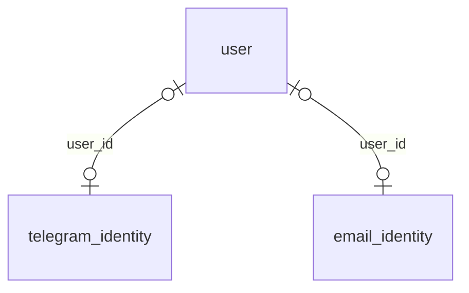

# 2.1 用户模型 实施方案

> 2026-10-30 可维护性改造已调整认证临时状态、回执恢复、缓存故障与只读事务规则。本文保留该阶段当时的方案/验证事实；当前行为以 [用户鉴权](../../../../engineering/用户鉴权.md)、[后台鉴权](../../../../engineering/后台鉴权.md) 和 [用户模型](../../../../engineering/用户模型.md) 为准。

[阶段目录](../README.md) · [全部工作记录](../../README.md) · [工作范围清单](../../../../engineering/工程阶段与工作清单.md)

方案状态：2.1 已按本方案实施并验证，实际交付与限制见 [实施记录](03实施记录.md) 和 [验证记录](04验证记录.md)。登录入口、身份变更及任务归属采用已确认的 [十项决议](01讨论记录.md#本轮十项确认2026-10-28)；用户于 2026-10-29 进一步要求按身份类型分表，采用 user、telegram_identity、email_identity，各身份表直接指向用户，外部资料使用明确字段平铺；以下为当前技术方案；公开鉴权与会话仍属后续阶段。

## 目标与交付边界

2.1 建立独立产品用户、稳定外部身份及当前绑定关系，交付 SQL 定义与迁移、生成 model、手写事务扩展，以及供后续鉴权调用的创建/查询用例。邮箱用户可以没有 TG，钱包操作不改变产品用户。

| 本项交付 | 后续衔接 |
| --- | --- |
| 用户与身份的持久化、首次创建、已有身份查找、用户状态与资料字段 | 2.2 验证邮箱验证码/TG 授权，再调用本项用例；不能相信客户端自报已验证 |
| 同一身份唯一归属、每用户每类型最多一个的数据库约束 | 2.2 实现绑定/解绑/换绑入口、认证材料消费、操作记录和失败恢复 |
| 外部身份的归属版本及用户会话版本，为并发校验保留依据 | 2.3 实现凭证、会话撤销及续期；模型字段存在不等于会话已经安全可用 |
| 内部创建和查询结果、明确错误语义 | 2.4 才暴露受鉴权保护的当前用户接口与页面；App 客户端仍归 8.4 |
| 稳定用户/身份主键，支持后续同库事务协作 | 阶段 3 建账本，阶段 4 建任务完成、资格及奖励记录；不在本项提前添加首奖或余额字段 |

2.1 不增加公开的“提交邮箱/TG ID 即可创建用户”接口，不创建设备登录、钱包登录、任务进行中记录或假鉴权页面。正式 HTTP 路由继续只有现有健康接口，直到后续真实鉴权接入。

## 用户表与按类型划分的身份表

采用 user、telegram_identity、email_identity 三张表。表名统一使用 identity 表示身份。用户与全部外部身份是一对多关系；每张身份表直接以可空 user_id 指向用户，NULL 表示当前未绑定。此前已确认每用户最多一个邮箱和一个 TG，所以当前每张身份表对同一用户最多一行；未来其他身份按类型新增表及接入逻辑。

外部资料分别平铺为邮箱地址、邮箱用户名和域名，或者 TG ID、username、姓名与头像等字段。取消通用 external_identity 表和 subject/display_value 字段，不增加绑定关系表，也不以 JSON/EAV 代替这些有明确含义的列。身份变更审计归 2.2，历史归属不能用来恢复登录。

数据库主键与内部关联使用 `BIGINT id`。参照 dexpoker，`idx` 是内部 `id` 经配置密钥和业务类型参数编码得到的对外字符串，不是独立生成的 UUID；user 表不增加 idx 列或对应唯一索引。输出时 Encode(id)，接收时 Decode(idx)，再按数值 id 查询；内部用例、model 与数据库关联继续使用 id。

编解码复用 dexpoker 所用的 `github.com/capitalone/fpe/ff1` 库，通过一个公共适配封装，不自写算法。用户类型参数采用具名定义 `UserId`；参照其正数 ID 格式，将十进制 id 至少补齐 16 位后做 FF1 编码，再加 `0` 前缀，作为字符串传输。数据库用户 ID 仅接受正 int64，不引入游戏中的负数 ID 约定，也不把至少 16 位误写为所有 BIGINT 都固定 16 位。密钥由本项目配置提供，启动时校验，不复制 dexpoker 的密钥。

同一 id 在密钥、类型参数和格式不变时得到相同 idx，换绑邮箱/TG 或切换钱包不改变它。已投入使用的编码配置应保持稳定，后续确需更改须处理已有 idx 的兼容性。接入层检查空串、前缀、长度、数字格式、解码溢出与非正结果，非法输入返回明确错误；不照搬旧代码直接切片输入的做法。idx 编码不代替登录认证、记录存在性与资源访问权限检查，也不要求将所有内部数字转换成字符串。

### user：产品用户

| 字段 | SQL 类型与约束 | 职责 |
| --- | --- | --- |
| id | BIGINT，主键、自增 | 内部用户关联 |
| status | VARCHAR(16)，ASCII 精确比较、NOT NULL | 具名状态 active / disabled，创建为 active |
| nickname | VARCHAR(128)，NOT NULL，默认空字符串 | 独立产品昵称；TG 首次注册可初始化，邮箱使用默认资料 |
| avatar_url | VARCHAR(2048)，NOT NULL，默认空字符串 | 产品头像；空值由界面使用默认头像，不在后端抓取任意 URL |
| auth_version | BIGINT，NOT NULL，初始 1 | 全账户会话撤销版本；禁用、解绑/换绑成功和退出全部设备时由相应用例递增 |
| created_at / updated_at | DATETIME(6)，NOT NULL | UTC 时间；创建默认当前时间，修改同步更新时间 |

不存 TG ID、邮箱、钱包私钥、余额、积分或首奖标志。状态禁用保留身份与数据，不以删除绑定代替禁用。模型查询可返回禁用记录用于诊断，登录解析必须明确拒绝；后台资金恢复不能套用用户发起操作的准入检查。

昵称和头像只在创建时接受外部资料初始化，已有用户登录不覆盖；后续产品资料编辑由 2.4 落实。默认文案由客户端国际化资源承接，数据库可用空昵称表示尚未编辑，不能将固定中文文案写成所有用户的资料。

### 两张身份表各自保存的归属字段

以下字段分别建立在 telegram_identity 和 email_identity 中，不抽成另一张公共表。

| 字段 | SQL 类型与约束 | 职责 |
| --- | --- | --- |
| id | BIGINT，主键、自增 | 本类型身份的稳定行 ID；与身份类型一起标识任务资格主体 |
| user_id | BIGINT，NULL，默认 NULL，唯一索引 | 当前所属 user.id；解绑清空；每用户在本表最多一条已绑定身份 |
| binding_version | BIGINT，NOT NULL，默认 0 | 每次实际绑定或解绑递增，重新绑定同一用户也不回退 |
| bound_at | DATETIME(6)，NULL，默认 NULL | 当前这次绑定的 UTC 时间；解绑与 user_id 一起清空 |
| created_at / updated_at | DATETIME(6)，NOT NULL | 身份首次建立及最后更新的 UTC 时间 |

各表分别以 user_id 外键引用应用库内的 user.id，限制删除/更新，不级联删除身份。各表唯一索引允许多个 user_id 为 NULL 的行，因此未绑定身份可以保留；参见 [MySQL 唯一索引](https://dev.mysql.com/doc/refman/8.4/en/create-index.html)。绑定数量统计分别查询两张身份表，再按同一用户汇总，不能只在某一张表内判断“至少两个身份”。

### telegram_identity：Telegram 身份与资料

除归属字段外，平铺以下列：

| 字段 | SQL 类型与约束 | 职责 |
| --- | --- | --- |
| telegram_user_id | BIGINT，NOT NULL，唯一索引 | 经过服务端验证的 Telegram 用户 ID，建立后不变 |
| username | VARCHAR(128)，NULL | TG username，允许缺失，不作为身份主键或唯一归属依据 |
| first_name | VARCHAR(256)，NOT NULL | TG 名字，来自已验证授权资料 |
| last_name | VARCHAR(256)，NULL | TG 姓氏，允许缺失 |
| photo_url | VARCHAR(2048)，NULL | TG 头像地址，允许缺失；后端不主动抓取任意 URL |
| language_code | VARCHAR(64)，NULL | TG 提供的语言标记，不自动覆盖产品语言偏好 |

TG 的稳定 ID 使用 64 位整数保存；username、姓氏、头像及语言是可选资料，详见 [Telegram WebAppUser](https://core.telegram.org/bots/webapps#webappuser)。表中的字符串长度是本版存储容量，不作为平台字段最大长度声明；实际输入检查与生成映射在实施时验证。

`uk_telegram_user_id(telegram_user_id)` 防止同一 TG 重复建档；`uk_telegram_owner(user_id)` 保证同一产品用户最多一个 TG。已验证的 TG 资料更新只修改本表的外部资料，不能改变身份 id、telegram_user_id、user_id 或 binding_version，也不覆盖 user 表里用户编辑过的昵称和头像。完整资料快照中缺失的可选字段保存为 NULL，表示本次快照未提供；局部更新仅更新明确提供的字段，不能把省略字段当作整份资料清空。2.2 按授权来源区分完整快照与局部资料，拒绝未验证或过期资料覆盖。

### email_identity：邮箱身份与资料

除归属字段外，平铺以下列：“邮箱号/所属邮箱”在本版具体落为邮箱用户名与邮箱域名，例如 alice@example.com 对应 alice 和 example.com。

| 字段 | SQL 类型与约束 | 职责 |
| --- | --- | --- |
| email_address | VARBINARY(512)，NOT NULL，唯一索引 | 规范化后的完整邮箱地址，作为邮箱身份唯一键 |
| email_local_part | VARBINARY(512)，NOT NULL | 邮箱用户名/本地部分，保留大小写、点号与加号后缀 |
| email_domain | VARCHAR(255)，NOT NULL | 所属邮箱域名，转小写；不凭域名猜测实际邮件托管商 |
| email_original | VARCHAR(512)，NOT NULL | 验证时的原始输入，用于展示，与唯一键区分 |

`uk_email_address(email_address)` 防止同邮箱重复建档；`uk_email_owner(user_id)` 保证同一产品用户最多一个邮箱。四个地址字段由同一规范化函数从已验证输入一次生成，确保完整地址与拆分字段一致；不接受客户端分别提交互相矛盾的地址、用户名和域名。规范化去首尾空白、仅域名小写，不猜测别名。完整地址及其拆分字段建立后不变；换邮箱关联另一条身份，不原地改写旧邮箱地址。输入超过列容量时明确失败，不能截断后匹配其他身份；实际邮箱格式支持范围归 2.2。

完整地址与本地部分按字节比较，避免文本排序规则合并不同大小写的本地部分，参见 [MySQL BINARY / VARBINARY](https://dev.mysql.com/doc/refman/8.4/en/binary-varbinary.html)。邮箱验证码与认证材料归 2.2 的验证流程，不作为长期邮箱资料保存。

### 归属变更与任务引用

归属变更只更新对应类型身份行：

- 首次绑定：锁定并确认未占用后设置 user_id、bound_at 并递增 binding_version；新身份首次绑定版本为 1。
- 解绑：将 user_id、bound_at 设为 NULL，递增 binding_version；保留身份行、平台稳定标识及任务次数。
- 换绑：同一类型表内，先清空旧身份归属，再设置已验证且未占用的新身份归属，分别递增两行版本；任一步失败整体回滚。换绑前仍须已绑定至少两个身份。
- 同一当前身份的重复绑定或正常登录：返回原归属，不无故增加版本。解绑后重新绑定同一用户时，版本继续增长。

分表后的数字 id 只在各自表内唯一。任务资格主体采用 `(identity_type, identity_id)`，例如 telegram / 7 与 email / 7 是不同身份；identity_type 使用具名定义，来源由已实现任务类型决定，不从用户输入拼接 SQL 表名。两张身份表自身无需重复保存 identity_type，也不为统一编号重建通用身份主表。

任务验证快照为 `(identity_type, identity_id, user_id, binding_version)`，完成提交时按指定类型复查归属和版本；同身份解绑再绑回原用户也不能复用旧验证。历史完成记录保留当时快照，不要求旧版本等于当前版本。单一类型任务可直接引用对应身份表；通用记录中的类型加 ID 不构成跨表外键，阶段 4 必须通过明确的类型用例在同一事务校验存在性，不能声称一个外键可引用两张表。

每用户至少保留一种登录方式、换绑前至少两种属于跨表条件，由锁定用户后的用例汇总检查。目标身份已属于其他用户时拒绝，不得 UPDATE 覆盖归属。已解绑身份再次验证登录时，可新建产品用户并关联原身份行；不按历史恢复旧账户。原任务次数随类型和身份 id 保留，原奖励随原产品用户保留。

## 创建与查询用例

本项用例放在 `backend/logic/user/`，持久化放在 `backend/model/user/`；这些路径现已建立。接入方只传业务所需依赖，不传完整 ServiceContext，也不提供可绕过规则的公开 CRUD。

| 内部能力 | 输入与处理 | 输出与失败语义 |
| --- | --- | --- |
| ResolveOrCreateVerifiedTelegram | 可信鉴权调用方提供 telegram_user_id 及已验证的 TG 资料，查询/创建 telegram_identity 并关联用户 | 原有或新建用户、TG 身份 id 及版本；禁用明确拒绝，不签发会话 |
| ResolveOrCreateVerifiedEmail | 可信鉴权调用方提供已验证邮箱，规范化并查询/创建 email_identity、关联用户 | 原有或新建用户、邮箱身份 id 及版本；不信任自报已验证标记 |
| FindUserByID | 供已完成权限检查的调用方按内部用户 id 查询；外部 idx 在接入层先解码 | 用户基础资料及状态；不存在与依赖失败分别返回；输出契约需要 idx 时统一编码 |
| FindCurrentIdentities | 分别按 user_id 查询 TG 与邮箱，返回明确类型的可选资料项 | 空缺身份为可观察缺项；不把缺 TG 当成未登录，不返回任何凭据 |
| CheckCurrentBindingInSession | 使用调用方传入的同一 sqlx.Session 按具名身份类型检查对应表内的用户归属及 binding_version | 一致时继续，换代/解绑/禁用分别拒绝；不自行提交或重开事务 |

VerifiedTelegram / VerifiedEmail 仅表示内部接口前置条件，不是“调用方填了 verified=true 就可信”。真实验证、用途绑定、验证码单次消费以及可用会话由 2.2–2.3 实现后才能开放；2.1 的测试仅在内部受控调用构造已验证结果。

邮箱规范化逻辑集中一处，创建、查询及未来绑定共用；TG 用例直接处理已验证的数值 ID 和明确资料字段。拒绝未知身份类型、空标识及超过存储上限的值。唯一键冲突按具体约束解释；身份已经归属其他用户不能转换成自动转移或登录切换。领域错误使用具名定义，正式对外错误码在 2.2/2.4 的 `.api` 源加入并生成，不手改 `codes_gen.go`。

## 事务、并发及恢复

### 首次创建与重复登录

1. TG 用例按 telegram_user_id，邮箱用例按规范化 email_address，在各自表中读取当前归属作为定位线索；该普通读不代表锁定或最终授权。
2. 有归属时，在事务内先锁定候选用户，再锁定外部身份并重新读取 user_id 和 binding_version。若已换到其他用户或已解绑，结束当前事务后重新解析，不在持锁事务内转去锁另一个用户。确认仍归属后检查用户状态并返回原用户；不覆盖产品资料，外部 TG 资料按已验证来源更新。
3. 无归属时，在事务中建立候选产品用户，查找或创建稳定外部身份并锁定，再确认 user_id 仍为 NULL，最后写入当前 user_id、绑定时间并递增版本，一起提交。若并发竞争发现已绑定，回滚本次候选用户，再按已有归属处理；不能留下无身份的注册残留。
4. 同身份首次创建冲突、已知回滚后的归属变化，可由该用例在明确的有限次数内重新查询；不向公共事务层添加自动重试。已经提交但响应丢失时，后续有效认证按当前绑定返回原用户，不增加重复用户。

创建时自增号产生间隙不影响业务；外部身份主键与已使用的归属版本不得重置或复用。提交阶段失败遵循现有 `transaction.Failure.Unknown()`，不能宣称一定回滚，也不能未经重新核验就再建用户。登录查找遵循当前归属，不承诺将已被解绑的身份恢复到先前的创建结果。

### 统一锁顺序与身份变更交接

已知用户的操作先锁产品用户，再按固定的身份类型顺序、各表内 identity id 升序锁本次涉及的身份，最后检查/更新 user_id、bound_at 与 binding_version；同一用户的所有绑定写入都遵守该入口；跨类型时固定先 email、后 telegram，各类型内按 id 升序。查找登录遵循前述重新定位流程，不能持有身份锁后再追着最新归属反向锁用户。需要锁定读取的关键查询使用同一事务的 `FOR UPDATE`，不能以事务外缓存值替代，参见 [MySQL 锁定读取](https://dev.mysql.com/doc/refman/8.4/en/innodb-locking-reads.html)。

2.2 换绑提交时检查有效用户会话、当前类型身份归属及 binding_version、跨表合计至少两个已绑定身份、目标验证结果及目标未占用；不要求旧身份重新验证。清空旧身份 user_id、设置新身份 user_id、分别递增 binding_version、递增用户 auth_version 及必要操作记录原子提交，失败全部保留原状。解绑按同一用户锁汇总两张身份表，检查操作后至少还剩一种登录方式。身份占用检查不得持锁进入其他用户的变更流程。

2.3 使用提交后的新 auth_version 重发当前会话，其他会话必须因版本不符失效；普通退出只撤销当前会话。新增第二种身份不自动等同于换绑。凭证生成/响应失败时，已提交的绑定不能假装未变更，用户可用保留身份重新登录；具体幂等请求及结果查询由 2.2–2.3 补齐。

阶段 4 在事务外验证外部事实，事务内按兼容顺序锁用户和身份、复查 user_id 和 binding_version，再提交完成记录、资格消耗与全部奖励。邀请涉及多个用户时需在阶段 4 确定完整用户集合并按固定顺序锁定，不能在任意已持锁节点追加反向取锁。任务仍无进行中状态，也不因页面停留锁住换绑；真实资金与后台任务继续保留各自必要状态。

### 复用现有事务设施

使用 [transaction.Runner](../../../../../backend/transaction/transaction.go) 的显式 TransactCtx，以及 [现有 WithSession 示例](../../../../../backend/model/example/contract_sample_model.go) 的扩展方式。协作查询和写入全部绑定同一个 session，不混用默认连接；不嵌套事务，不在事务中发邮件、调用 TG、写 Redis 或发送 MQ。

用户表与各类型身份表的当前事实以 MySQL 为准；2.1 不引入身份查询缓存。未来依赖 Redis 的会话不能在 Redis 故障时绕过鉴权。禁用后的后台资金恢复由原资金用例执行，不能删除既有单据或将用户恢复为可操作状态。

## SQL、生成与实施顺序

此前“通用身份加绑定表”草案的隔离探测发现 goctl v1.10.2 拒绝 CREATE TABLE 内的外键声明，移出声明后可生成复合唯一索引及 VARBINARY 字段的 model；探测没有执行数据库 DDL，也未验证本次按类型分表方案的完整字段与约束。具体记录见 [验证记录](04验证记录.md#方案阶段生成兼容性探测)。现已按显式源清单实现，并用真实 MySQL 验证完整三表与外键；不改生成器内部解析器，也不丢弃外键约束。

| 实施位置 | 具体内容 |
| --- | --- |
| `backend/manifest/sql/ddl/user/tables.sql` | user、telegram_identity、email_identity 的 CREATE TABLE、主键、唯一索引和普通索引；作为 model 生成输入 |
| `backend/manifest/sql/ddl/user/constraints.sql` | ALTER TABLE 添加外键；完整 DDL 重放按 tables → constraints 顺序执行；不传入 goctl |
| `backend/manifest/sql/diff/business/000001_create_user_model.up.sql` | 独立正式业务迁移序列首项，包含同样的建表和外键定义；不修改 examples 迁移 |
| `scripts/generate.py` 与生成文件清单 | 登记 user model 输入和产物、纳入检查与手写保护；不递归扫描所有 SQL；原示例和 platform API 继续检查 |
| `backend/model/user/` | 生成无缓存基础 model；分别生成 user/TG/邮箱 model；手写 WithSession、锁定与按 user_id 查询、具名类型 |
| `backend/logic/user/` | 创建/查询用例、规范化、输入检查、状态和归属错误；不注册 HTTP 登录入口 |
| `backend/idcodec/`、`backend/config/` | 封装 FF1 库、具名类型参数、配置校验及输入错误；供后续 API 接入使用，不增加数据库 idx 字段或映射表 |
| `backend/tools/migrate/`、测试隔离入口 | 增加明确 business 源选择；保持显式目标、凭据和本地测试边界，不自动运行迁移或扩大生产权限 |
| `backend/tests/integration/` | 新建隔离库重放完整 DDL 与 business 迁移，对比结构，并验证约束、并发和回滚 |

先实现源定义及生成兼容，再实现事务用例与测试。正式业务源名称不代表工具获准连接生产库；沿用现有 local 环境、允许地址、受限测试账号和本轮资源归属保护。运行正式环境迁移的配置与发布入口仍归 8.2。

初次建库执行用户表、两张类型身份表及各自 user_id 外键；`up` 重复执行保持无变更。失败后保留 dirty/version 和实际诊断，不自动 down/force；MySQL DDL 不能按业务 DML 的整体回滚承诺处理。新库完整 DDL 与迁移对比必须包含外键，不能只比较列名。后续阶段追加新编号迁移，不回改已执行文件。

## 验收条件及证据范围

业务场景沿用 [身份与任务归属补充验收](../../../../testing/验收与场景追踪.md#身份与任务归属补充验收)，本项优先证明模型不变量。

| 检查 | 通过标准 | 验证方式 |
| --- | --- | --- |
| 源与生成 | 反复生成无差异，手写 WithSession 不被覆盖，外键只由完整 DDL/迁移执行 | 既有生成检查加 user 源覆盖 |
| idx 编解码 | 正数 ID（含 int64 上界）往返一致，同配置输出稳定，正数格式与 dexpoker 兼容；空串、非法前缀/长度/字符、溢出及非正结果明确拒绝且不 panic；无 idx 持久化列或额外查询索引 | 编解码行为测试及固定测试密钥的参考向量；配置校验；DDL/生成结果检查 |
| 创建与查找 | 邮箱/TG 分别可首次创建；当前仍绑定同一用户时返回原 id，同编码配置得到原 idx；不修改用户编辑的产品资料，不初始化首奖/余额 | 单元用例；真实 MySQL 持久化验证 |
| 并发首次注册 | 同身份多个请求最终只有一条指向唯一产品用户的身份记录、一个提交成功的产品用户，失败候选用户全部回滚 | 独立 MySQL 并发用例 |
| 约束 | 重复身份、同用户同类型重复和无效用户引用被数据库拒绝；多个 user_id 为 NULL 的同类型身份可共存；已占用身份的归属覆盖由用例拒绝 | 真实 MySQL 直接写入反例 |
| 精确身份比较 | 邮箱完整地址与拆分字段一致，域名小写、本地部分大小写和点号/加号保留；TG 按稳定数值 ID，username 可缺失/变更；未知类型/超长输入拒绝 | 单元测试及真实数据库唯一索引往返 |
| 跨类型 ID 隔离 | TG 和邮箱存在相同数字 id 时，资格引用与绑定检查仍按类型定位，不能串用次数或验证结果 | 类型用例及阶段 4 结算集成 |
| 外部资料与产品资料 | 已验证 TG 快照可更新 username/姓名/头像；归属、版本和 user 昵称头像不变；可选资料缺失不影响按 TG ID 登录 | 用例及后续鉴权联调 |
| 事务失败 | 用户创建或身份归属写入失败不留下部分注册；提交应答未知保持未知语义 | 真实事务回滚；提交失败在不可靠边界注入 |
| 解绑后建档 | 模拟未来合法解绑后，user_id 和 bound_at 为 NULL，原外部身份 id 保留；重新登录新建用户，不能恢复原用户 | 内部持久化集成场景，不作为已实现解绑接口 |
| 绑定代际 | 解绑再绑同一用户后 binding_version 增长，旧快照校验失败；重复当前绑定不增加版本 | 模型同 session 校验用例 |
| 禁用与缺项 | 禁用用户登录解析被拒绝且不另建用户；无 TG 是缺少身份，不是用户不存在 | 用例及查询测试 |
| 数据库演进 | 完整 DDL 与 business 迁移结构一致，重复 up 不重建；失败保留 dirty 状态且不自动强制恢复 | 专用临时库、独立集成入口 |

现有可运行检查：仓库根执行 `python3 scripts/generate.py --check`、`bash scripts/check_contracts.sh`、`python3 scripts/check_docs.py`、`git diff --check`；`backend/` 执行 `go test -race ./...` 与 `go vet ./...`。当前已执行生成、单元、race/vet、独立 MySQL 与 HTTP 回归，结果见验证记录；早期生成探测仍仅作历史证据。

真实 MySQL 验证继续使用 `go test -tags=integration ./tests/integration -v -count=1`，前提是按 [开发与测试环境](../../../../engineering/开发与测试环境.md) 准备专用配置；测试自己创建并精确清理本轮资源，缺配置明确失败。business 迁移 CLI 已实现并经实际命令验证，使用方式见 [用户模型](../../../../engineering/用户模型.md)。

2.1 通过并不代表邮箱送达、Telegram 授权、会话撤销、真实换绑、任务领奖或 App 已完成；这些在各自工作项验证。所有实现提交及运行结果分别写入实施记录、验证记录，不以本方案或生成探测代替业务验收。

## 方案确认与变更

2026-10-28 早期讨论：曾记录三种 App 登录入口、直接登录命名及默认开放方案，后续已取消直接登录。任务次数随外部身份、奖励随产品用户、首奖仍在首次任务完成后入账且前置解释仅供内部的规则继续有效。具体依据见讨论记录，没有新增业务实现。

同日后续决定：用户明确“放弃直接登录吧，只要邮箱和tg登录”。Q02 设备标识、凭证与恢复建议整体放弃，当前方案与验收只保留邮箱/TG 登录方向；继续讨论 Q03，不实施登录接口或 App 存储代码。

同日确认邮箱认证：用户“邮箱认证就按你说的验证码”，采纳验证码方式及注册登录合一方向。同步规则、界面与验收要求；验证码参数和绑定规则仍待细化，本轮未实现邮件发送或鉴权接口。

同日确认绑定规则：用户采纳此前关于绑定数量及身份占用处理的建议，落实每用户邮箱/TG 各一个上限、身份唯一归属、占用拒绝且不自动合并/转移。同步设计与拟验收，不将解绑/换绑或任务进行中的策略扩展为已确认，未新增代码或数据库约束。

同日十项统一回复：业务规则按讨论记录全部收敛，修订换绑条件及认证、删除任务在途方案，确认验证码/邮箱规范化/资料/禁用/会话与阶段范围；以上早期未决记录仅供追溯。未新增业务代码或迁移。

2026-10-28 继续下一步：依据已确认十项细化三表、约束、创建/查询、并发与恢复、阶段衔接和验收。临时 goctl 探测发现内联外键解析限制，确定建表与约束分别作为生成/完整 DDL 输入的本版设计。本轮仍未新增业务 SQL、迁移、model 或接口。

2026-10-29 用户修订关系模型：明确用户与外部身份一对多，只需用户表与外部身份表，后者设字段指向用户。以可空 user_id 表示归属，binding_version 保留在身份行，替代原三表及 binding id 方案；同步约束、创建查询、换绑事务及验收。未新增业务 SQL、迁移或代码。

2026-10-29 后续修订：用户要求不同身份分别建表并平铺外部信息。采用 user、telegram_identity、email_identity，保留各身份表 user_id 直接关联；原通用身份表方案被替代。同步类型专属字段、唯一约束、强类型创建查询、跨表身份数量及任务引用；本轮仍仅调整设计，未实现业务表或接口。

2026-10-29 idx 修正：用户指出原 idx 逻辑不对并要求参照 dexpoker。核对其 SQL、FF1 编解码与接口查询后，删除独立 UUID 列及唯一索引方案，明确 idx 为内部数值 id 的可逆编码，内部查询按 id，接口边界编解码。方案与规范已同步；当前仍无业务表、迁移或 idx 运行实现。

2026-10-29 继续实施：用户“好，继续”后完成 2.1。新增 SQL、生成 model、内部用例、公共 idx 与配置、business 迁移入口及测试；真实 MySQL、并发注册、提交未知语义和原有健康 HTTP 回归通过。运行边界与本地配置变化见实施/验证记录。
