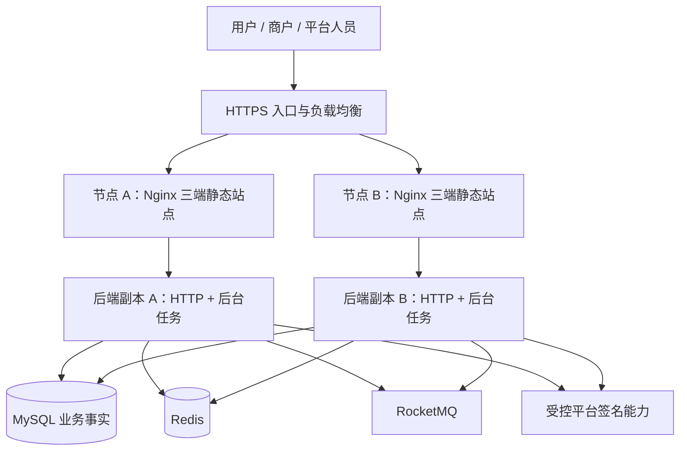

# 8.2 部署与恢复 实施方案

[阶段目录](../README.md) · [全部工作记录](../../README.md) · [工作范围清单](../../../../engineering/工程阶段与工作清单.md)

方案状态：2026-10-28 提前讨论草案。按用户意见取消首版 API/worker 强制分进程要求；具体云服务、节点数、规格、发布工具及恢复指标尚未确认。本文描述目标，不表示现有业务已具备生产条件。

## 目标与边界

以一个后端程序运行 HTTP API 与后台任务，保留三个独立前端应用、共享业务数据库及 Redis/RocketMQ。减少日常发布单元，同时保证任务重启可恢复、重复请求不重复记账、更新可验证、故障可诊断。

生产实施属于 8.2；本文提前约束 1.5 的环境接口及后续业务实现。当前不创建云资源、不部署公开服务、不实现业务任务或签名，不把本机健康检查视为生产验收。

## 应用与数据拓扑建议

建议初期采用 Linux 虚拟机、Docker 镜像和每台机器上的 Compose 管理应用容器。Compose 只描述单机运行，不承担跨机器调度、自动摘流或数据库高可用；这些由负载均衡、发布流程和数据服务各自负责。当前规模不先引入 Kubernetes，也不自行编写通用编排平台。具体安装版本和资源限制实施时锁定。

后台消费、事件发布也在上述后端进程中，图中 MQ 连线概括双向交互。建议两台应用机跨故障域；每台包含 Nginx 和一个完整后端副本，不另购 worker 服务器。双副本是可用性建议，不是目前已经验证的能力或确定采购数。每台需能承受另一台退出后的目标负载，并计入发布期间的额外资源；具体 CPU/内存由压测确定。

低预算可选择单应用节点，但需接受整机故障与维护停机；在同一台机器运行两个容器不能消除整机单点。数据服务仍应独立，平台签名仍保持独立信任边界。一个部署单元不等于生产只允许一个进程副本。

| 组件 | 建议部署方式 | 需落实的差异 |
| --- | --- | --- |
| 后端 | 一个不可变镜像，每副本一个进程；HTTP 与后台模块共用依赖，分别限制并发 | 后台模块尚未实现；用独立于 HTTP 请求的 context 管理任务，避免请求结束取消持久工作 |
| 三个前端 | 独立构建、独立版本产物和域名；Nginx 分静态根目录，只读挂载对应产物 | 不运行 Vite/Node 开发服务器；发布时保留兼容旧页面的带哈希资源，避免滚动期间资源 404 |
| MySQL | 优先托管高可用、自动备份与时间点恢复；一套逻辑业务库 | 主备/多副本是物理实现，不拆业务事务；选择受支持且经项目验证的版本，不能直接复制本地浮动 mysql 镜像 |
| Redis | 优先托管高可用；自建可评估 Sentinel，按客户端接入方式验证 | 当前仅单地址/password 配置，TLS、ACL 用户、Sentinel 等需按选型补齐；高可用不使 Redis 成为账本真相 |
| RocketMQ | 优先评估与现有 remoting SDK 兼容的托管服务；否则专用多副本集群 | 不能仅凭“RocketMQ 5”名称认定兼容；需验证协议、鉴权、broker 可达地址、故障切换与消费行为 |
| 平台签名 | 独立受控服务或工具，按 5.3/O09 选择；可评估满足链算法的密钥设施 | 普通后端镜像不带平台私钥；用户助记词/私钥继续只在用户侧；部署共机不等于信任隔离 |

如选择全自建，MySQL 主备与备份、Redis 故障转移、RocketMQ 存储副本/切换及仲裁都需要额外规划和演练。两台应用机不等于总共只需两台机器，也不把单个 MQ Broker 当作生产高可用配置。[RocketMQ 部署说明](https://rocketmq.apache.org/docs/deploymentOperations/01deploy/) 明确区分单节点与多副本部署。

## 无状态与水平扩容条件

目标是完整后端副本可以被替换、增加或缩减，不依赖粘性会话。当前只有健康接口和公共基础，以下业务条件需随所属工作项实现，不能声称已经满足。

| 状态/行为 | 归属与规则 |
| --- | --- |
| 用户/商户会话 | 所有节点按相同协议验证；凭证、撤销/版本状态由阶段 2 确定共享存储和缓存策略，不使用进程内 map 作为唯一会话来源 |
| 账务、订单、幂等 | MySQL 唯一约束、事务、条件更新/锁及业务结果记录；同一请求落到不同节点仍不产生重复动作 |
| 后台任务和 outbox | 任务身份、状态、重试信息先持久化；领取要原子化，使用版本/租约等阻止失效执行者覆盖新结果；具体算法在 3.5 确定 |
| MQ 消费 | 副本按同一业务消费组协作，实例身份唯一；同一事件重投或重新分配时通过持久幂等处理，不能把消息分发等同于唯一执行 |
| 周期扫描 | 每个副本可以扫描，但待处理项必须持久去重并竞争领取；不能每个进程各跑一次扣款/发奖计时器 |
| 链监听与出款 | 扫描游标可恢复、链事件有唯一键；同一出款意图及交易提案可追踪，未知结果先核验；钱包 nonce/序号竞争在 5.3 处理 |
| 文件与缓存 | 正式文件进入共享对象存储等持久设施；节点本机仅临时文件、连接池、健康快照、可重建缓存和日志缓冲 |

同进程不削弱这些要求：`go func()` 或本机 mutex 只能协调一个进程。后台外部调用一旦可能执行，租约过期不能证明未执行；恢复时沿用原任务/请求身份核验，并在签名/外部执行边界采取幂等或防止旧执行者继续提交的措施。不能用一把 Redis 锁代替资金唯一执行协议。

扩容也受共享资源限制。当前 `MaxConns: 1000` 是每个进程的工作并发上限；10 个副本不代表全系统仍只有 1000。当前每进程 MySQL MaxOpen 默认 20，10 个副本的连接预算就可能到 200，尚未计入发布额外副本、迁移及运维连接。同进程后台与 HTTP 共用连接池，需分别控制工作并发，避免后台任务耗尽请求资源。

扩缩以请求延迟、错误率、CPU/内存、连接池等待、任务积压年龄、消费能力、RPC/签名配额综合判断；队列/分区、同一账户事务和单钱包序号也可能限制有效并行。先按验证过的容量人工调整副本，确有需要再增加自动扩缩。后台和 HTTP 负载差异显著时再拆入口，业务代码不重写，首版不预先增加复杂角色开关。

## 域名、网络与配置

域名示例为 `app.example.com`、`merchant.example.com`、`admin.example.com`，只是占位，不代表已注册。三个 HTTPS 站点各自 `/api/` 同源转发至后端；管理端入口再加访问限制，后端仍必须鉴权授权，不能仅靠隐藏域名。

负载均衡终止 TLS 或继续到后端 TLS 按网络边界确定；API、中间件、数据库与管理指标不直接暴露公网。外部只能访问明确允许的入口，生产与测试使用独立资源、凭据及命名空间，开发机不持有正式出款密钥。

普通参数通过版本化 YAML，秘密由受控的环境注入或秘密管理服务提供；沿用现有配置接口，不提交到 Git、镜像层或 VITE 构建变量。发布权限、迁移账户、运行账户分工，日志保留充分诊断但不转储令牌/密钥。秘密文件挂载如被采用，须实现并验证明确加载方式，不能假装当前程序已支持 `_FILE` 等约定。

生产设置 `Environment: production`、`Mode: pro`，实例标识、内网地址及资源预算按环境提供。容器内监听地址与宿主机公网暴露分别配置，不能照抄本地 127.0.0.1 后期待跨容器直连。现有 Breaker/Shedding/Gunzip 仍受 JSON 契约校验限制，不因为 Mode=pro 就擅自开启。

负载均衡以 ready 决定接流量，live 用于诊断进程存活；下游短暂失败不应造成整批服务反复重启。Nginx 静态站点和 API 健康分别验收，后台任务还需独立的积压/进度指标。Compose 的健康标记本身不会自动完成负载均衡摘流。

## 构建、发布与回退

建议一次构建、同产物晋级：CI 按锁文件完成契约检查、测试、编译，产出后端镜像与三端静态包，记录 Git commit、镜像 digest、包校验和、配置版本和迁移版本。预发布使用同样产物验证，正式机器只拉取固定版本，不现场 git pull/build，不使用 latest。

发布步骤建议：

1. 串行化同环境发布，核对版本、备份可恢复性、数据库空间和迁移影响；测试环境先演练迁移及旧/新版本并存。
2. 使用显式一次性迁移任务执行兼容性变更，独立凭据和迁移锁保证不由每个应用副本重复运行。先扩展结构，再发兼容代码，必要时回填；删除列/改变语义延后到旧版本退出以后。MySQL DDL 失败需核对实际结构和 dirty 状态，不能自动 force/down。
3. 逐节点发布。先从负载均衡摘除节点 A，确认流量停止进入；停止该进程新任务领取及新 HTTP 工作，等待已受理请求/任务有界收尾，然后更新镜像、配置及静态产物。节点 B 继续服务。
4. 新 A 完成初始化、依赖与必要后台能力检查，验证静态页、API、任务诊断后接流量；观察后再更新 B。新旧程序、消息格式、数据库结构须在这段时间兼容。后台任务属于同一发布过程，不能只摘 HTTP 而让旧任务继续领取。
5. 出现异常先停止后续发布/相关能力，在 schema 兼容前提下回退应用及静态包。数据库通常保留兼容扩展结构，用后续迁移修复；不得为回退程序直接恢复旧数据库覆盖新交易。

当前 HTTP 应用排空 30 秒、框架退出等待 37 秒；容器停止等待应大于进程实际退出预算，可先以 60 秒作为待验证起点。后台任务加入后重新核算：先停止领取/消费新任务，再收尾或持久保留未决状态，最后关闭 MQ/Redis/MySQL 和日志。SDK 关闭和外部调用也须实测，不承诺等待期能取消已发生的外部操作。Compose 默认停止等待只有 10 秒，必须显式调整，参见 [stop_grace_period](https://docs.docker.com/reference/compose-file/services/#stop_grace_period)。

收到超时/中断不能自动重放资金写入。发布不承诺绝对零失败；跨副本恢复和幂等应让客户端查到原操作的真实状态。还未建立的 worker 生命周期、发布摘流脚本和容器配置，都需要实际实现后验收。

## 备份、故障与恢复

MySQL 建议自动全量备份加持续 binlog 归档，备份存于独立故障域，按预算设置保留时间并定期恢复到新实例验证。时间点恢复依赖完整备份及其后的日志，不能只保留 SQL 文件或单机数据卷；依据见 [MySQL 时间点恢复](https://dev.mysql.com/doc/refman/8.4/en/point-in-time-recovery-binlog.html)。

高可用和备份解决不同问题。Redis 故障转移也不保证所有已确认写入都保留，资金账本/唯一执行依据仍应持久保存在 MySQL；会话或正确性数据丢失时必须按所属业务策略处理，不能一律当缓存回源。[Redis Sentinel 说明](https://redis.io/docs/latest/operate/oss_and_stack/management/sentinel/) 描述了异步复制的限制。

| 故障 | 目标处理方式 |
| --- | --- |
| 应用节点宕机 | 入口摘流，其他副本接请求；持久任务在租约/竞争与幂等机制允许后接管，不能仅凭节点失联立即重发出款 |
| MySQL 不可用 | 拒绝依赖数据库的写入，保护未知提交结果；恢复后按任务/业务身份查询，不伪造成功或新建重复操作 |
| Redis 不可用 | 可重建缓存按策略降级；若承担会话/正确性检查则相应能力失败关闭，不默认绕过权限 |
| MQ 不可用 | 业务事务中的 outbox 保留投递依据，观察积压并在恢复后补投；outbox 尚未实现的阶段不宣称已有此能力 |
| 签名或链 RPC 异常 | 相关出款进入待处理/结果未知，核验原意图与交易；其他不依赖该服务的功能按边界运行 |
| 数据库灾难恢复 | 恢复到新实例，先限制资金执行，核对外部链上事实、签名记录、任务与账务，再决定恢复写入；不能把数据库倒回当作链上交易也倒回 |

签名密钥与数据库分别备份、分别演练恢复，普通应用备份不夹带平台私钥。常规单节点故障以不丢已确认账务为设计目标，但实际承诺取决于数据库持久化/复制配置和演练；灾备 RPO（可能丢失的数据时间窗口）、RTO（恢复服务时间）需与预算和业务共同确定，当前不虚构零丢失或固定恢复分钟数。

## 监测与上线验收

建议集中收集结构化日志及服务/实例/版本/traceId；指标至少覆盖延迟、5xx、限额拒绝、DB 连接等待、慢查询、复制状态、Redis 内存与驱逐、MQ 积压/重试、后台任务最长等待、未知出款和对账差异。工具可复用云监控或 Prometheus/Grafana 生态，具体选型待环境确认，不先自建监控平台。资金异常需有责任人和处置入口，不能只有 CPU 图表。

正式验收须覆盖：新节点加入/旧节点退出；两节点同时提交同一幂等请求；任务重复投递、领取后宕机、租约过期旧执行者恢复；后台满载下的 HTTP 响应；滚动升级新旧版本并存；真实 SIGTERM 收尾；数据库备份恢复及外部事实核对。阶段 2/3/5 负责实现业务语义，8.2 验证部署组合，不能把健康接口压力测试当作资金多副本正确性证明。

当前代码的具体缺口包括：业务会话/账本/幂等/持久任务未实现；Redis 尚无 Sentinel/TLS/ACL 用户等所需部署适配；MQ 健康诊断仍包含单 Broker 地址，实例标识与集群故障切换需复验；不存在正式镜像、Compose、CI 发布或生产恢复演练。

## 方案确认与变更

2026-10-28：在 1.5 讨论中回应正式部署、无状态及 worker 问题。用户指出无需物理区分 API/worker，方案改为同程序/同进程，相关 1.1、架构、规范和台账同步更新。推荐两个完整应用副本、独立数据服务、不可变产物和分节点发布；这些具体生产选项尚未确认。未部署、未采购、未执行迁移，实施与验收记录保持未开始。
