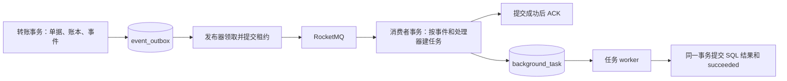

# 持久化后台任务

3.5 已接通事务事件、RocketMQ 分发、任务持久去重与执行恢复。内部美元互转的单据、凭证、余额和 `transfer.completed` 事件同事务提交；MQ 故障不回滚已经成功的转账。讨论与验收见 [3.5 工作记录](../design/工程工作记录/03-资金账户与账本/3.5-持久化后台任务/01讨论记录.md)。

正式入口目前只发布转账事实，没有注册通知处理器；真实邮件、TG、商户回调在所属业务接入。本轮以隔离 SQL 处理器验证完整任务链路，没有新增公开资金写入 API 或页面。

## 处理边界



| 入口 | 实际契约 |
| --- | --- |
| [event.Append](../../backend/event/event.go) | 必须使用调用方已有事务；来源 kind/business_id/version 唯一；序列化或插入失败向外传播，不能吞掉错误后提交资金 |
| [Store.PublishOne](../../backend/background/mq.go) | 短事务领取事件，提交后调用 MQ；只有 SendOK 才标记 published，超时或其他发送状态保留同一事件身份重试 |
| [Store.Receive](../../backend/background/tasks.go) | 从主库读取事件，按注册处理器建任务；所有匹配任务同事务提交，再返回消费成功；重复接收不重置已有状态 |
| Store.Execute | 复核任务、处理器、租约和领取代次并锁行；SQL 结果与 succeeded 一起提交 |
| [Runtime](../../backend/background/runtime.go) | 与 API 同进程，发布与执行使用独立的有界并发池，多实例共享数据库领取 |

MQ 消息只携带版本和事件 idx，message key 同样为事件 idx；业务参数读取主库事件快照，不信任消息中的业务字段，也不用 Broker msgId 作为业务身份。转账事件保存发送方、接收方、凭证、金额字符串和单位。原请求重放返回原转账，不再追加事件。

`published` 只表示 Broker 确认接收。消费 ACK 只表示任务已持久接收，不表示处理器完成，更不表示真实通知送达或链上到账。多个处理器各自有 `(event_id, handler)` 唯一任务；处理器名称及其业务含义必须稳定，不能通过改名绕过旧任务去重。

## 并发、失败和恢复

领取使用数据库 UTC 时间与 `FOR UPDATE SKIP LOCKED`，跳过已锁任务。过期租约与到期任务分别走索引查询，避免 OR/filesort 锁住过多候选行。仅领取事务显式使用 READ COMMITTED，减少队列范围扫描的间隙锁；资金事务与处理器事务保持原隔离级别。此选择依据真实并发测试及 [MySQL 隔离级别说明](https://dev.mysql.com/doc/refman/8.4/en/innodb-transaction-isolation-levels.html)。

每次领取增加 attempts 和 generation。旧代次不能回写新代次结果；人工重试只重置 attempts，generation 不回退。执行 SQL 处理器时持有任务行锁直至提交；租约到期也不能越过这个行锁执行同一任务。进程在领取后或事务中被杀死，数据库释放锁、回滚未提交结果，后续实例从过期租约恢复。

| 状态或失败 | 后续行为 |
| --- | --- |
| ready / running | 等待到期领取 / 已领取并持有租约 |
| published / succeeded | 事件发送确认 / SQL 任务结果已提交；不是同一种完成含义 |
| 发送应答丢失或发送确认后的数据库回写失败 | 保留原 idx 重发；可能重复投递，由持久任务唯一键去重 |
| 已确认回滚的 Retryable、MySQL 1205/1213 | 在尝试上限内延迟重试整个 SQL 处理器；其他错误和 panic 默认 dead |
| dead | 自动尝试耗尽或明确不允许自动重试；保留原记录与错误，人工修复后按原身份重试 |
| blocked | 处理器明确报告业务结果未知；通用重试入口拒绝，必须由所属业务核实原结果 |
| 提交应答未知或回滚清理异常 | 不覆写可能已经成功的任务，不立即重执；待租约恢复时锁行读取持久状态 |

处理器契约只允许使用传入 session 完成同库 SQL 工作。外部付款、链上广播、邮件等不能放入这个自动重试事务；它们需要所属业务的请求身份、结果查询与恢复语义，再接入独立执行步骤。不能把数据库回滚解释成外部动作未发生。

消费者入库失败、未知事件或不支持的版本返回重试，配置 RocketMQ `MaxReconsumeTimes=3`，最终死信由 Broker 管理。数据库 dead/blocked 与 Broker DLQ 是不同层次。本轮验证了接收事务回滚、数据库尝试耗尽和人工恢复；没有加速等待 Broker 完整重投周期来验证真实 DLQ 落点。

## 配置、启动与关闭

先显式升级到 business 9，并按部署环境准备 `<namespace>_business_events_v1` topic；namespace 沿用 `dexwallet_<environment>`。正式程序不自动创建 topic 或执行迁移。在 [platform.yaml](../../backend/api/etc/platform.yaml) 中显式启用：

```yaml
Background: {}
```

省略该项时不启动发布器或 worker，但内部转账仍在事务内保存事件，所以本版始终要求 business 9。有注册处理器时消费组为 `<namespace>_background_tasks_v1`，实例 ID 每次启动不同，同一组的处理器注册必须一致；无处理器时不启动消费者，不会把尚未接入的通知当作处理完成。

| 配置 | 默认值 |
| --- | --- |
| Publishers / Workers | 各 2，每池允许 1–32 |
| PollInterval | 1s |
| OperationTimeout / LeaseDuration | 10s / 30s，租约必须大于操作期限 |
| RetryBase / RetryMax | 5s / 5m，指数退避并封顶 |
| MaxAttempts | 6，含首次领取；过期领取也计入上限 |

Background 要求 RocketMQ.Enabled=true，操作期限不得超过 ShutdownTimeout。MQ 的 Required 仍决定整体健康门禁；暂时不可用时事件留库，资金成功与通知进度分别诊断。启动时检查任务表存在，缺迁移明确失败。

[ServiceContext](../../backend/svc/background.go) 统一组装运行时。主入口在退出时先停止新领取和新接收，等待已接收任务及 SQL 事务结束，再关闭 MQ/MySQL 等依赖；排空超时取消操作、保留错误，不能声称执行完成。Close 无法确认排空时保留依赖至进程退出，后续由持久租约恢复。沿用 go-zero 信号与退出期限，没有独立 worker 部署或第二套信号处理。

真实双实例 race 测试暴露 rocketmq-client-go v2.1.2 的 SubscriptionData 并发读写。已固定到 Apache 上游修复提交 [4de354a](https://github.com/apache/rocketmq-client-go/commit/4de354a4c07de88805c6b4b13ed13d921136861f)，Go 版本为 `v2.1.3-0.20230904112025-4de354a4c07d`；未建立本地 SDK 分叉，go.mod/go.sum 保留来源和校验。修复后真实 MQ race 检查通过。

## 运维查询与原身份重试

从 `backend/` 执行 [本地工具](../../backend/tools/background/main.go)，沿用配置文件、当前数据库及 IDSecret。该入口不启动 API、发布器或消费者，输出运维诊断；不是用户公开接口。

```sh
go run ./tools/background -f api/etc/platform.yaml --queue events --state dead
go run ./tools/background -f api/etc/platform.yaml --queue tasks --state blocked
go run ./tools/background -f api/etc/platform.yaml --queue tasks --state '' --limit 100
go run ./tools/background -f api/etc/platform.yaml --action retry --queue events --idx '<事件idx>' --reason '依赖恢复，补发原事件'
go run ./tools/background -f api/etc/platform.yaml --action retry --queue tasks --idx '<任务idx>' --reason '修复处理器后重试原任务'
```

工具输出事件/任务 idx、来源、处理器、状态、次数、代次、调度时间、最后错误和重试说明。人工重试记录当前 OS 用户、原因及数据库时间。任务仅允许 dead 重试；blocked、succeeded、running 拒绝。事件允许 dead 或 published 按原身份再发布，例如恢复 Broker 保留期外的历史事件；已成功任务不会重置。当前保留最后一次人工重试说明，不是完整操作审计流水。

先核对错误、任务状态与业务原单，再决定是否重试。blocked 必须走所属业务的结果核实，本轮没有通用“强制成功/失败”或重发资金入口。尚未建立历史清理、定时保留期、自动监控告警或 Broker DLQ 管理页面。

## SQL、迁移与验收

权威源为 [tables.sql](../../backend/manifest/sql/ddl/background/tables.sql) 与 [constraints.sql](../../backend/manifest/sql/ddl/background/constraints.sql)，生成两个无缓存 model，运行逻辑保留在 background/event 包。新增 [000009 up](../../backend/manifest/sql/diff/business/000009_background_tasks.up.sql)；[down](../../backend/manifest/sql/diff/business/000009_background_tasks.down.sql) 遇到任何事件或任务历史均拒绝删除。拒绝会留下 dirty 与 guard 表，按既有迁移规范诊断，不自动 force 或删除历史。

共享开发库和生产库未升级，本轮只运行受限隔离测试。普通检查用 `bash scripts/check.sh common`；准备专用 local 配置后执行 `bash scripts/check.sh integration`。后台与转账专项可在 backend 执行：

```sh
go run ./tools/testenv run go test -race -tags=integration ./tests/integration -run '^Test(Background|Transfer)' -v -count=1 -timeout=180s
```

具体场景和未开放范围见 [验证记录](../design/工程工作记录/03-资金账户与账本/3.5-持久化后台任务/04验证记录.md)。测试的 topic、组、retry/DLQ 名称登记在本次资源清单，按精确名称清理；不删除共享业务资源。
