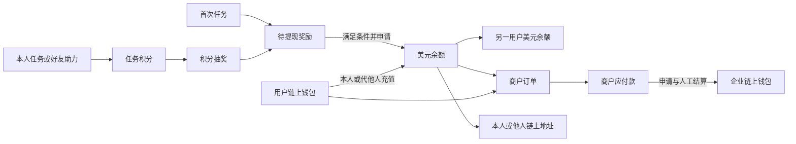

# 项目总览

## 产品定位

DexWallet 将平台美元账本与用户控制的链上钱包结合，提供个人收付款、商户订单支付与企业结算。任务与奖励用于引导使用，奖励达到条件后进入美元余额，进一步参与消费、转账或链上转出。

产品应让用户随时理解三件事：钱在哪里、这次操作会怎样改变资金、遇到中断如何继续。四类账户及 Pro 进度分别表达，不能用一个总资产数掩盖可用条件。

## 用户与使用场景

| 角色 | 首要目标 | 主要入口 | 成功结果 |
| --- | --- | --- | --- |
| 受邀新用户 | 看懂任务并获得首奖 | 具体任务邀请链接 | 首次完成后得到待提现奖励与 Pro 进度 |
| 日常付款用户 | 给个人或商户付款 | 收款链接、扫码、钱包 | 看清目标和费用，完成并找到账单 |
| 链上钱包用户 | 管理资产，充值或转账 | 钱包、资产详情 | 正确网络与资产转到确认过的目标 |
| 任务参与者 | 获得积分、奖励及邀请收益 | 奖励 | 知道本次收益与下一步可执行操作 |
| 企业商户 | 创建订单、确认收款、退款和结算 | 商户后台或服务端 API | 收款与企业实际结算均可核对 |
| 平台操作员 | 审核、处理异常、维护通道与对账 | 待办工作台 | 每笔处理有证据、资金结果和操作记录 |

邀请链接直接进入任务，支付链接直接进入订单，普通打开进入钱包。需要鉴权时恢复原上下文；仅使用美元余额或任务功能不要求创建链上钱包。

## 客户端与资产范围

首发 Telegram Mini App，本质为 H5；后续独立 App 的首版资产范围同时保留。App 的原生框架尚未定稿。

| 网络 | Mini App | 独立 App 首版 |
| --- | --- | --- |
| TON | TON、USDT | TON、USDT |
| Base | 不开放 | ETH、USDC |
| Solana | 不开放 | SOL、USDC、USDT |
| TRON | 不开放 | TRX、USDT |

共九个 App 网络资产组合，Mini App 两个。Base ETH 不代表 Ethereum 主网；同名资产按网络与合约或代币标识分别管理。各业务在此集合内按通道能力逐项启用，不因界面已设计就视为可用。

内置钱包支持创建、导入、备份与恢复，密钥由用户保管；外部钱包按网络和签名能力开放，不设品牌白名单。首版仅同设备唤起与返回，业务收款码和支付码继续支持。

## 功能边界

| 领域 | 本项目包含 | 本版不包含 |
| --- | --- | --- |
| 身份 | Mini App 静默鉴权、独立产品账户、外部身份映射；App 暂定邮箱、Telegram、直接登录；后台独立账户 | 钱包导入或切换作为产品登录 |
| 钱包 | 链上资产查看、收款、普通转账、美元账户互转、本人和他人充值、美元转出到链上 | 跨链桥、任意代币兑换、跨设备钱包配对 |
| 商户支付 | 手动及 API 开单、纯余额、纯链上、组合付款、通知与查单、退款 | 商户反扫付款码代扣、自动周期扣费、多商户拆单分账 |
| 奖励 | 首奖、任务资格与验证、任务邀请、好友助力、单层分成、Pro、积分抽奖、奖励转入 | 通用邀请链接、任意奖励撤销、购买 Pro、递归分成 |
| 商户与平台 | 企业创建商户、平台启用、人工结算、审核、异常、对账、配置和审计 | 完整电商库存物流、法币银行结算、复杂组织与多级审批界面 |

交易所或未连接钱包手动转入属于有条件的补充通道：归属、报价、费用未落实前不开入口。独立 App 暂定邮箱、Telegram、直接登录三种入口；直接登录按设备识别，无须先绑定外部身份，除操作必要条件外不统一限制功能。设备号来源、持有凭证与恢复方式仍待落实，不表示只凭客户端报送的设备号就能取得账户。具体规则见 [业务规则](02业务规则.md)，讨论边界见 [2.1 用户模型](../design/工程工作记录/02-用户与鉴权/2.1-用户模型/01讨论记录.md)。

## 产品闭环

链上支付的实收进入项目资金钱包，商户取得应付款；纯余额支付只转移账本负债。用户链上直接转账不经过平台账本。

## 体验目标与观察指标

观察入口首次选择、完成率、错误理解、人工求助和中断恢复情况。交易侧观察重复扣款、长期未知、异常关闭依据和通知恢复；奖励侧观察首奖、Pro 与提现条件理解是否正确。指标口径先明确事件与分母，基线测量后再定阈值，不预设未经验证的转化率目标。

详细流程见 [钱包与支付](03钱包与支付.md) 和 [任务与奖励](04任务与奖励.md)，交付阶段见 [实施路线](../engineering/实施路线.md)。
