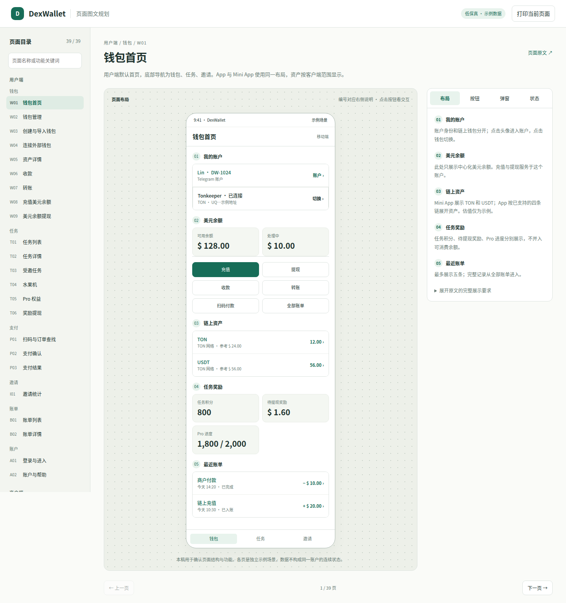
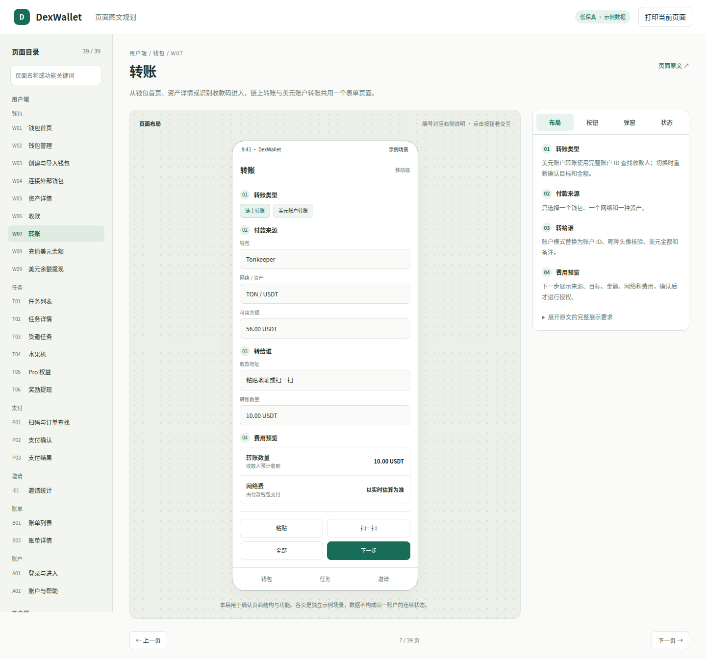
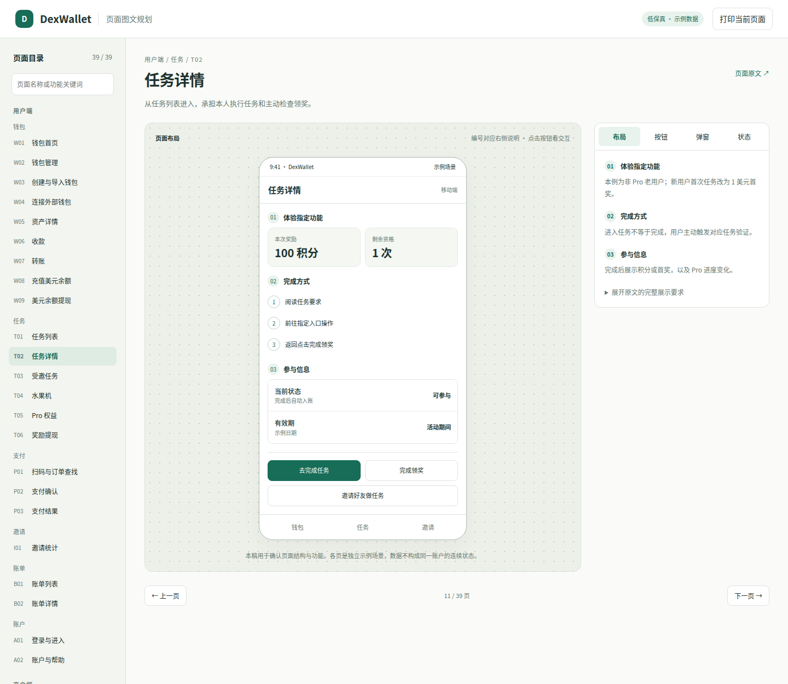
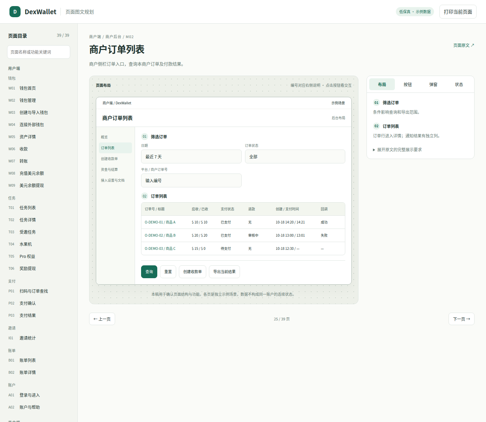
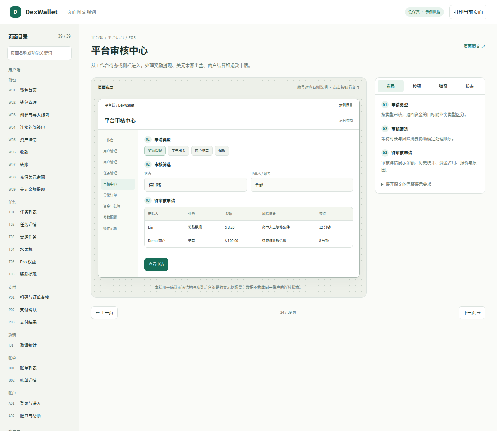
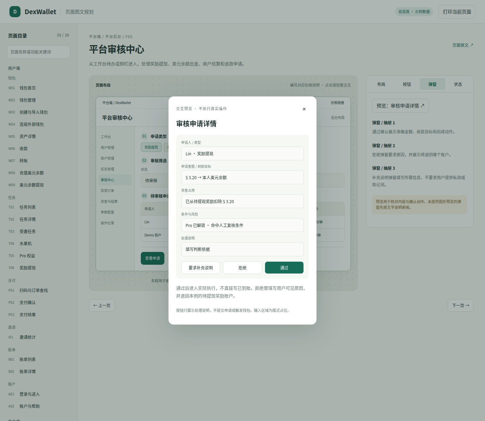

# DexWallet 页面图文规划

以“页面线框图 + 编号说明 + 点击行为”审阅产品。覆盖已有 39 个页面：用户端 23 页、商户端 6 页、平台端 9 页，以及后台登录。布局和示例文案可直接按页面修改。

## 打开方式

本地用浏览器打开 [index.html](index.html)，无需安装依赖或启动服务。左侧切换页面，中间看线框图，右侧切换布局、按钮、弹窗、状态。页面链接支持 `#w07` 这样的定位。

GitHub 文件浏览器不运行 HTML；在线阅读时先看下面的截图，或拉取仓库后打开 HTML。浏览器中的“打印当前页面”可保存当前页及四类说明为 PDF。

## 如何审阅

- 点图中的编号，对照该区域的展示内容和功能说明。
- 点主要按钮，查看行为说明及目标页面；右侧“按钮”列出全部 181 组操作，包括其他状态才出现的操作。
- 在“弹窗”中打开典型弹窗预览，核对字段、操作和确认后的行为。
- 在“状态”中核对限制、异常和空状态要求。当前版本未逐一绘制所有异常状态。

这是可浏览的低保真图稿。表单、标签和数据是布局示例，未实现业务校验、真实登录、钱包授权或资金操作；按钮只用于查看说明与导航。不同页面展示独立场景，不共用真实余额。网络、币种、费用和奖励规则以 [产品约定](../产品约定.md) 为准。

## 图稿预览

### 钱包首页

账户和钱包入口在顶部，美元余额下方提供充值、提现、收款、转账和扫码入口；链上资产及任务奖励分别展示。



### 转账

先选择链上或美元账户转账，再核对来源、收款目标、数量与费用，下一步进入确认。



### 任务详情

奖励、资格与步骤在同页呈现。本例为已有邀请资格的老用户；新用户无邀请按钮。



### 商户订单

筛选区和订单表格分层展示，支付状态与回调状态单独列示。



### 平台审核与详情弹窗

审核中心按申请类型分类，详情展示资金占用、到账目标、条件和处理说明。审核通过后进入执行，不直接代表已到账。





## 文件组织与维护

```text
图文原型/
├─ README.md        浏览入口与截图
├─ index.html       离线图文浏览器
├─ pages.json       每页布局、示例内容、编号说明
├─ build.py         合并布局与对应页面 Markdown
├─ assets/
│  ├─ pages.js      生成的页面数据
│  ├─ app.js        浏览、跳转和弹窗预览
│  └─ style.css     移动端、后台与打印布局
└─ previews/        代表页面截图
```

功能规则继续按原来的角色和页面目录维护；修改文字文档后，在仓库根目录运行 `python3 docs/product/图文原型/build.py` 更新图文稿中的文字说明。布局调整修改 `pages.json`，再执行同一命令。生成的 `assets/pages.js` 随仓库提交，使 HTML 可以离线打开；截图需要在布局修改后重新导出。

已在 Chrome 检查全部 39 页、按钮说明、典型弹窗和页面搜索；在 390 像素宽度下检查了用户端和后台代表页面。图稿提供 11 种典型弹窗预览，其余弹窗保留逐页说明。
