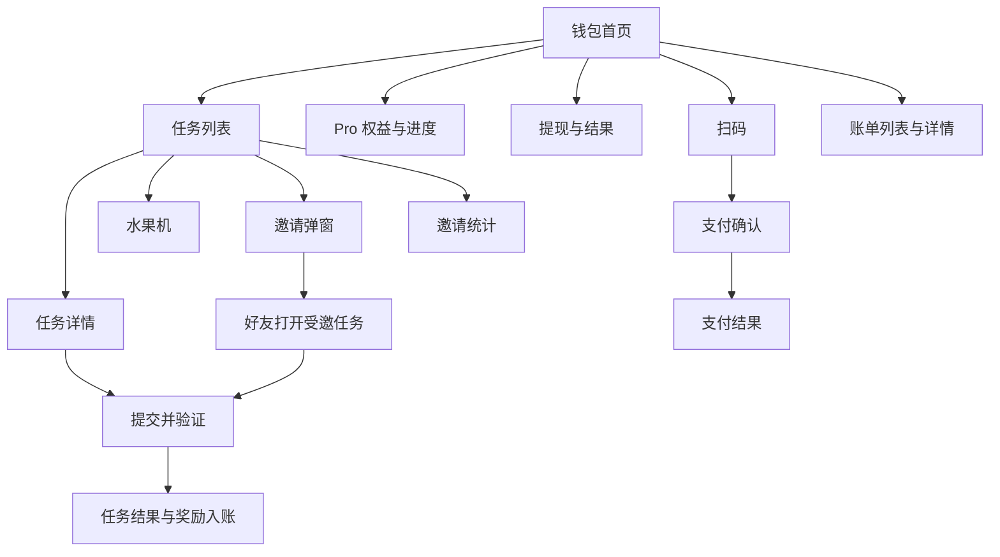

# DexWallet 产品分析与页面功能拆分

DexWallet 当前包含两条用户路径：通过任务和邀请获得奖励，以及通过钱包向商户付款。页面结构建议以钱包为首页，以任务和邀请为另外两个一级入口；账单、提现、Pro 权益和支付结果承接各自流程。

当前方案最需要补齐的是奖励如何变为可提现金额、不同邀请场景下谁获得奖励，以及支付中间状态如何展示。以下按 UI 页面拆分功能，供原型设计和后续需求细化使用。

## 现有方案分析

原始依据为 [产品大纲](大纲.md)。[钱包](钱包.md)、[任务列表](任务列表.md)、[任务详情](任务详情.md) 和 [邀请统计](邀请统计.md) 目前只有页面名称，尚无 UI 稿或完整交互描述。

### 已有业务描述

| 业务 | 原方案内容 | 尚未明确的边界 |
| --- | --- | --- |
| 初始奖励 | 初始奖励 1 美元 | 领取条件、入账形式，是否与受邀新用户奖励为同一笔 |
| Pro | 继续做任务达到 2 美元后解锁，可提现且奖励积分翻倍 | 2 美元的累计口径、解锁是否自动、翻倍覆盖哪些奖励 |
| 任务积分 | 1000 积分等于 1 美元 | 这是展示折算还是实际兑换比例 |
| 水果机 | 每 100 积分转一次，奖励期望为 0.1 美元 × RTP | 是否消耗积分、产出什么资产、是否为提现前必经步骤 |
| 任务参与 | 每个任务有自己做和邀请别人做两个选项 | 邀请后是否替代本人完成，是否能由多人协助 |
| 受邀参与 | 新用户显示 1 美元，老用户显示助力 | 参与者和邀请者分别获得什么，是否影响本人任务资格 |
| 邀请关系 | 邀请的新用户成为下级，下级后续任务奖励的 20% 以积分奖励邀请者 | 绑定时点、多次邀请归属、计算基数和结算时点 |
| 商户支付 | 商户创建订单，钱包扫码获取信息，付款后后端检查并回调商户 | 支持的链与币种、钱包形态、订单有效期、付款异常处理 |
| 账单 | 需要账单页面 | 包含链上支付、奖励、提现中的哪些记录 |

### 需要解决的产品问题

1. **余额概念混用。** 积分、积分的美元参考值、抽奖所得、可提现余额、链上资产需要分别定义。页面不能把参考价值直接展示为可花费余额。
2. **任务详情和任务完成混用。** 原方案中的“任务完成页”承担任务介绍，建议命名为任务详情页，完成结果另用页面状态或结果页承接。
3. **邀请包含两种不同结果。** 为某个任务邀请好友，以及建立长期邀请关系，需要分别反馈。链接已复制、好友已进入、助力已完成、分成已到账不是同一个状态。
4. **成功页面缺少判断依据。** 任务提交后可能仍待验证，付款发出后可能仍待确认；UI 应明确处理中、成功和失败。
5. **商户端与用户端范围混合。** 商户创建订单和接收回调属于支付依赖，本次用户端页面拆分不默认增加商户后台。

## 页面结构建议

下文标记“原有”的页面或弹窗来自原方案；“补充”用于承接原有功能的完整流程；“条件补充”需先确定对应业务形态。所有新增交互均为设计建议，未决业务规则集中列在文末。

| 层级 | 页面或界面 | 来源 | 用户要完成的事 |
| --- | --- | --- | --- |
| 一级入口 | 钱包首页 | 原有 | 查看资产与奖励概况，发起扫码支付 |
| 一级入口 | 任务列表页 | 原有 | 选择任务，查看进度，进入邀请或水果机 |
| 一级入口 | 邀请统计页 | 原有，原文也称分享统计 | 查看好友贡献及邀请收益 |
| 二级页面 | 任务详情页 | 原有，统一任务完成页的命名 | 了解条件并执行任务 |
| 二级页面 | 受邀任务落地页 | 补充 | 理解邀请关系，完成任务或助力；可复用任务详情布局 |
| 二级页面或结果状态 | 任务完成结果 | 补充 | 确认完成情况与奖励去向 |
| 弹窗或抽屉 | 邀请弹窗 | 原有 | 复制当前任务的邀请链接 |
| 弹窗或独立页面 | 水果机 | 原有 | 使用积分参与抽奖并查看结果 |
| 二级页面或抽屉 | Pro 权益与解锁进度 | 补充 | 理解门槛、当前进度和已解锁权益 |
| 二级页面 | 提现页及结果 | 补充 | 提交提现并跟踪处理状态 |
| 功能界面 | 扫码页 | 原有功能拆出 | 扫描商户订单 |
| 二级页面 | 支付确认页 | 原有功能拆出 | 核对订单，选择支付币种并确认付款 |
| 二级页面或结果状态 | 支付结果 | 补充 | 查看付款状态及后续处理入口 |
| 二级页面 | 账单列表与详情 | 原有列表，补充详情 | 查找并解释每一笔资金或积分变化 |
| 接入流程 | 身份建立及钱包接入 | 条件补充 | 按选定账户和钱包形态完成身份识别或钱包准备 |

账单建议从钱包首页进入；Pro 从钱包和任务页的进度卡进入；提现从钱包首页进入。邀请统计可先作为任务页的二级入口，是否放入底部导航取决于邀请在首版中的重要程度。

### 用户主流程

水果机产出、Pro 解锁进度与可提现余额之间的关系仍待确定，因此流程图不将它们串为固定的资金兑换路径。

## 按页面拆分功能

### 钱包首页

页面目标：让用户理解自己有哪些资产、哪些金额可操作，以及下一步可以做什么。

| UI 区域 | 功能点 | 操作与反馈 |
| --- | --- | --- |
| 账户及钱包状态 | 展示当前身份和钱包准备状态 | 未具备支付条件时提供对应接入入口，具体流程取决于钱包形态 |
| 钱包资产区 | 展示支付可用的币种、数量及所属网络 | 数据加载失败提供重试，不显示为零余额 |
| 奖励概况区 | 展示任务积分、奖励余额及可提现金额 | 只展示业务最终定义的账户类别，积分折算金额注明用途 |
| Pro 进度卡 | 展示当前状态、解锁条件、差额和权益入口 | 未解锁进入权益说明，已解锁显示生效权益 |
| 主要操作区 | 扫码支付、提现 | 扫码进入相机；提现按解锁状态进入表单或门槛说明 |
| 近期账单 | 展示近期变化、类型、金额、时间与状态 | 点击进入详情，查看全部进入账单列表 |
| 任务引导 | 展示任务入口及初始奖励入口 | 初始奖励的可领取、已领取状态取决于最终发放条件 |

重点状态：首次使用、资产加载中、加载失败、零资产、未解锁 Pro、已解锁 Pro、存在处理中的提现或支付。

待定：是否需要收款、转账、资产明细、钱包导入或备份。原方案只有商户扫码支付，不能据“钱包”名称推定这些能力都在首版范围内。

### 任务列表页

页面目标：让用户判断任务能获得什么、是否可参加，以及选择自己完成或邀请好友。

| UI 区域 | 功能点 | 操作与反馈 |
| --- | --- | --- |
| 奖励概览 | 展示当前积分、初始奖励状态、Pro 进度 | 点击进度进入权益说明 |
| 任务卡片 | 展示标题、简述、奖励、参与条件和当前状态 | 点击卡片进入详情；若用美元展示积分奖励，应明确是折算值 |
| 自己做按钮 | 进入本人任务流程 | 不满足条件时说明原因，已完成任务按重复参与规则处理 |
| 邀请别人做按钮 | 打开当前任务的邀请弹窗 | 保留任务上下文，让用户知道邀请好友完成哪项任务 |
| 水果机入口 | 展示积分余额及参与门槛 | 进入玩法界面；可参与次数须等扣分规则确定后再显示 |
| 邀请统计入口 | 查看已邀请好友及奖励贡献 | 跳转邀请统计页 |

建议任务状态：可参与、进行中、待验证、已完成、未通过、已失效或暂不可参与。是否需要筛选标签取决于任务数量，不必为少量任务增加筛选复杂度。

普通任务卡展示任务自身奖励；通过邀请链接进入后的新老用户奖励差异，在受邀任务页面说明，避免列表中的奖励含义随上下文不明地变化。

### 任务详情页

页面目标：让用户看懂完成条件、执行动作，并知道奖励何时到账。

| UI 区域 | 功能点 | 操作与反馈 |
| --- | --- | --- |
| 任务说明 | 标题、奖励、参与资格、截止条件 | 有次数或时间限制时明确展示 |
| 完成步骤 | 展示动作、目标、完成判定方式 | 根据任务类型跳转目标页面或执行站内操作 |
| 任务进度 | 展示当前步骤、完成情况和验证结果 | 离开再回来时恢复真实进度 |
| 主操作 | 开始任务、继续任务或检查完成情况 | 若自动验证则无需额外提交；是否需要凭证按任务类型决定 |
| 邀请入口 | 打开本任务邀请弹窗 | 说明好友完成后，本人能获得什么 |
| 结果说明 | 展示奖励状态和未通过原因 | 可重试时给出操作，不可重试时说明条件 |

点击“去完成”、访问外部页面或返回应用，均不直接等同于任务完成。待验证阶段与已入账阶段应有不同的状态文案。

### 受邀任务落地页

页面目标：让好友明确自己在帮助谁、需要完成什么、自己能获得什么。

| 参与身份 | 原方案要求的展示 | 需要补齐的交互 |
| --- | --- | --- |
| 身份尚未识别 | 暂不能判断新老用户奖励 | 展示任务和邀请背景，待识别后确定权益，避免提前承诺 1 美元 |
| 新用户 | 显示 1 美元奖励 | 明确领取条件、奖励归属及与初始奖励是否重复 |
| 老用户 | 显示助力 | 明确助力目标、成功条件，以及是否另有本人奖励 |
| 已参与用户 | 原方案未定义 | 展示本次任务处理结果，是否允许再次参与待定 |

页面还应展示邀请者的可识别信息、任务内容和主操作按钮。链接失效、任务结束、邀请自己、已有邀请关系等情况，需要提供明确反馈；具体是否允许参与由邀请规则决定。

长期邀请关系与本次任务助力分别展示，避免把“成功建立邀请关系”写成“任务助力成功”。

### 邀请弹窗

页面目标：用户能准确分享一项任务，并理解分享后的奖励条件。

| UI 区域 | 功能点 | 操作与反馈 |
| --- | --- | --- |
| 邀请说明 | 任务名称、好友要做的事、双方奖励条件 | 新用户奖励与长期分成分别说明 |
| 邀请链接 | 生成当前任务对应的可复制链接 | 生成中、生成失败、复制成功分别反馈 |
| 分享操作 | 复制链接，可按运行平台支持系统分享 | 复制成功仅表示链接已复制 |
| 统计入口 | 查看好友参与和奖励进度 | 跳转邀请统计页 |

长期分成的 20% 是已有规则，但不能直接将其写成“邀请一次立即获得 20%”，需保留下级获得任务奖励这一触发条件。

### 任务完成结果

页面目标：确认谁完成了什么，以及奖励进入哪里。可以作为详情页的结果状态，无须为每个状态新增页面。

| 结果状态 | 展示内容 | 后续操作 |
| --- | --- | --- |
| 待验证 | 已提交或已检测到操作，尚待验证 | 查看进度、返回任务列表 |
| 完成且奖励已到账 | 奖励数量、单位、到账账户或账单入口 | 查看账单、继续任务 |
| 完成但奖励处理中 | 完成结果与奖励处理状态分别展示 | 查看奖励进度，避免诱导重复领取 |
| 助力成功 | 助力对象和结果；本人有奖励时单独展示 | 查看自己的任务 |
| 未通过 | 具体未满足的条件 | 按规则重试或返回 |

若本次奖励触发 Pro 解锁，结果区应提示权益已生效并提供查看入口。是否触发以最终确定的进度口径为准。

### 水果机

页面目标：让用户在开始前理解投入，结束后看清结果及余额变化。

| UI 区域 | 功能点 | 操作与反馈 |
| --- | --- | --- |
| 积分与规则 | 当前积分、每次所需积分、结果范围及产出单位 | “消耗 100 积分”须待扣分规则确认后使用 |
| 开始按钮 | 发起单次抽奖 | 积分不足时引导做任务，处理中防止重复发起 |
| 动画区域 | 展示一次抽奖的过程 | 动画与同一次业务结果对应 |
| 结果区域 | 展示奖励、入账位置和本次积分变化 | 可查看记录或再次参与 |
| 异常恢复 | 查询未展示完或处理中那一笔结果 | 断网、关闭、重进后恢复结果，避免重复扣减 |

“0.1 美元 × RTP”描述的是期望值，不能用于保证每次获得 0.1 美元。规则说明需与最终奖励分布一致，单次奖励以实际结果展示。

### Pro 权益与解锁进度

页面目标：让用户知道距离解锁还有多远，解锁后具体发生什么变化。

| UI 区域 | 功能点 | 操作与反馈 |
| --- | --- | --- |
| 状态与进度 | 未解锁、已达条件待处理、已解锁 | 展示统计口径及剩余差额；若不存在处理阶段则无需中间状态 |
| 提现权益 | 说明 Pro 与提现资格的关系 | 解锁后进入提现，未解锁引导完成任务 |
| 积分翻倍权益 | 说明适用奖励、生效时点 | 任务基础奖励与翻倍后奖励保持一致的展示口径 |
| 达成反馈 | 解锁成功提示 | 返回任务或进入提现 |

原方案没有购买 Pro 的描述，不增加订阅、购买或付费升级入口。达到 2 美元所用的是当前余额还是历史累计，以及提现后是否维持 Pro，均需先确定。

### 提现页及结果

页面目标：把可提现金额提交到明确的收款目标，并让用户持续查询结果。

| UI 区域 | 功能点 | 操作与反馈 |
| --- | --- | --- |
| 资格与额度 | Pro 状态、可提现余额、已有处理中金额 | 未满足条件时展示原因和对应入口 |
| 提现表单 | 金额、收款目标；若涉及链上提现，展示币种和网络 | 校验余额和已定义的限额，收款目标形式取决于提现方式 |
| 提交前确认 | 本次金额、费用、预计到账金额、收款信息 | 有费用时明示，无规则时不能自行假定免费 |
| 处理结果 | 待处理、已到账、失败 | 提供记录详情；失败说明金额是否恢复可用 |

提交后防止重复请求。页面离开后可从账单继续查询，不依赖停留在结果页。提现方式、最低金额、费用、处理时效、失败资金处理均为待定项。

### 扫码页

页面目标：识别商户订单并进入订单确认。

| UI 区域 | 功能点 | 操作与反馈 |
| --- | --- | --- |
| 相机区域 | 请求相机权限并扫描二维码 | 拒绝授权时提供说明和重新授权路径 |
| 识别状态 | 校验是否为支持的订单内容 | 无效或不支持时提示重新扫描 |
| 订单查询 | 根据识别结果获取订单信息 | 查询中防止重复跳转，失败可重试 |
| 订单可用性 | 判断订单是否可继续支付 | 已支付、已关闭、已过期时展示对应结果 |

扫码成功进入确认页，仍由用户核对金额和币种后付款。图片识别、手动输入订单等辅助入口可按实际使用场景后续决定。

### 支付确认页

页面目标：让用户理解向哪个商户、为哪个订单、使用什么资产支付多少。

| UI 区域 | 功能点 | 操作与反馈 |
| --- | --- | --- |
| 订单信息 | 商户名称、订单号、订单金额、有效状态 | 如设置有效期，展示剩余时间或到期提示 |
| 币种选择 | 展示订单允许的币种及相应网络 | 切换后同步更新应付数量与余额检查 |
| 费用明细 | 应付资产数量、支付所需费用 | 费用和金额来源需定义，不能仅凭美元金额推定代币数量 |
| 支付信息 | 收款目标及必要订单关联信息 | 订单关联信息由支付流程带入，避免要求用户手动填写 |
| 确认支付 | 用户授权后发起付款 | 授权取消、余额不足、费用不足、订单失效分别反馈 |

原方案用 memo 记录订单号，这属于订单识别的实现设想；选定支付网络后应核实方案适用性。UI 的业务要求是付款能准确关联订单，无需向普通用户暴露后端轮询细节。

### 支付结果

页面目标：区分付款是否发出、是否确认，以及商户是否已确认订单。

| 结果状态 | 展示内容 | 可用操作 |
| --- | --- | --- |
| 等待授权 | 等待用户在钱包或应用中确认 | 返回确认页或取消 |
| 授权取消或发送失败 | 本次未完成支付，说明原因 | 订单仍有效时重新发起 |
| 已发送待确认 | 支付处理中、订单号和可用的交易信息 | 查询状态、返回钱包，不提示再次付款 |
| 支付已确认且商户已确认 | 支付成功、商户、金额、时间 | 返回商户或查看账单 |
| 支付已确认但商户确认中 | 用户付款结果与商户处理结果分别说明 | 查询进度、查看凭据，避免引导重复支付 |
| 金额或订单匹配异常 | 已检测到付款但尚不能完成订单 | 展示可追踪的订单及交易信息，进入后续处理路径 |

回调重试属于后台动作；用户端应能在离开页面后重新查到付款结果。支付超时、金额不符等异常由谁处理、从何处发起处理，需要明确后才能落实入口。

### 邀请统计页

页面目标：说明哪些好友参与了任务、产生了多少贡献，以及哪些奖励已经到账。

| UI 区域 | 功能点 | 操作与反馈 |
| --- | --- | --- |
| 数据概览 | 已绑定好友数、任务参与或助力数、累计已到账分成积分 | 指标名称与计算口径一致，复制次数不计入成功邀请 |
| 好友列表 | 好友可识别信息、绑定时间、贡献积分 | 查看该好友对应的任务奖励记录 |
| 收益明细 | 来源好友、关联任务、奖励基数、分成积分、时间和状态 | 已到账与处理中分开显示，关联账单详情 |
| 规则说明 | 新用户关系绑定、后续任务奖励 20% 分成 | 翻倍和其他奖励是否计入基数明确后再补充 |
| 继续邀请 | 返回可邀请任务或再次打开任务分享 | 通用推广链接不是原有明确能力，首版可先围绕任务邀请 |

空状态引导用户选择任务邀请好友。好友已绑定但尚未完成任务时，应保留好友记录并显示暂无贡献，不能等同于邀请失败。

### 账单列表与详情

页面目标：解释每一次变化的原因、数额、去向和处理状态。

| UI 区域 | 功能点 | 操作与反馈 |
| --- | --- | --- |
| 账户或类型切换 | 建议按钱包资金和任务奖励分别查看 | 不把积分数量与货币金额相加汇总 |
| 账单列表 | 收支方向、类型、数量、单位、时间、状态 | 点击进入详情；数据较多时分页或继续加载 |
| 账单详情 | 账单标识、业务来源、金额构成、处理状态 | 按类型关联任务、邀请收益、提现或支付订单 |
| 支付补充信息 | 商户订单、支付币种与网络、可用的交易凭据 | 提供复制或查看凭据入口 |
| 奖励补充信息 | 任务奖励、邀请分成、翻倍奖励的组成 | 能解释为何得到当前数量，避免只有一个总数 |

建议覆盖任务奖励、邀请分成、水果机积分变化及奖励、提现、商户支付；是否合并为一个列表由账户模型决定。冻结金额不等于已支出，失败恢复金额不等于新增收益，各状态应保持可追溯关系。

## 设计前需要确定的业务规则

| 优先级 | 决策项 | 要回答的问题 | 影响的 UI |
| --- | --- | --- | --- |
| 先确定 | 账户与钱包形态 | 如何识别用户？钱包是内置、托管还是外部连接？支持哪些网络与币种？ | 首次使用、钱包、支付、提现 |
| 先确定 | 奖励账户模型 | 任务发积分后能否直接兑换？水果机是否必经？抽奖产出积分还是可提现金额？奖励余额能否用于商户支付？ | 钱包、任务、水果机、提现、账单 |
| 先确定 | 初始 1 美元 | 何时获得？与受邀新用户奖励是否为同一笔？发积分还是金额？ | 首次使用、任务列表、受邀落地页 |
| 先确定 | Pro 的 2 美元门槛 | 当前余额还是累计收益？初始奖励、邀请奖励、抽奖奖励是否计入？解锁后是否永久有效？ | 进度卡、权益、提现 |
| 先确定 | 两类参与的关系 | 自己做和邀请别人做能否同时获得奖励？好友完成是否直接完成邀请者的任务？多人助力如何计算？ | 任务卡、详情、邀请弹窗和结果 |
| 先确定 | 新老用户助力奖励 | 邀请者和参与者各得多少？老用户是否仅助力？每项任务能助力多少次？ | 受邀落地页、结果、统计 |
| 先确定 | 邀请绑定与分成 | 什么是新用户？何时绑定？冲突归属如何定？20% 的基数是否含 Pro 翻倍？何时到账？ | 邀请规则、统计、收益明细 |
| 先确定 | 积分翻倍 | 哪些积分来源翻倍？是否影响已有任务？分成是否再次翻倍？ | 任务奖励展示、Pro 权益、账单 |
| 先确定 | 水果机结算 | 每次是否扣 100 积分？奖励单位与分布是什么？不足 100 积分如何处理？RTP 如何配置？ | 玩法说明、开始按钮、结果 |
| 先确定 | 提现规则 | 提到哪里？最低金额、费用、可提现额度和失败恢复如何计算？ | 提现表单、确认和结果 |
| 原型细化时确定 | 任务判定 | 每种任务如何验证？是否重复开放？失败、过期、奖励延迟怎样处理？ | 任务详情和结果 |
| 原型细化时确定 | 支付订单规则 | 金额按何种单位计价？多币种如何确定实付数量？有效期、确认条件和异常处理路径是什么？ | 支付确认、结果和账单 |
| 原型细化时确定 | 统计口径 | 绑定人数、有效助力、已到账收益如何统计？是否需要时间筛选？ | 邀请统计 |

可以用一个具体案例检查规则是否闭合：A 邀请新用户 B 完成任务，B 获得所述 1 美元奖励；需要能明确写出 B 实际入账的资产及数量、是否另有初始奖励、A 是否获得任务奖励及 20% 分成、双方 Pro 进度如何变化，以及 B 是否还需经过水果机才能提现。该案例未确定前，不宜把页面上的金额文案和计算公式定死。

## 原型与功能交付拆分建议

| 功能组 | 涉及页面 | 应能演示的完整结果 |
| --- | --- | --- |
| 任务获奖 | 任务列表、详情、完成结果、奖励账单 | 用户完成任务，经验证后看到正确奖励和进度；失败原因可解释 |
| 邀请参与 | 邀请弹窗、受邀落地页、任务结果、邀请统计 | 分享者与好友分别看到参与结果，关系绑定和奖励归属可追溯 |
| 水果机 | 积分入口、玩法界面、结果、奖励账单 | 单次参与对应一次投入和结果，断网后可恢复 |
| Pro 与提现 | 权益进度、钱包、提现及结果、账单 | 达到明确门槛后获得权益，提交提现后可持续查询 |
| 商户付款 | 钱包、扫码、支付确认、支付结果、资金账单 | 用户确认付款后能区分处理中、成功和异常，离开后仍可追踪 |

原型可先统一页面导航与金额单位，再逐组补齐正常、处理中、失败和空状态。任务类型、任务内容以及邀请结算规则确定后，再拆成开发任务；不把上述页面数量直接当作开发任务数量。

首版范围建议围绕这五组闭环评估。商城、交易行情、多级邀请、付费 Pro、完整商户后台，以及收款和通用转账，均不作为当前方案自然包含的功能。
