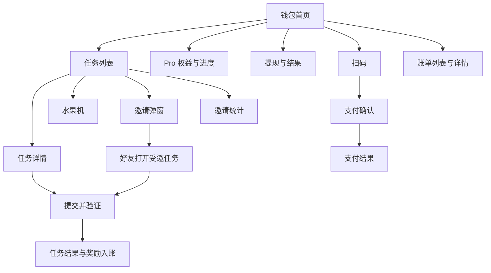

# DexWallet 产品分析与页面功能拆分

DexWallet 当前包含两条用户路径：通过任务和邀请获得奖励，以及通过钱包向商户付款。页面结构建议以钱包为首页，以任务和邀请为另外两个一级入口；账单、提现、Pro 权益和支付结果承接各自流程。

任务、邀请、Pro及奖励账户的主要规则已明确。以下按UI页面组织当前功能，供原型设计使用；具体水果机概率表及另行讨论的钱包支付方案在文末列出。

## 现有方案分析

原始依据为 [产品大纲](大纲.md)。[钱包](钱包.md)、[任务列表](任务列表.md)、[任务详情](任务详情.md) 和 [邀请统计](邀请统计.md) 目前只有页面名称，尚无 UI 稿或完整交互描述。

### 当前已明确规则

后续回答和会话决议已覆盖原始大纲中的部分设想，当前以 [待确认功能清单](design/待确认功能清单.md) 为准。

| 业务 | 当前规则 | 仍需细化 |
| --- | --- | --- |
| 产品与身份 | 首版 Telegram Mini App 静默登录；产品用户与外部身份分开 | 钱包接入交互和后续平台适配 |
| 钱包 | 提供前端钱包能力，也可使用外部钱包；允许多个钱包，后端不保存用户密钥；App 与 Mini App 范围见 [首版网络币种与外部钱包范围](design/网络币种与外部钱包建议.md) | 钱包连接兼容性、具体交互及资产用途 |
| 任务首奖 | 本人首次完成任务发1美元至任务待提现余额，同时记1000点Pro进度，不增加可消费积分；受邀新用户首奖是同一笔 | 无 |
| 任务验证 | 用户统一点击完成领奖，具体资格与验证由任务分别实现，成功自动入账 | 首批任务内容 |
| 新用户邀请资格 | 首次任务完成前仅本人做任务，不能生成邀请；仍可通过他人邀请亲自完成首个任务 | 无 |
| 好友助力 | 邀请者获得一次任务积分；新参与者获得一次1美元首奖，老参与者不获奖励 | 具体任务资格由任务实现 |
| 助力次数 | 邀请者接受有效助力次数不限；参与者助力与本人做任务共用参与资格 | 无 |
| 自己助力 | 禁止；本人打开自己的助力页面返回任务页面 | 无 |
| 邀请绑定 | 本人首次任务在邀请页完成并验证成功时绑定，之后不可由用户变更或解除 | 无 |
| 邀请分成 | 任务积分实际到账同时，上级获得20%积分并向下取整；分成不再产生上级分成 | 无 |
| Pro | 首奖记1000进度，本人任务及好友助力所得任务积分累计计入；20%分成不计入；达到2000自动永久解锁，积分消费不减进度，水果机现金不增加进度 | 无 |
| 积分翻倍 | 按获得任务积分者完成任务时的Pro状态计算；触发解锁的当笔不翻倍，后续任务积分翻倍；上级Pro不再放大分成 | 无 |
| 水果机 | 每次消耗100积分，计价基准0.10美元，初始RTP为0.95；现金进入任务待提现余额，扣分与结果及入账同事务 | 具体建议档位待定稿 |
| 奖励提现 | 任务待提现美元余额转入本人中心化钱包美元余额；最低2美元、无手续费；申请扣款形成订单，拒绝退回 | 动态资格与高风险审核规则预留 |
| 奖励撤销 | 不做任务奖励及分成事后撤销 | 事务失败回滚与提现拒绝退回仍保留 |
| 支付与商户端 | 支付、商户接入及后台、异常订单处理均在范围内 | 详细方案单独讨论 |
| 账单与统计 | 账单覆盖资金转入转出，邀请统计和筛选由页面方案设计 | 具体展示方案 |

### 页面需遵循的区别

1. **四类资产分开。** 任务积分用于水果机，任务待提现现金受领取条件限制，中心化钱包美元余额可用于后续钱包功能，链上资产由所选钱包持有。Pro累计进度独立于这四类余额。
2. **新用户不能邀请。** 任务卡、详情、邀请统计入口统一处理，不能只隐藏某一处按钮。用户第一次本人完成任务后再开放邀请。
3. **两类邀请收益分开。** 好友在本人的邀请页完成任务，给本人产生任务积分；下级获得任务积分时，给上级产生20%分成。这两类收益不应都叫“助力奖励”。
4. **Pro与最低提现额分开。** Pro进度达到2000不代表现金余额已有2美元，还需满足最低金额及其他有效条件。
5. **明确结算与展示。** 水果机动画不决定入账，重复请求不能重复扣分；任务验证通过才发奖。

## 页面结构建议

下文标记“原有”的页面或弹窗来自原方案；“补充”用于承接原有功能的完整流程；“条件补充”需先确定对应业务形态。所有新增交互均为设计建议，未决业务规则集中列在文末。

| 层级 | 页面或界面 | 来源 | 用户要完成的事 |
| --- | --- | --- | --- |
| 一级入口 | 钱包首页 | 原有 | 查看资产与奖励概况，发起扫码支付 |
| 一级入口 | 任务列表页 | 原有 | 选择任务，查看进度，进入邀请或水果机 |
| 一级入口 | 邀请统计页 | 原有，原文也称分享统计 | 查看好友贡献及邀请收益 |
| 二级页面 | 任务详情页 | 原有，统一任务完成页的命名 | 了解条件并执行任务 |
| 二级页面 | 受邀任务落地页 | 补充 | 理解邀请关系，完成任务或助力；可复用任务详情布局 |
| 二级页面或结果状态 | 任务完成结果 | 补充 | 确认完成情况与奖励去向 |
| 弹窗或抽屉 | 邀请弹窗 | 原有 | 复制当前任务的邀请链接 |
| 弹窗或独立页面 | 水果机 | 原有 | 使用积分参与抽奖并查看结果 |
| 二级页面或抽屉 | Pro 权益与解锁进度 | 补充 | 理解门槛、当前进度和已解锁权益 |
| 二级页面 | 提现页及结果 | 补充 | 提交提现并跟踪处理状态 |
| 功能界面 | 扫码页 | 原有功能拆出 | 扫描商户订单 |
| 二级页面 | 支付确认页 | 原有功能拆出 | 核对订单，选择支付币种并确认付款 |
| 二级页面或结果状态 | 支付结果 | 补充 | 查看付款状态及后续处理入口 |
| 二级页面 | 账单列表与详情 | 原有列表，补充详情 | 查找并解释每一笔资金或积分变化 |
| 接入流程 | 身份建立及钱包接入 | 补充 | Telegram静默鉴权，按需创建、导入或连接钱包 |
| 二级页面 | 收款、普通转账、单币种资产详情 | 后续已确认纳入首版 | 钱包方案细化时补充布局 |

账单从钱包首页进入；Pro从钱包和任务页的进度卡进入；奖励提现转入中心化钱包。页面规划采用钱包、任务、邀请三个一级入口。新用户的邀请页显示完成首个任务的引导，不提供邀请操作。

### 用户主流程

资金路径为任务积分 → 水果机 → 任务待提现美元余额 → 条件校验 → 中心化钱包美元余额。首次1美元直接进入任务待提现余额。Pro按累计积分另行计算；钱包支付的资金组合逻辑单独讨论。

## 按页面拆分功能

### 钱包首页

页面目标：让用户理解自己有哪些资产、哪些金额可操作，以及下一步可以做什么。

| UI 区域 | 功能点 | 操作与反馈 |
| --- | --- | --- |
| 账户及钱包状态 | 展示当前身份和钱包准备状态 | 未具备支付条件时提供对应接入入口，具体流程取决于钱包形态 |
| 钱包资产区 | 展示支付可用的币种、数量及所属网络 | 数据加载失败提供重试，不显示为零余额 |
| 奖励概况区 | 展示任务积分、奖励余额及可提现金额 | 只展示业务最终定义的账户类别，积分折算金额注明用途 |
| Pro 进度卡 | 展示当前状态、解锁条件、差额和权益入口 | 未解锁进入权益说明，已解锁显示生效权益 |
| 主要操作区 | 扫码支付、提现 | 扫码进入相机；提现按解锁状态进入表单或门槛说明 |
| 近期账单 | 展示近期变化、类型、金额、时间与状态 | 点击进入详情，查看全部进入账单列表 |
| 任务引导 | 展示任务入口及初始奖励入口 | 初始奖励的可领取、已领取状态取决于最终发放条件 |

重点状态：首次使用、资产加载中、加载失败、零资产、未解锁 Pro、已解锁 Pro、存在处理中的提现或支付。

收款、普通转账、单币种资产详情已确定纳入首版。允许内置钱包创建或导入，也允许选择外部钱包，未准备内置钱包不阻塞任务等不依赖钱包的功能。

### 任务列表页

页面目标：让用户判断任务能获得什么、是否可参加，以及选择自己完成或邀请好友。

| UI 区域 | 功能点 | 操作与反馈 |
| --- | --- | --- |
| 奖励概览 | 展示当前积分、初始奖励状态、Pro 进度 | 点击进度进入权益说明 |
| 任务卡片 | 展示标题、简述、奖励、参与条件和当前状态 | 点击卡片进入详情；若用美元展示积分奖励，应明确是折算值 |
| 自己做按钮 | 进入本人任务流程 | 不满足条件时说明原因，已完成任务按重复参与规则处理 |
| 邀请别人做按钮 | 仅完成首个任务后的老用户可见和可用 | 新用户仅自己做；老用户打开当前任务邀请弹窗 |
| 水果机入口 | 展示积分余额、每次100积分及可参与次数 | 可参与次数为积分余额除以100向下取整 |
| 邀请统计入口 | 查看已邀请好友及奖励贡献 | 跳转邀请统计页 |

建议任务状态：可参与、进行中、待验证、已完成、未通过、已失效或暂不可参与。是否需要筛选标签取决于任务数量，不必为少量任务增加筛选复杂度。

普通任务卡按本人身份展示奖励：新用户首次本人完成任务获得1美元，老用户本人完成获得任务积分。受邀页另行说明新用户首奖及老用户无本人奖励的助力行为。

### 任务详情页

页面目标：让用户看懂完成条件、执行动作，并知道奖励何时到账。

| UI 区域 | 功能点 | 操作与反馈 |
| --- | --- | --- |
| 任务说明 | 标题、奖励、参与资格、截止条件 | 有次数或时间限制时明确展示 |
| 完成步骤 | 展示动作、目标、完成判定方式 | 根据任务类型跳转目标页面或执行站内操作 |
| 任务进度 | 展示当前步骤、完成情况和验证结果 | 离开再回来时恢复真实进度 |
| 主操作 | 开始任务、继续任务、完成领奖 | 统一由用户点击完成领奖触发验证，各任务实现具体验证 |
| 邀请入口 | 仅老用户打开本任务邀请弹窗 | 首次任务完成前不展示；开放后说明本人获得的任务积分 |
| 结果说明 | 展示奖励状态和未通过原因 | 可重试时给出操作，不可重试时说明条件 |

点击“去完成”、访问外部页面或返回应用，均不直接等同于任务完成。待验证阶段与已入账阶段应有不同的状态文案。

### 受邀任务落地页

页面目标：让好友明确自己在帮助谁、需要完成什么、自己能获得什么。

| 参与身份 | 原方案要求的展示 | 需要补齐的交互 |
| --- | --- | --- |
| 身份尚未识别 | 暂不能判断新老用户奖励 | 展示任务和邀请背景，待识别后确定权益，避免提前承诺 1 美元 |
| 新用户 | 显示1美元首奖 | 本人完成并点击完成领奖，验证后进入待提现余额，与初始奖励同一笔 |
| 老用户 | 显示助力 | 本人不获奖，消耗对应任务参与资格，邀请者获得任务积分 |
| 已参与用户 | 展示任务处理结果 | 是否可再次参与由该任务的资格实现决定，助力与本人做任务共用资格 |

页面展示邀请者信息、任务内容和本人参与按钮。本人打开自己的邀请链接直接返回任务页面，不生成助力或奖励。新用户可受邀完成首个任务，但不能转邀；已有邀请关系的老用户可按任务资格助力其他人，不改绑关系。

长期邀请关系与本次任务助力分别展示，避免把“成功建立邀请关系”写成“任务助力成功”。

### 邀请弹窗

页面目标：用户能准确分享一项任务，并理解分享后的奖励条件。

| UI 区域 | 功能点 | 操作与反馈 |
| --- | --- | --- |
| 邀请说明 | 任务名称、好友要做的事、双方奖励条件 | 新用户奖励与长期分成分别说明 |
| 邀请链接 | 生成当前任务对应的可复制链接 | 生成中、生成失败、复制成功分别反馈 |
| 分享操作 | 复制链接，可按运行平台支持系统分享 | 复制成功仅表示链接已复制 |
| 统计入口 | 查看好友参与和奖励进度 | 跳转邀请统计页 |

长期分成的 20% 是已有规则，但不能直接将其写成“邀请一次立即获得 20%”，需保留下级获得任务奖励这一触发条件。

### 任务完成结果

页面目标：确认谁完成了什么，以及奖励进入哪里。可以作为详情页的结果状态，无须为每个状态新增页面。

| 结果状态 | 展示内容 | 后续操作 |
| --- | --- | --- |
| 待验证 | 已提交或已检测到操作，尚待验证 | 查看进度、返回任务列表 |
| 完成且奖励已到账 | 奖励数量、单位、到账账户或账单入口 | 查看账单、继续任务 |
| 完成但奖励处理中 | 完成结果与奖励处理状态分别展示 | 查看奖励进度，避免诱导重复领取 |
| 助力成功 | 助力对象和结果；本人有奖励时单独展示 | 查看自己的任务 |
| 未通过 | 具体未满足的条件 | 按规则重试或返回 |

首次1美元显示现金到账和Pro进度增加1000，后续本人任务及好友助力所得任务积分增加对应进度；20%分成不增加进度。若本次奖励使累计进度达到2000，结果区提示Pro已解锁并提供权益入口。

### 水果机

页面目标：让用户在开始前理解投入，结束后看清结果及余额变化。

| UI 区域 | 功能点 | 操作与反馈 |
| --- | --- | --- |
| 积分与规则 | 当前积分、每次消耗100积分、现金奖励范围及单位 | 具体奖项与概率见水果机奖励方案 |
| 开始按钮 | 发起单次抽奖 | 积分不足时引导做任务，处理中防止重复发起 |
| 动画区域 | 展示一次抽奖的过程 | 动画与同一次业务结果对应 |
| 结果区域 | 展示奖励、入账位置和本次积分变化 | 可查看记录或再次参与 |
| 异常恢复 | 查询未展示完或处理中那一笔结果 | 断网、关闭、重进后恢复结果，避免重复扣减 |

“0.1 美元 × RTP”描述的是期望值，不能用于保证每次获得 0.1 美元。规则说明需与最终奖励分布一致，单次奖励以实际结果展示。

### Pro 权益与解锁进度

页面目标：让用户知道距离解锁还有多远，解锁后具体发生什么变化。

| UI 区域 | 功能点 | 操作与反馈 |
| --- | --- | --- |
| 状态与进度 | 未解锁、已达条件待处理、已解锁 | 展示统计口径及剩余差额；若不存在处理阶段则无需中间状态 |
| 提现权益 | 说明 Pro 与提现资格的关系 | 解锁后进入提现，未解锁引导完成任务 |
| 积分翻倍权益 | 说明适用奖励、生效时点 | 任务基础奖励与翻倍后奖励保持一致的展示口径 |
| 达成反馈 | 解锁成功提示 | 返回任务或进入提现 |

Pro进度为首次1美元对应的1000点进度，加本人做任务及好友助力所得的实际累计任务积分；20%分成不计入，首奖进度不增加可消费积分。达到2000自动永久生效，积分消费和提现不降低进度。触发解锁的任务奖励不翻倍，之后按领取者完成任务时的Pro状态计算；上级Pro不再次放大20%分成。不设置购买或订阅入口。

### 提现页及结果

页面目标：把可提现金额提交到明确的收款目标，并让用户持续查询结果。

| UI 区域 | 功能点 | 操作与反馈 |
| --- | --- | --- |
| 资格与额度 | Pro 状态、可提现余额、已有处理中金额 | 未满足条件时展示原因和对应入口 |
| 提现表单 | 金额、固定到账位置为本人中心化钱包美元余额 | 最低2美元、无手续费，不填写链上地址 |
| 提交前确认 | 本次金额、费用0、预计到账金额、本人中心化钱包美元余额 | 说明任务奖励提现到账位置，不展示链上收款表单 |
| 处理结果 | 待处理、已到账、失败 | 提供记录详情；失败说明金额是否恢复可用 |

提交后扣减任务待提现余额形成订单，自动处理，高风险预留人工审核；拒绝后退回余额并允许重新申请。页面离开后可从账单继续查询。动态资格条件预留调整，中心化钱包到链上钱包的转出另行细化。

### 扫码页

扫码、支付确认与支付结果以下保留先前布局草案，支付业务和异常处理按用户要求单独讨论。相册识别与手动输入orderId已明确纳入首版。

页面目标：识别商户订单并进入订单确认。

| UI 区域 | 功能点 | 操作与反馈 |
| --- | --- | --- |
| 相机区域 | 请求相机权限并扫描二维码 | 拒绝授权时提供说明和重新授权路径 |
| 识别状态 | 校验是否为支持的订单内容 | 无效或不支持时提示重新扫描 |
| 订单查询 | 根据识别结果获取订单信息 | 查询中防止重复跳转，失败可重试 |
| 订单可用性 | 判断订单是否可继续支付 | 已支付、已关闭、已过期时展示对应结果 |

扫码、相册识别或手动输入orderId后查询订单，再进入确认页；具体支付确认内容在单独讨论的钱包方案中确定。

### 支付确认页

页面目标：让用户理解向哪个商户、为哪个订单、使用什么资产支付多少。

| UI 区域 | 功能点 | 操作与反馈 |
| --- | --- | --- |
| 订单信息 | 商户名称、订单号、订单金额、有效状态 | 如设置有效期，展示剩余时间或到期提示 |
| 币种选择 | 展示订单允许的币种及相应网络 | 切换后同步更新应付数量与余额检查 |
| 费用明细 | 应付资产数量、支付所需费用 | 费用和金额来源需定义，不能仅凭美元金额推定代币数量 |
| 支付信息 | 收款目标及必要订单关联信息 | 订单关联信息由支付流程带入，避免要求用户手动填写 |
| 确认支付 | 用户授权后发起付款 | 授权取消、余额不足、费用不足、订单失效分别反馈 |

原方案用 memo 记录订单号，这属于订单识别的实现设想；选定支付网络后应核实方案适用性。UI 的业务要求是付款能准确关联订单，无需向普通用户暴露后端轮询细节。

### 支付结果

页面目标：区分付款是否发出、是否确认，以及商户是否已确认订单。

| 结果状态 | 展示内容 | 可用操作 |
| --- | --- | --- |
| 等待授权 | 等待用户在钱包或应用中确认 | 返回确认页或取消 |
| 授权取消或发送失败 | 本次未完成支付，说明原因 | 订单仍有效时重新发起 |
| 已发送待确认 | 支付处理中、订单号和可用的交易信息 | 查询状态、返回钱包，不提示再次付款 |
| 支付已确认且商户已确认 | 支付成功、商户、金额、时间 | 返回商户或查看账单 |
| 支付已确认但商户确认中 | 用户付款结果与商户处理结果分别说明 | 查询进度、查看凭据，避免引导重复支付 |
| 金额或订单匹配异常 | 已检测到付款但尚不能完成订单 | 展示可追踪的订单及交易信息，进入后续处理路径 |

回调重试属于后台动作；用户端应能在离开页面后重新查到付款结果。支付超时、金额不符等异常由谁处理、从何处发起处理，需要明确后才能落实入口。

### 邀请统计页

页面目标：说明哪些好友参与了任务、产生了多少贡献，以及哪些奖励已经到账。

| UI 区域 | 功能点 | 操作与反馈 |
| --- | --- | --- |
| 数据概览 | 已绑定好友数、任务参与或助力数、累计已到账分成积分 | 指标名称与计算口径一致，复制次数不计入成功邀请 |
| 好友列表 | 好友可识别信息、绑定时间、贡献积分 | 查看该好友对应的任务奖励记录 |
| 收益明细 | 来源好友、关联任务、奖励基数、分成积分、时间和状态 | 已到账与处理中分开显示，关联账单详情 |
| 规则说明 | 首次受邀任务验证成功绑定；下级实际到账任务积分的20%分成 | 包含下级Pro翻倍后的任务积分，向下取整；首奖现金、水果机现金和分成自身不再产生分成 |
| 继续邀请 | 老用户返回任务或打开任务分享 | 新用户引导本人完成首个任务；不做通用推广链接 |

老用户空状态引导选择任务邀请；新用户先引导本人完成首个任务。绑定发生在好友首次任务完成时，后续尚无积分贡献时显示暂无分成，不展示已绑定但从未完成任务这一不成立的状态。

### 账单列表与详情

页面目标：解释每一次变化的原因、数额、去向和处理状态。

| UI 区域 | 功能点 | 操作与反馈 |
| --- | --- | --- |
| 账户或类型切换 | 建议按钱包资金和任务奖励分别查看 | 不把积分数量与货币金额相加汇总 |
| 账单列表 | 收支方向、类型、数量、单位、时间、状态 | 点击进入详情；数据较多时分页或继续加载 |
| 账单详情 | 账单标识、业务来源、金额构成、处理状态 | 按类型关联任务、邀请收益、提现或支付订单 |
| 支付补充信息 | 商户订单、支付币种与网络、可用的交易凭据 | 提供复制或查看凭据入口 |
| 奖励补充信息 | 任务奖励、邀请分成、翻倍奖励的组成 | 能解释为何得到当前数量，避免只有一个总数 |

账单覆盖全部资金转入转出，并提供任务积分与奖励记录。可按账户与类型筛选，不把不同单位相加。冻结金额不等于已支出，失败恢复不等于新增收益，账户内转移保留关联关系。

## 剩余设计事项

| 事项 | 状态 | 下一步 |
| --- | --- | --- |
| 水果机具体奖项 | 已参考dexpoker给出集中分配方案，RTP精确为0.95 | 见 [水果机奖励方案](design/水果机奖励方案.md)，具体表为建议 |
| 首批任务 | 框架统一完成领奖，任务条件与验证独立实现 | 有具体任务时定义其资格和奖励 |
| 网络、币种与外部钱包 | App 四链九个资产组合，外部钱包按协议开放；Mini App 为 TON、USDT，接入 TON Connect 兼容钱包 | 资产范围与钱包开放原则已确认，交互和协议建议见 [外部钱包接入方案](design/外部钱包接入方案.md) |
| 邀请统计与查询 | 用户授权按需求、性能和易用性规划 | 展示直接助力所得与长期分成两类收益 |
| 提现动态条件 | 用户要求预留可调整逻辑，高风险人工审核 | 后续根据实际运营细化 |
| 钱包支付、商户后台和异常处理 | 用户指定单独讨论 | 保留此前页面草案，不作为已确认业务流程 |

## 原型与功能交付拆分建议

| 功能组 | 涉及页面 | 应能演示的完整结果 |
| --- | --- | --- |
| 任务获奖 | 任务列表、详情、完成结果、奖励账单 | 用户完成任务，经验证后看到正确奖励和进度；失败原因可解释 |
| 邀请参与 | 邀请弹窗、受邀落地页、任务结果、邀请统计 | 分享者与好友分别看到参与结果，关系绑定和奖励归属可追溯 |
| 水果机 | 积分入口、玩法界面、结果、奖励账单 | 单次参与对应一次投入和结果，断网后可恢复 |
| Pro 与提现 | 权益进度、钱包、提现及结果、账单 | 达到明确门槛后获得权益，提交提现后可持续查询 |
| 商户付款 | 钱包、扫码、支付确认、支付结果、资金账单 | 用户确认付款后能区分处理中、成功和异常，离开后仍可追踪 |

原型可先统一页面导航与金额单位，再逐组补齐正常、处理中、失败和空状态。任务类型、任务内容以及邀请结算规则确定后，再拆成开发任务；不把上述页面数量直接当作开发任务数量。

首版已增加收款、普通转账、单币种资产详情、相册扫码、手动输入orderId、商户接入与后台以及异常处理入口。钱包支付、商户后台和异常处理按用户要求另行讨论。通用邀请链接不做；任务奖励撤销不做。
